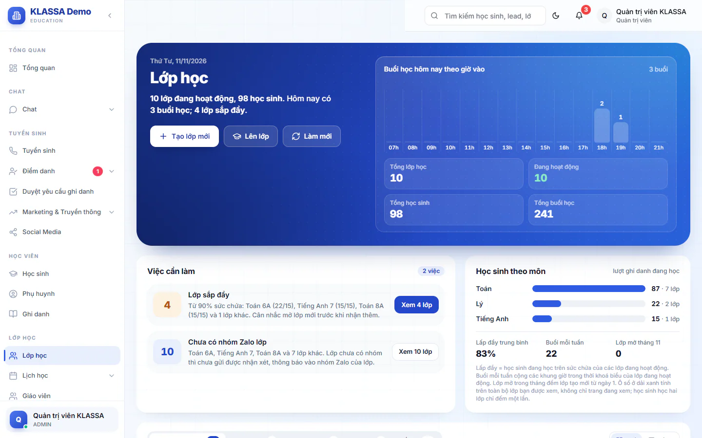

# Danh sách lớp học

Trang này cho bạn thấy mọi lớp đang có, lớp nào sắp đầy, lớp nào chưa có giáo viên chính và hôm nay có bao nhiêu buổi học. Giáo viên và trợ giảng chỉ thấy các lớp mình được phân công.

## Mở trang và đọc nhanh tình hình

::: steps
1. Vào **Lớp học** ở menu bên trái.
2. Dải trên cùng ghi số **Tổng lớp học**, **Đang hoạt động**, **Tổng học sinh**, **Tổng buổi học** và các buổi học hôm nay theo giờ vào.
3. Thẻ **Việc cần làm** liệt kê các lớp cần chú ý. Bấm nút **Xem N lớp** để danh sách bên dưới lọc đúng các lớp đó.
:::

Các việc có thể hiện ra:

- **Lớp sắp đầy**: sĩ số từ 90% sức chứa trở lên.
- **Chưa có giáo viên chính**: lớp chưa gán giáo viên chính.
- **Sắp bế giảng trong 14 ngày**.
- **Chưa có nhóm Zalo lớp**: lớp chưa có nhóm thì chưa gửi được nhận xét và thông báo vào nhóm Zalo của lớp.

Thẻ **Học sinh theo môn** bên cạnh cho biết số lượt ghi danh đang học ở từng môn, cùng mức lấp đầy trung bình và số lớp mở trong tháng.

## Tìm lớp trong danh sách

::: steps
1. Chọn tab trạng thái: **Đang hoạt động**, **Tạm dừng**, **Hoàn thành**, **Đã hủy** hoặc **Tất cả**. Lớp **Đã đầy** vẫn nằm trong tab **Đang hoạt động**.
2. Gõ vào ô **Tìm theo tên lớp, mã lớp**.
3. Dùng các nút lọc **Khối**, **Môn**, **Giáo viên** (lọc cả giáo viên chính lẫn trợ giảng) và **Cơ sở**. Nút **Giáo viên** không hiện với giáo viên và trợ giảng. Nút **Cơ sở** chỉ có với Quản trị viên; các vai khác thấy lớp thuộc cơ sở của mình.
4. Đổi cách sắp xếp (**Ngày tạo mới nhất**, **Tên lớp A-Z**, **Khai giảng gần nhất**) và chọn kiểu xem **Thẻ** hoặc **Bảng**.
:::

Mỗi thẻ lớp ghi tên, mã, trạng thái, cấp độ, khối, giáo viên chính và trợ giảng, môn, cơ sở, phòng, lịch học, sĩ số trên sức chứa, số buổi mỗi tuần, số buổi đã học và ngày khai giảng, bế giảng. Lớp linh hoạt có thêm nhãn **Lớp linh hoạt** (xem [Lớp linh hoạt](lop-linh-hoat.md)).

Bấm vào thẻ hoặc nút **Chi tiết** để mở [chi tiết lớp](chi-tiet.md). Hai nút nhanh khác trên thẻ:

- **Danh sách học sinh**: mở danh sách học sinh của lớp.
- **Thời khoá biểu**: mở [thời khóa biểu](lich-day.md) chỉ của lớp này.

## Tạo, sửa và đổi trạng thái lớp

- Bấm **Tạo lớp mới** để [tạo lớp](tao-moi.md). Nút này có với Quản trị viên, Quản lý chi nhánh và Quản lý.
- Bấm **Lên lớp** để [lên lớp hoặc chuyển lớp hàng loạt](len-lop-chuyen-lop.md).
- Menu ba chấm trên mỗi lớp (chỉ Quản trị viên và Quản lý chi nhánh) có **Chỉnh sửa lớp học**, **Tạm dừng lớp học** hoặc **Mở lại lớp học**, và **Xóa lớp học**. Xem [Sửa, tạm dừng và xoá lớp](chinh-sua.md).
- Bấm **Làm mới** để tải lại số liệu.

::: tip Mẹo
Bấm vào một việc ở thẻ **Việc cần làm** rồi xem lọc đang áp dụng ở dòng **Đang lọc**. Bấm dấu x trên dòng đó để bỏ lọc.
:::

## Câu hỏi thường gặp

::: details Tôi là giáo viên, sao danh sách ít lớp hơn đồng nghiệp?
Giáo viên và trợ giảng chỉ thấy lớp mình được phân công. Nếu thiếu lớp, nhờ Quản lý kiểm tra phần phân công ở [Chỉnh sửa lớp học](chinh-sua.md).
:::

::: details Lớp vừa tạm dừng không còn ở tab Đang hoạt động?
Đúng. Lớp tạm dừng nằm ở tab **Tạm dừng**. Học sinh vẫn được giữ trong lớp.
:::
