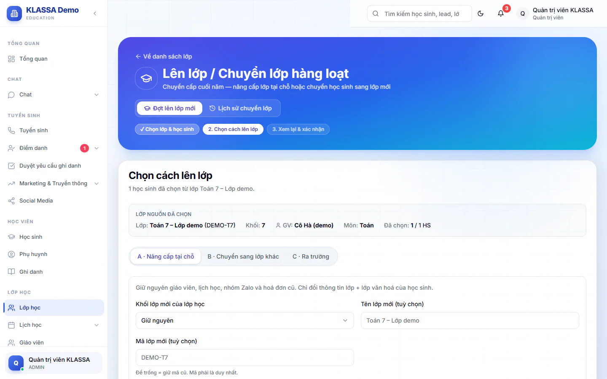

# Lên lớp và chuyển lớp hàng loạt

Dùng khi sang năm học mới hoặc khi cần chuyển nhiều em cùng lúc. Bạn không phải mở từng hồ sơ học sinh. Trang chạy theo ba bước: chọn lớp và học sinh, chọn cách lên lớp, xem lại và xác nhận.

## Làm một đợt lên lớp

::: steps
1. Vào **Lớp học**, bấm **Lên lớp**. Trang **Lên lớp / Chuyển lớp hàng loạt** mở, tab **Đợt lên lớp mới** đang chọn.
2. Bước **1. Chọn lớp & học sinh**: ở ô **Lớp nguồn**, chọn lớp đang học (lọc nhanh bằng **Lọc theo khối** và **Lọc theo giáo viên**). Bảng hiện từng em kèm **Lớp hiện tại**, **Ưu đãi hiện tại**, **Công nợ**. Mặc định chọn tất cả, bỏ tích em nào chưa lên lớp. Bấm **Tiếp tục**.
3. Bước **2. Chọn cách lên lớp**: chọn một trong ba cách ở phần dưới.

   

4. Bước **3. Xem lại & xác nhận**: kiểm tra tóm tắt, bấm nút **Xác nhận lên lớp N HS** (hoặc **Xác nhận cho N HS ra trường**).
:::

Kết quả hiện bằng thông báo. Nếu có em bị lỗi, hệ thống ghi số em lỗi và lý do, các em còn lại vẫn được xử lý.

## Ba cách lên lớp

### A. Nâng cấp tại chỗ

Giữ nguyên giáo viên, lịch học, nhóm Zalo và hoá đơn cũ. Chỉ đổi thông tin lớp và lớp văn hoá của học sinh. Hợp với lớp "Toán 9" lên thành "Toán 10" mà không đổi người dạy.

- **Khối lớp mới của lớp học**: để trống nghĩa là **Giữ nguyên**.
- **Tên lớp mới** và **Mã lớp mới** (tuỳ chọn).
- Công tắc **Cập nhật lớp văn hoá của học sinh** (mặc định bật), rồi chọn **Lớp mới của học sinh**.
- Công tắc **Cập nhật mã học sinh theo khối mới** (mặc định tắt): sinh lại mã theo khối mới.

::: warning Lưu ý
Mã học sinh cũ in trên biên lai hoặc tin nhắn đã gửi sẽ không còn khớp. Chỉ bật khi trung tâm dùng mã theo khối.
:::

Phải đổi ít nhất một thứ (khối, tên, mã, lớp văn hoá hoặc mã học sinh) thì mới sang được bước 3.

### B. Chuyển sang lớp khác

Chuyển các em đã chọn sang lớp đích. Chọn một trong hai:

- **Lớp có sẵn**: chọn **Lớp đích** (phải khác lớp nguồn).
- **Tạo lớp mới**: điền **Tên lớp**, **Mã lớp**, **Môn học**, **Khối lớp** (bắt buộc), **Sĩ số tối đa**, **Giáo viên**, và ít nhất một buổi trong **Lịch học**.

Các tuỳ chọn đi kèm:

- **Gói học phí áp dụng (chung)**: mặc định **Giữ gói cũ của từng học sinh**, hoặc chọn một gói cho cả nhóm.
- **Giữ ưu đãi cũ** (mặc định bật).
- **Tạo hoá đơn khoá mới** (mặc định tắt).
- **Đối soát công nợ lớp cũ** (mặc định tắt): hoàn phần học phí đã đóng mà chưa học thành credit để trừ vào phiếu lớp mới. Phiếu chưa trả của lớp cũ giữ nguyên để thu. Bật mục này thì **Tạo hoá đơn khoá mới** tự bật theo, và bạn phải bật nó thì mới xác nhận được. Có thêm mục xác nhận điều chỉnh cả phiếu đã gửi phụ huynh.
- **Đóng lớp nguồn sau khi chuyển hết** (mặc định tắt, lớp nguồn được giữ).
- **Cập nhật mã HS theo khối lớp đích**.

Ở bước 3, bảng cho từng em cho phép sửa **Ưu đãi** (theo % hoặc VNĐ) và **Gói học phí** riêng, đồng thời hiện **Công nợ cũ** (ví dụ "N HĐ chưa trả") trước khi bạn xác nhận. Việc tính phiếu xem thêm ở [Quản lý học phí](../hoc-phi/quan-ly-hoc-phi.md).

### C. Ra trường

Dành cho khối cuối. Học sinh chuyển sang trạng thái **Đã tốt nghiệp** và các ghi danh được kết thúc. Hệ thống không tạo lớp hay hoá đơn mới. Công nợ cũ giữ nguyên để vẫn thu. Công tắc **Đóng lớp sau khi cho ra trường hết** quyết định lớp có đóng không (khi chọn cách này, công tắc mặc định bật).

## Xem lại các đợt đã làm

Bấm tab **Lịch sử chuyển lớp**. Mỗi đợt ghi cách làm (**Nâng cấp tại chỗ**, **Chuyển lớp** hoặc **Ra trường**), số em lỗi nếu có. Bấm vào đợt để xem từng học sinh, hoá đơn mới, credit hoặc nợ cũ và trạng thái.

::: tip Mẹo
Làm thử với một lớp nhỏ trước, rồi xem kết quả ở **Lịch sử chuyển lớp** và hồ sơ học sinh trước khi làm hàng loạt.
:::

## Câu hỏi thường gặp

::: details Chuyển một em đơn lẻ giữa năm thì sao?
Vẫn dùng cách B và chỉ tích đúng em đó ở bước 1.
:::

::: details Có hoàn tác cả đợt được không?
Không có nút hoàn tác. Hãy kiểm tra kỹ ở bước 3. Nếu sai, sửa lại từng em ở hồ sơ học sinh hoặc ghi danh.
:::
