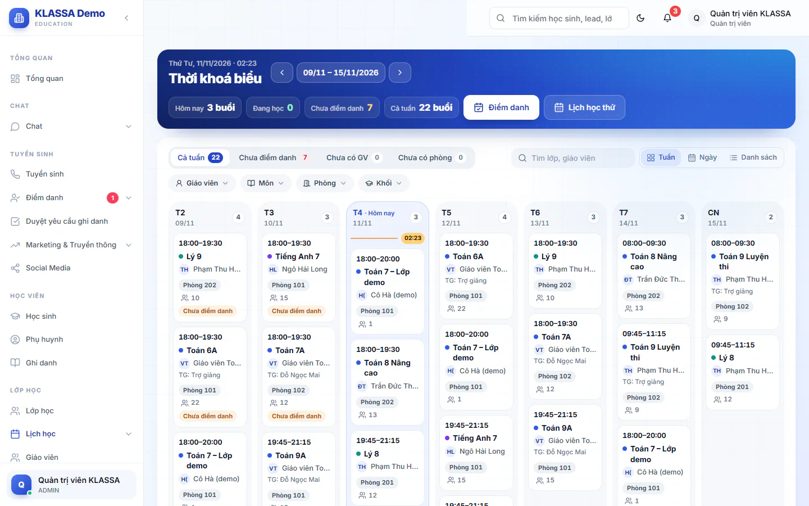

# Thời khóa biểu

Trang cho bạn thấy các buổi học của tuần đang xem: buổi nào hôm nay, buổi nào đã điểm danh, buổi nào bị bỏ sót, lớp nào chưa có giáo viên hay phòng, và chỗ nào bị trùng giờ. Lịch này là lịch thật của tuần đó, không chỉ là khung giờ cố định. Giáo viên và trợ giảng chỉ thấy các buổi của lớp mình được phân công. Trang chỉ để xem, không kéo thả hay sửa buổi ở đây.

## Xem lịch tuần

::: steps
1. Vào **Lịch học → Thời khóa biểu**.
2. Dải đầu trang ghi tuần đang xem. Bấm mũi tên để sang tuần trước hoặc tuần sau. Khi đang ở tuần khác, nút về hôm nay hiện ra.
3. Chọn kiểu xem: **Tuần**, **Ngày** hoặc **Danh sách**. Tuần luôn tính từ Thứ Hai đến Chủ nhật.
4. Bấm vào một buổi để mở hộp danh sách học sinh đang học của lớp đó.
:::

Các chỉ số ở dải đầu: **Hôm nay** (số buổi) và **Đang học** khi bạn xem tuần hiện tại, **Chưa điểm danh** và **Cả tuần**. Hai nút ở dải đầu: **Điểm danh** (sang trang [điểm danh](../diem-danh/cham-hang-ngay.md)) và **Lịch học thử** (cho vai được xem lịch học thử).

## Đọc một buổi trên lịch

Mỗi thẻ ghi giờ, môn, giáo viên, trợ giảng, phòng, số học sinh và các nhãn:

- **Đang học**: buổi hôm nay đang diễn ra.
- **Đã điểm danh**: buổi đã được điểm danh.
- **Chưa điểm danh**: buổi đã qua giờ mà chưa có điểm danh.
- **Đã huỷ**: buổi bị huỷ.
- **Nghỉ: tên ngày nghỉ**: lớp nghỉ vì ngày lễ đã khai báo ở [Ngày nghỉ lễ](../cai-dat/ngay-nghi-le.md).
- **Dạy thay**: buổi có giáo viên dạy thay, thẻ hiện tên người dạy thật. Xem [Dạy thay](../nhan-su/dan-day-thay.md).
- **Buổi bù**, **Bổ trợ**, **Hỗ trợ miễn phí**, **Học online**, **Buổi thêm**: buổi ngoài lịch thường.
- **Lớp linh hoạt**: buổi của [lớp linh hoạt](lop-linh-hoat.md). Lớp linh hoạt không có khung tuần, chỉ hiện các buổi đã được mở.

Buổi đã huỷ hoặc nghỉ lễ hiển thị mờ và không tính vào các số đếm.

## Lọc và tìm

Dùng **Lọc nhanh** với các tab **Cả tuần**, **Chưa điểm danh**, **Chưa có GV**, **Chưa có phòng**. Thêm các nút lọc **Giáo viên** (giáo viên hoặc trợ giảng), **Môn**, **Phòng**, **Khối**, và **Chi nhánh** (chỉ Quản trị viên). Có ô tìm theo tên.

Hai cách mở sẵn một bộ lọc:

- Ở danh sách hoặc chi tiết lớp bấm **Thời khoá biểu**: chỉ hiện lớp đó, kèm nút **Xem mọi lớp** để bỏ lọc.
- Ở trang [Giáo viên](../giao-vien/danh-sach.md) bấm **Lịch dạy**: lọc sẵn theo giáo viên đó.

## Thẻ Cần xử lý

Phía dưới lịch có thẻ **Cần xử lý** cho tuần đang xem, gồm:

- **Lớp chưa có giáo viên**: bấm **Xem lớp** để lọc.
- **Buổi đã qua chưa điểm danh**: nêu buổi sớm nhất, bấm **Xem** hoặc **Điểm danh** để xử lý.
- **Giáo viên trùng giờ**: một giáo viên có hai lớp chồng giờ.
- **Phòng trùng giờ**: một phòng có hai lớp chồng giờ.
- **Lớp chưa gán phòng**: gán phòng ở trang [Chỉnh sửa lớp học](chinh-sua.md).

Nếu không có việc nào, thẻ ghi **Không có việc cần xử lý** kèm số buổi đã soát.

::: tip Mẹo
Đầu mỗi tuần, mở tab **Chưa có GV** và **Chưa có phòng** để lấp chỗ trống trước khi lớp bắt đầu.
:::

## Câu hỏi thường gặp

::: details Lớp tôi nghỉ lễ nhưng vẫn hiện trên lịch?
Buổi nghỉ lễ vẫn hiện nhưng mờ, kèm nhãn **Nghỉ: tên ngày nghỉ**. Ngày nghỉ có thể chỉ áp cho một cơ sở, một khối hoặc một số lớp, nên lớp ngoài phạm vi vẫn học bình thường.
:::

::: details Sao tôi không đổi giờ buổi học được ở đây?
Đổi giờ cố định bằng [Chỉnh sửa lớp học](chinh-sua.md).
:::

::: details Sao lớp linh hoạt không có buổi nào?
Lớp linh hoạt chỉ hiện các buổi đã được mở khi có người tạo buổi linh hoạt ở trang điểm danh.
:::
