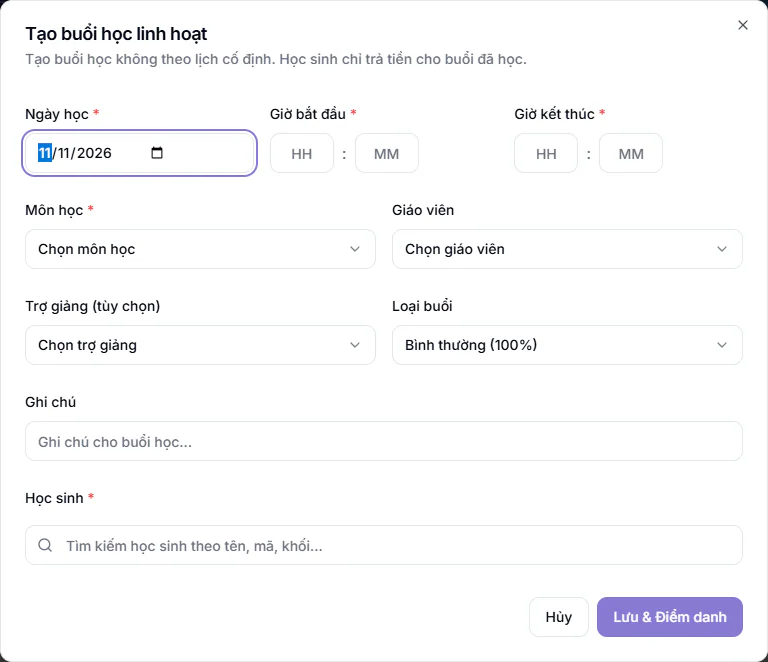

# Lớp linh hoạt

Lớp linh hoạt dành cho học sinh học không đều: học bù, học kèm, học theo nhu cầu từng buổi. Lớp không có lịch cố định hằng tuần. Mỗi buổi được tạo đúng ngày học, và học sinh chỉ trả tiền cho những buổi đã đi học.

## Lớp linh hoạt khác lớp thường thế nào

- Hệ thống tự lập một lớp **Lớp linh hoạt** cho mỗi môn trong mỗi cơ sở, tên dạng "Toán - Linh hoạt". Bạn không tạo lớp này ở trang [Tạo lớp học mới](tao-moi.md).
- Lớp không có sức chứa giới hạn và không có khung giờ. Trên [thời khóa biểu](lich-day.md) chỉ hiện các buổi đã mở.
- Trong danh sách và trang chi tiết lớp, lớp mang nhãn **Lớp linh hoạt**.
- Đây là lớp chung của cả môn. Vì vậy lễ tân kiêm trợ giảng ở một buổi linh hoạt không được xem nhận xét hay dữ liệu của mọi học sinh trong môn.

## Tạo một buổi học linh hoạt

::: steps
1. Vào trang **Điểm danh** (xem [Điểm danh hằng ngày](../diem-danh/cham-hang-ngay.md)) và bấm **Tạo buổi linh hoạt**.
2. Hộp **Tạo buổi học linh hoạt** hiện ra. Chọn **Ngày học**, **Giờ bắt đầu** và **Giờ kết thúc** (bắt buộc, giờ kết thúc phải sau giờ bắt đầu).
3. Chọn **Môn học** (bắt buộc).
4. Chọn **Giáo viên** và **Trợ giảng (tùy chọn)**. Phải có ít nhất giáo viên hoặc trợ giảng. Ô trợ giảng cho chọn trợ giảng, giáo viên kiêm trợ giảng và lễ tân kiêm trợ giảng.
5. Chọn **Loại buổi**: **Bình thường (100%)**, **Học online (50%)** hoặc **Hỗ trợ miễn phí (0%)**. Con số là tỉ lệ tính lương cho buổi.
6. Thêm ít nhất một học sinh bằng ô **Tìm kiếm học sinh theo tên, mã, khối...**. Với mỗi em, ô **Học phí buổi này** ghi mức tiền của buổi đó. Nhập 0 nghĩa là buổi này em được miễn phí. Giá không được âm.
7. Ghi chú nếu cần rồi bấm **Lưu & Điểm danh**.
:::

Khi tạo, các em đã chọn được ghi danh vào lớp linh hoạt của môn và được ghi **Có mặt** cho buổi đó. Buổi đã tạo xuất hiện trên [điểm danh](../diem-danh/cham-hang-ngay.md) và thời khóa biểu.

::: warning Lưu ý
- Giáo viên và trợ giảng chỉ tạo được buổi cho **hôm nay**, đúng môn mình được phân công, và chỉ tạo cho chính mình. Ngày đã qua hoặc ngày sắp tới cần Quản trị viên, Quản lý chi nhánh, Quản lý, Lễ tân hoặc Kế toán tạo, vì tạo buổi là ghi luôn có mặt và tính tiền cho học sinh.
- Mức **Học phí buổi này** do giáo viên và trợ giảng nhập không làm đổi giá của em: buổi vẫn tính theo giá ghi danh của em. Số họ nhập chỉ dùng khi em chưa học linh hoạt môn này.
- Ngày đã bị khoá điểm danh (xem [Khoá điểm danh](../diem-danh/khoa-diem-danh.md)) cũng chỉ Quản trị viên và Quản lý chi nhánh tạo được.
- Quản trị viên có thể tắt quyền tạo buổi linh hoạt của giáo viên và trợ giảng ở **Cài đặt**, mục **Điểm danh**, công tắc **Cho phép Giáo viên & Trợ giảng tạo buổi linh hoạt**. Công tắc mặc định bật. Khi tắt, giáo viên và trợ giảng không thấy nút và phải nhờ lễ tân hoặc quản lý tạo.
:::

## Câu hỏi thường gặp

::: details Học phí lớp linh hoạt tính thế nào?
Theo số buổi em thực sự đi học, với mức tiền bạn nhập ở ô **Học phí buổi này**. Cách ra phiếu xem [Tạo hoá đơn](../hoc-phi/tao-hoa-don.md).
:::
