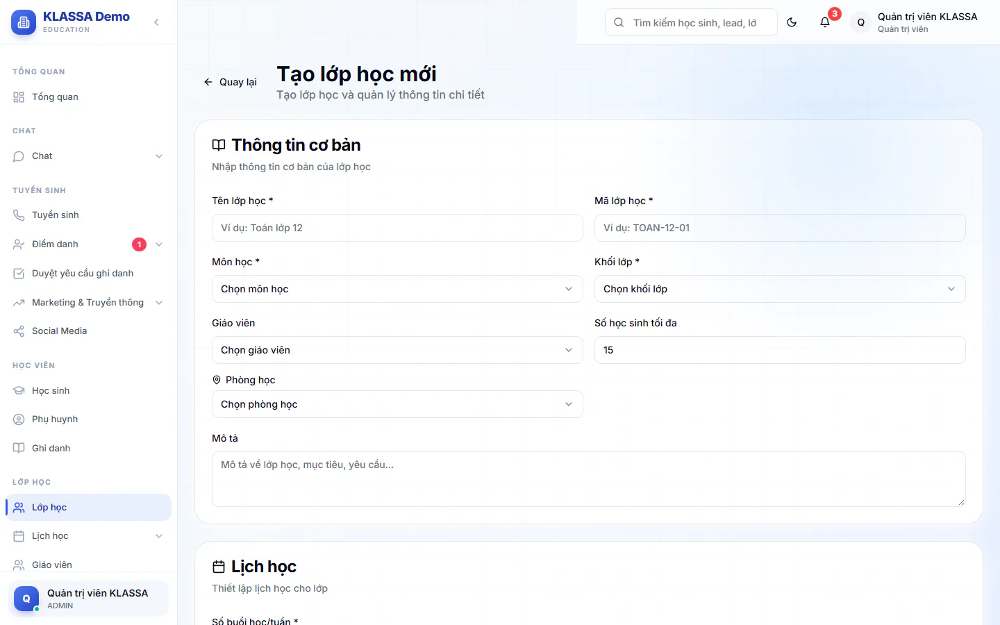

# Tạo lớp học mới

Bạn tạo lớp trước, sau đó mới [ghi danh học sinh](../hoc-sinh/ghi-danh.md) và điểm danh. Lớp cần có tên, mã, môn, khối và ít nhất một buổi học mỗi tuần.

## Tạo một lớp

::: steps
1. Vào **Lớp học**, bấm **Tạo lớp mới**. Trang **Tạo lớp học mới** mở ra.
2. Ở phần **Thông tin cơ bản**, điền **Tên lớp học** (ví dụ Toán lớp 9A1) và **Mã lớp học** (ví dụ TOAN-9-01). Hai ô này bắt buộc, mã lớp không được trùng lớp đã có.
3. Chọn **Môn học** và **Khối lớp** (bắt buộc).
4. Chọn **Giáo viên** nếu đã biết người dạy. Để **Chưa phân công** thì thêm sau cũng được. Danh sách này chỉ có người mang vai Giáo viên.
5. Nhập **Số học sinh tối đa** (từ 1 đến 50, mặc định 15) và chọn **Phòng học** nếu có.
6. Ở phần **Lịch học**, chọn **Số buổi học/tuần** (1 đến 5). Với mỗi buổi, chọn **Thứ**, **Giờ bắt đầu** và **Giờ kết thúc**.
7. Bấm **Tạo lớp học**. Khi thành công, hệ thống báo "Tạo lớp học thành công!" và quay về danh sách lớp.
:::

::: warning Lưu ý
- Lớp mới luôn ở trạng thái **Đang hoạt động** và có cấp độ **Cơ bản**. Muốn đổi cấp độ hoặc trạng thái, dùng [Chỉnh sửa lớp học](chinh-sua.md).
- Các ô **Mô tả**, **Học phí (VNĐ)** và **Trạng thái** trên form tạo lớp hiện chưa được lưu. Học phí không gắn theo lớp mà theo gói học phí khi ghi danh, xem [Quản lý học phí](../hoc-phi/quan-ly-hoc-phi.md).
- Trợ giảng không chọn được ở form này. Thêm trợ giảng ở [Chỉnh sửa lớp học](chinh-sua.md).
:::

## Lớp thuộc cơ sở nào

Lớp được tạo trong cơ sở của tài khoản bạn. Quản trị viên không có cơ sở riêng nên lớp rơi vào cơ sở đang hoạt động đầu tiên. Nếu cần lớp ở cơ sở khác, nhờ người quản lý cơ sở đó tạo. Cách tạo cơ sở xem [Cơ sở](../cai-dat/co-so.md).

## Phòng bị trùng giờ

Khi bạn chọn phòng, hệ thống kiểm tra các lớp khác dùng phòng đó cùng khung giờ. Nếu trùng, một hộp xác nhận liệt kê lớp, thứ và giờ đang trùng, hỏi bạn có vẫn gán phòng không. Bấm đồng ý để tiếp tục hoặc huỷ để chọn phòng khác. Cảnh báo này không chặn việc tạo lớp.

Danh mục phòng nằm ở **Cài đặt**, thẻ **Phòng học**, nút **Thêm phòng học** (nhập **Tên phòng**, **Sức chứa (số chỗ)**, **Chi nhánh**). Chỉ phòng đang kích hoạt mới hiện trong ô chọn.

## Câu hỏi thường gặp

::: details Báo "Vui lòng điền đầy đủ thông tin bắt buộc"?
Một trong bốn ô **Tên lớp học**, **Mã lớp học**, **Môn học**, **Khối lớp** còn trống.
:::

::: details Báo "Vui lòng thiết lập ít nhất 1 lịch học"?
Mỗi buổi phải có đủ **Thứ**, **Giờ bắt đầu** và **Giờ kết thúc**. Buổi thiếu một trong ba ô bị bỏ qua, nếu không còn buổi nào hợp lệ thì không tạo được lớp.
:::

::: details Danh sách môn học trống?
Môn học do người quản lý tạo ở **Cài đặt**, thẻ **Môn học**.
:::

::: details Cần lớp học tự do, không theo lịch cố định?
Dùng [lớp linh hoạt](lop-linh-hoat.md), hệ thống tự lập lớp theo môn.
:::
