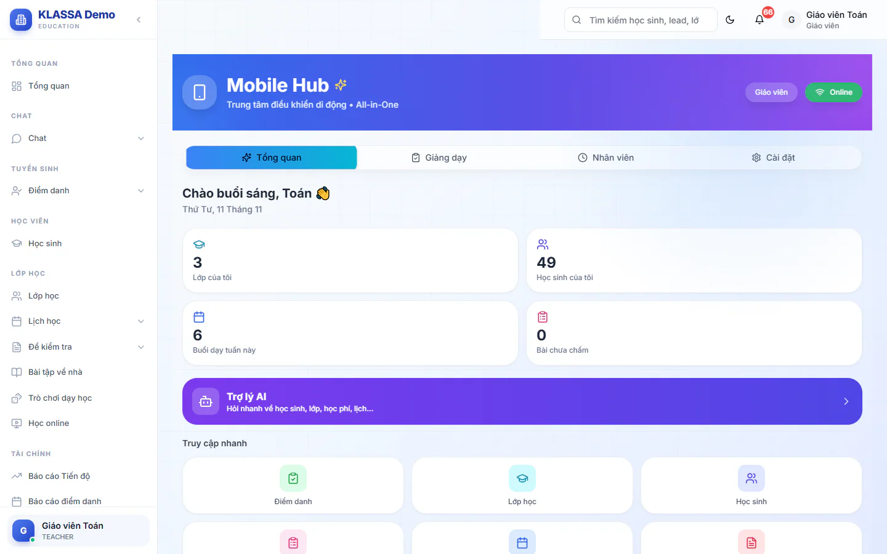

# Trang Mobile trên web

Trang **Mobile** gom các việc hay làm nhất của từng vai vào một màn hình gọn, dễ bấm bằng một tay trên điện thoại. Trang chạy trong trình duyệt, không cần cài gì thêm. Nếu bạn muốn một ứng dụng riêng có thông báo đẩy và mở khoá vân tay, xem [Cài đặt app điện thoại](cai-dat-app.md).

## Mở trang Mobile

::: steps
1. Đăng nhập phần mềm trên điện thoại hoặc máy tính.
2. Vào **AI Hub → Mobile** (nhóm AUTOMATION & AI trong menu).
3. Phía trên hiện vai của bạn và trạng thái mạng **Online** hoặc **Offline**.
:::

## Các tab theo vai

Thanh tab chỉ hiện tab dành cho vai của bạn:

| Tab | Vai thấy | Nội dung |
| --- | --- | --- |
| **Tổng quan** | Tất cả | Lời chào, số liệu chính và lối tắt tới các trang hay dùng |
| **Giảng dạy** | Giáo viên, Trợ giảng | Chấm công, **Lớp học hôm nay**, điểm danh nhanh, xem [Giáo viên dùng trên điện thoại](giao-vien.md) |
| **Nhân viên** | Giáo viên, Trợ giảng, Nhân sự, Lễ tân, Kế toán, Quản lý | Chấm công vào ra, **Xin nghỉ phép**, giờ làm và lương tháng này |
| **Tư vấn** | Lễ tân, Quản lý | Số cuộc gọi, chuyển đổi, **Leads hôm nay**, lối tắt tới tuyển sinh |
| **Tài chính** | Kế toán, Quản trị viên, Quản lý chi nhánh | Thu hôm nay và tháng này, phiếu chờ thu, quá hạn, **Hóa đơn chờ phê duyệt** |
| **Quản trị** | Quản trị viên, Quản lý chi nhánh | Lối tắt tới báo cáo, nhân sự, tích hợp, cấu hình và quản lý gói mở rộng |
| **Cài đặt** | Tất cả | Thông báo đẩy và tuỳ chọn của riêng thiết bị này |

Phụ huynh không dùng trang này mà dùng [Cổng Phụ huynh](../cong-phu-huynh/gioi-thieu.md).

## Cài trang Mobile như một ứng dụng

Trên Chrome hoặc Safari của điện thoại, dùng chức năng thêm vào màn hình chính của trình duyệt. Biểu tượng KLASSA xuất hiện trên màn hình, mở nhanh như app.

::: tip Mẹo
Máy tính chỉ cần mở trang Mobile để xem giao diện điện thoại trông thế nào. Việc quản lý nhiều cột như báo cáo dài hay cấu hình hệ thống vẫn nên làm trên máy tính.
:::

::: warning Lưu ý
Nhãn **Offline** nghĩa là máy đang mất mạng. Dữ liệu mới chỉ cập nhật khi có mạng trở lại.
:::

## Câu hỏi thường gặp

::: details Trang Mobile khác gì app KLASSA?
Trang Mobile là một trang của phần mềm web, mở bằng trình duyệt. App KLASSA là ứng dụng cài từ cửa hàng, đăng nhập bằng mã trung tâm và có thông báo đẩy, mở khoá vân tay.
:::

::: details Tôi không thấy tab Quản trị hay Tài chính?
Mỗi tab chỉ hiện với vai được phép. Xem bảng ở trên.
:::
