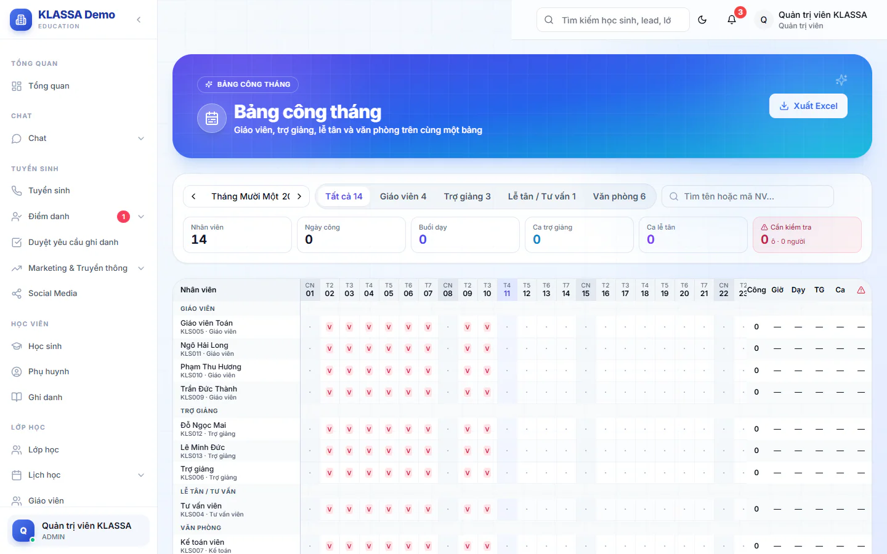

# Bảng công tháng

Trung tâm trả công theo nhiều cách: nhân viên văn phòng theo giờ vào ra, giáo viên theo buổi dạy, trợ giảng theo ca, lễ tân theo ca trực. Bảng công tháng gom cả bốn nhóm vào một bảng, mỗi dòng một người, mỗi cột một ngày, để bạn đối chiếu trước khi tính lương.

Vào **Quản lý HR → Bảng công tháng**.

## Đọc bảng

Chọn tháng bằng hai mũi tên **Tháng trước** và **Tháng sau**. Các nút nhóm phía trên cho bạn lọc: **Tất cả**, **Giáo viên**, **Trợ giảng**, **Lễ tân / Tư vấn**, **Văn phòng**, kèm số người của từng nhóm. Ô **Tìm tên hoặc mã NV...** để tìm một người.

Mỗi ô trong bảng là một ngày của một người, ghi bằng ký hiệu:

| Ký hiệu | Ý nghĩa |
|---------|---------|
| Số, ví dụ **8** | Số giờ chấm công trong ngày. |
| Số có nhãn đi muộn, ví dụ **7.5** | Có chấm công nhưng đi muộn. |
| **D2** | Dạy 2 buổi. Số đổi theo số buổi. |
| **T1** | Trợ giảng 1 ca. |
| **C1** | Trực 1 ca lễ tân. |
| **P** | Nghỉ phép. |
| **V** | Vắng. Chỉ hiện khi ngày đó không có buổi dạy hay ca nào. |

Bảng chú giải ở cuối trang, bấm để mở hoặc thu lại. Di chuột lên một ô để xem tên lớp hoặc ca.

Các cột tổng nằm bên phải: **Công** (số ngày có đi làm), **Giờ** (tổng giờ chấm công), **Dạy** (số buổi dạy), **TG** (số ca trợ giảng), **Ca** (số ca lễ tân) và một cột đánh dấu số ô cần kiểm tra.

Dải số ở đầu bảng tổng hợp **Nhân viên**, **Ngày công**, **Buổi dạy**, **Ca trợ giảng**, **Ca lễ tân** và **Cần kiểm tra**.

## Xem chi tiết một ngày

Bấm vào ô bất kỳ để mở hộp chi tiết của ngày đó. Hộp liệt kê các khối: chấm công giờ vào ra, **Buổi dạy**, **Ca trợ giảng** (kèm trạng thái **đã bấm**, **ngoài vùng** hoặc **chưa bấm**), **Ca lễ tân** (đã xác nhận có mặt, đánh vắng hoặc chưa xác nhận) và **Nghỉ phép**.

## Ô cần kiểm tra

Bảng tự đánh dấu những ngày có dấu hiệu lệch giữa các nguồn dữ liệu:

- Bị đánh vắng nhưng có buổi dạy hoặc ca trợ giảng hôm đó.
- Có ca trợ giảng nhưng chưa bấm check-in buổi học.
- Có giờ vào nhưng thiếu giờ ra.
- Ca lễ tân đã chốt nhưng không có chấm công và chưa ai xác nhận.

Bấm ô **Cần kiểm tra** để chỉ hiện những người có ngày cần xem. Mở ô tương ứng để thấy lý do ghi trong hộp chi tiết, rồi sửa ở [Điểm danh nhân viên](cham-cong.md) hoặc [Giờ dạy](buoi-day.md).

## Xuất ra tệp

Bấm **Xuất Excel** ở góc trên. Tệp có các cột mã nhân viên, họ tên, nhóm, chức vụ, từng ngày, rồi **Ngày công**, **Giờ**, **Buổi dạy**, **Ca TG**, **Ca lễ tân** và **Cần kiểm tra**.

::: tip Mẹo
Trước khi bấm **Tính lương mới**, lọc **Cần kiểm tra** và xử lý hết các ô lệch. Đây là cách nhanh nhất để tránh phiếu lương sai vì thiếu công.
:::

::: warning Bảng này chỉ để đối chiếu
Bảng công tháng không thay đổi dữ liệu và không phải phiếu lương. Muốn sửa công, hãy sửa ở trang nguồn rồi tính lại phiếu. Xem [Quản lý lương](bang-luong.md).
:::

## Câu hỏi thường gặp

::: details Vì sao giáo viên không có giờ vào ra mà không bị đánh vắng?
Giáo viên được tính có mặt theo buổi dạy trong ngày, hiện ký hiệu **D** thay vì số giờ. Ô chỉ hiện **V** khi ngày đó không có buổi dạy hay ca nào và bảng công ghi vắng.
:::

::: details Buổi dạy được gán cho giáo viên nào trong bảng?
Bảng gán buổi cho người giữ lớp theo cùng luật với bảng lương: buổi gán đích danh, hoặc giáo viên được giao lớp vào ngày đó, và loại buổi đã có đơn dạy thay đã duyệt. Nhờ vậy bảng khớp với phiếu lương.
:::
