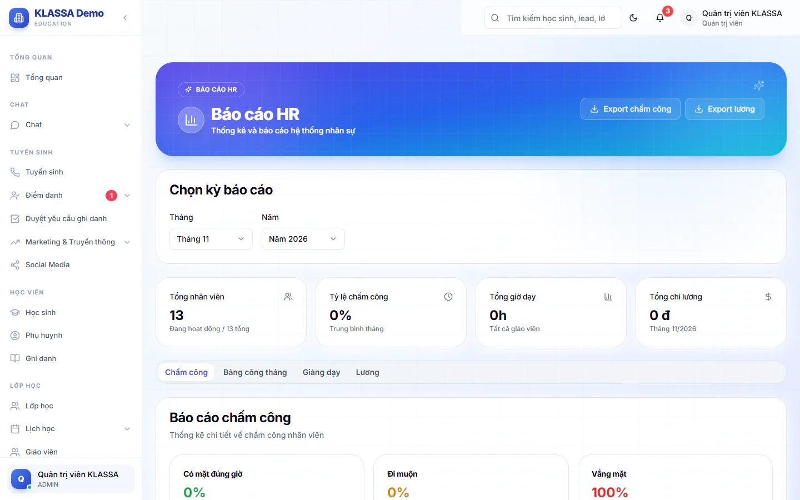

# Báo cáo HR

Trang này tổng hợp số liệu nhân sự của một tháng và cho bạn tải các báo cáo ra tệp CSV để gửi kế toán hoặc nộp cơ quan bảo hiểm, thuế.

## Xem báo cáo của một tháng

::: steps
1. Vào **Quản lý HR → Báo cáo HR**.
2. Ở khung **Chọn kỳ báo cáo**, chọn **Tháng** và **Năm**.
3. Xem bốn ô tổng hợp ở đầu trang.
4. Chuyển giữa các thẻ **Chấm công**, **Bảng công tháng**, **Giảng dạy**, **Lương** để xem chi tiết.
:::

Bốn ô tổng hợp:

| Ô | Cho biết |
|---|---|
| **Tổng nhân viên** | Số người đang hoạt động trên tổng số hồ sơ |
| **Tỷ lệ chấm công** | Tỷ lệ chấm công trung bình của tháng |
| **Tổng giờ dạy** | Tổng giờ dạy của tất cả giáo viên |
| **Tổng chi lương** | Tổng chi lương của tháng đã chọn |

## Nội dung từng thẻ

- **Chấm công**: ba chỉ số **Có mặt đúng giờ**, **Đi muộn**, **Vắng mặt**, mỗi chỉ số là một tỷ lệ phần trăm.
- **Bảng công tháng**: không còn bảng ở đây. Thẻ này dẫn sang trang **Bảng công tháng** riêng, nơi gộp giờ vào ra, buổi dạy và ca trực của mọi vai vào một bảng. Bấm **Mở Bảng công tháng**.
- **Giảng dạy**: **Tổng buổi dạy**, **Tổng giờ dạy**, **Trung bình/GV**.
- **Lương**: **Lương cơ bản**, **Lương giảng dạy**, **Thưởng & phụ cấp**.

Chi tiết cách tính lương xem ở [Quản lý lương](bang-luong.md), chấm công xem ở [Chấm công](cham-cong.md).

## Tải báo cáo

Các nút tải đều cho ra tệp CSV theo tháng và năm đang chọn:

- **Export chấm công** và **Export lương** ở đầu trang.
- **Kê khai BHXH tháng**: bảng số tiền bảo hiểm xã hội, y tế, thất nghiệp của từng người, để kê khai hằng tháng. Nút này nằm trong thẻ **Lương**.
- **Quyết toán TNCN năm**: bảng thuế thu nhập cá nhân cả năm, để quyết toán thuế. Nút này cũng nằm trong thẻ **Lương**.

Tệp tải về đặt tên có loại báo cáo, năm và tháng, ví dụ `attendance_2026_10.csv`. Mở được bằng Excel.

::: tip Mẹo
Chọn đúng tháng trước khi bấm tải. Tệp luôn lấy theo ô **Tháng** và **Năm** đang hiển thị.
:::

::: warning Lưu ý
Số liệu bảo hiểm và thuế chỉ chính xác khi các kỳ lương của tháng đó đã được tính xong. Kiểm tra bảng lương trước khi nộp cho cơ quan nhà nước.
:::

## Câu hỏi thường gặp

::: details Muốn xuất danh sách nhân viên thì làm sao?
Dùng nút **Export** ở trang [Danh sách nhân viên](danh-sach-nhan-vien.md).
:::

::: details Không tải được tệp?
Thông báo lỗi hiện ngay trên màn hình. Nếu là lỗi quyền, hãy đăng nhập bằng Quản trị viên hoặc Quản lý chi nhánh.
:::
