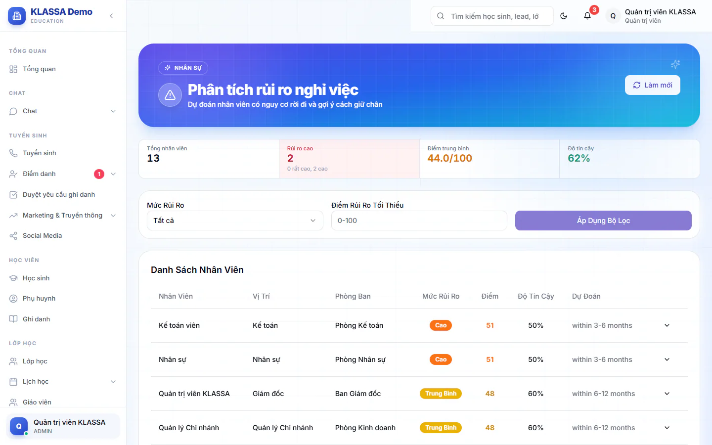

# Phân tích rủi ro nghỉ việc

Trang này chấm điểm nguy cơ nghỉ việc của từng nhân viên từ dữ liệu có sẵn (thâm niên, chuyên cần, nghỉ phép, lương, đánh giá, mức làm việc). Bạn dùng nó để nhận ra sớm người có thể rời đi và nói chuyện với họ trước khi quá muộn.

Tính năng cần gói mở rộng **AI — Gợi ý & Trợ lý Vận hành** (kèm **Nền tảng AI**). Điểm số do một bộ quy tắc cố định tính ra, chỉ mang tính gợi ý, không phải kết luận về một con người.

## Xem danh sách rủi ro

::: steps
1. Vào **Quản lý HR → Phân tích rủi ro nghỉ việc**.
2. Đọc dải số liệu ở đầu trang: **Tổng nhân viên**, **Rủi ro cao** (gồm mức Rất Cao và Cao), **Điểm trung bình** (trên 100) và **Độ tin cậy**.
3. Lọc nếu cần: chọn **Mức Rủi Ro** (**Tất cả**, **Rất Cao**, **Cao**, **Trung Bình**, **Thấp**) và/hoặc gõ **Điểm Rủi Ro Tối Thiểu** (0-100), rồi bấm **Áp Dụng Bộ Lọc**.
4. Bấm **Làm mới** để tính lại số liệu mới nhất.
:::

Bảng **Danh Sách Nhân Viên** có các cột **Nhân Viên**, **Vị Trí**, **Phòng Ban**, **Mức Rủi Ro**, **Điểm**, **Độ Tin Cậy**, **Dự Đoán**. Danh sách xếp từ điểm cao xuống thấp.

Cách đổi điểm thành mức: từ 75 trở lên là **Rất Cao**, 50-74 là **Cao**, 30-49 là **Trung Bình**, dưới 30 là **Thấp**.

## Xem chi tiết một người

Bấm nút ở cuối dòng để mở hộp **Chi Tiết Rủi Ro** kèm tên nhân viên. Hộp có:

- **Mức Rủi Ro** và **Dự Đoán** (khoảng thời gian có thể nghỉ).
- **Các Yếu Tố Rủi Ro**: từng yếu tố có điểm trên 100 và lời mô tả. Có sáu yếu tố: thâm niên (Tenure), chuyên cần (Attendance), mức dùng phép (Leave Usage), mức hài lòng về lương (Salary Satisfaction), hiệu suất (Performance) và cân bằng công việc (Work-Life Balance).
- **Đề Xuất Hành Động**: các việc nên làm, ví dụ trao đổi định hướng nghề nghiệp, sắp xếp người kèm cặp.

::: warning Lưu ý
Tên yếu tố, lời mô tả, dự đoán và đề xuất hiện bằng tiếng Anh. Nếu một yếu tố thiếu dữ liệu (ví dụ chưa có lịch sử lương), hệ thống gán điểm thấp và **Độ Tin Cậy** sẽ giảm. Hãy nhập đủ dữ liệu ở [hồ sơ nhân viên](danh-sach-nhan-vien.md), chấm công và nghỉ phép để kết quả sát hơn.
:::

::: tip Mẹo
Mục **Độ Tin Cậy** cho biết dữ liệu đầu vào đầy đủ đến đâu. Điểm cao nhưng độ tin cậy thấp nghĩa là cần xem thêm trước khi hành động.
:::

## Câu hỏi thường gặp

::: details Nhân viên có biết mình bị chấm điểm không?
Không. Trang chỉ hiện cho Quản trị viên và Quản lý chi nhánh. Hãy giữ kín thông tin này.
:::

::: details Quản lý chi nhánh thấy những ai?
Chỉ nhân viên thuộc chi nhánh của mình. Quản trị viên chọn được phạm vi rộng hơn.
:::

::: details Điểm cao có nghĩa là người đó chắc chắn nghỉ?
Không. Đây là dự báo từ dữ liệu, dùng để bắt đầu một cuộc trò chuyện, không để đánh giá hay xử lý nhân viên.
:::
