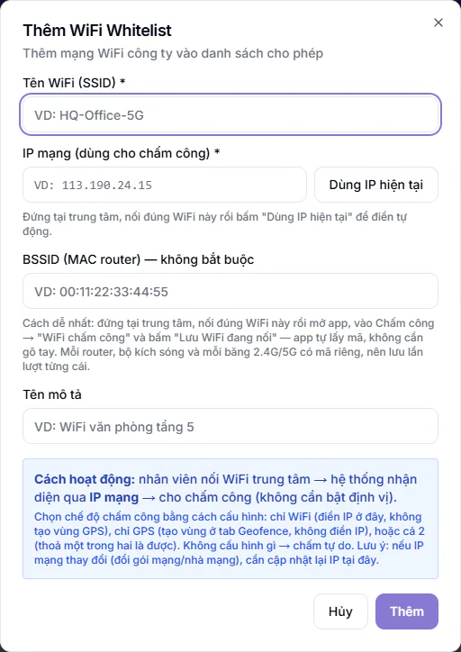

# Cấu hình chấm công

Để tránh việc nhân viên chấm công từ xa, bạn khai nơi nào được phép chấm: mạng WiFi của trung tâm, vùng GPS quanh cơ sở, hoặc máy chấm công. Hệ thống kiểm tra mỗi lần nhân viên bấm chấm công theo cách bạn đã khai.

Vào **Quản lý HR → Điểm danh nhân viên**, bấm **Cài đặt**. Trang **Cài đặt chấm công** có 3 tab: **WiFi cho phép**, **Phạm vi GPS** và **Thiết bị**.

## Chọn chế độ kiểm tra

Chế độ phụ thuộc vào việc bạn khai gì:

| Bạn khai | Hệ thống làm gì |
|----------|-----------------|
| Chỉ WiFi (điền IP mạng, không tạo vùng GPS) | Nhân viên phải đang nối WiFi của trung tâm. Không cần bật định vị. |
| Chỉ GPS (tạo vùng, không điền IP) | Nhân viên phải đang ở trong vùng. |
| Cả hai | Thoả một trong hai là chấm được. |
| Không khai gì | Chấm công tự do, không kiểm tra. |

Lần chấm không qua được kiểm tra sẽ bị từ chối. Trên app điện thoại, nhân viên có thể ghi lý do và gửi lại, lần chấm đó vào hàng chờ để quản lý xem và duyệt (xem [Điểm danh nhân viên](cham-cong.md)).

## Thêm WiFi được phép

::: steps
1. Vào tab **WiFi cho phép**, bấm **Thêm WiFi**. Hộp **Thêm WiFi Whitelist** hiện ra.
2. Điền **Tên WiFi (SSID)** (bắt buộc).
3. Điền **IP mạng (dùng cho chấm công)** (bắt buộc). Nếu bạn đang ngồi ở trung tâm, bấm **Dùng IP hiện tại** để điền sẵn.
4. Điền **BSSID (MAC router)** nếu muốn, không bắt buộc.
5. Ghi **Tên mô tả**, ví dụ "WiFi văn phòng tầng 5".
6. Bấm **Thêm**.
:::

Bảng liệt kê **SSID**, **IP mạng**, **BSSID**, **Mô tả** và **Trạng thái**. Ở mỗi dòng bạn bật tắt hoặc xoá được.

::: warning IP mạng thay đổi
Nếu trung tâm đổi gói mạng hoặc nhà mạng, IP công cộng có thể đổi theo. Khi đó nhân viên chấm công bằng WiFi bị từ chối, bạn cần cập nhật lại IP ở đây.
:::

Với app điện thoại, người quản lý có thể lưu WiFi đang nối ngay trên app để khai mã của cục phát (BSSID). Mỗi cục phát và mỗi băng tần 2.4G, 5G có mã riêng, nên hãy lưu từng cái.

## Thêm vùng GPS

::: steps
1. Vào tab **Phạm vi GPS**, bấm **Thêm Geofence**. Hộp **Thêm GPS Geofence** hiện ra.
2. Điền **Tên geofence** (bắt buộc), ví dụ "Cơ sở Cầu Giấy".
3. Giữ **Loại** là **Hình tròn**.
4. Điền **Latitude** và **Longitude** (bắt buộc). Lấy toạ độ từ Google Maps: bấm chuột phải vào vị trí trung tâm, chọn dòng toạ độ đầu tiên.
5. Điền **Bán kính (meters)** (bắt buộc), ví dụ 100.
6. Bấm **Thêm**.
:::

Bảng hiện **Tên**, **Tọa độ trung tâm**, **Bán kính** và **Trạng thái**. Bán kính quá nhỏ làm nhân viên đứng trong nhà cũng bị tính là ngoài vùng vì sai số định vị, hãy thử vài giá trị.

## Thiết bị

Tab **Thiết bị** để ghi danh sách máy chấm công. Bấm **Thêm thiết bị**, điền **Tên thiết bị**, **Loại thiết bị** (**Vân tay**, **Nhận diện khuôn mặt (FaceID)** hoặc **Thẻ từ**) và **Serial Number** (bắt buộc), kèm **IP Address** và **Vị trí** nếu có. Cột **Trạng thái** cho biết thiết bị đang **Online**, đã kết nối bao lâu trước, hoặc **Chưa kết nối**.

::: tip Mẹo
Máy chấm công cần được cài đặt để gửi dữ liệu về hệ thống. Nếu bạn muốn dùng máy vân tay hoặc thẻ từ, hãy liên hệ KLASSA để được hỗ trợ nối máy.
:::

## Câu hỏi thường gặp

::: details Nhân viên chấm công ở nhà thì sao?
Nếu trung tâm đã khai WiFi hoặc GPS, lần chấm đó bị từ chối. Nhân viên có thể ghi lý do và gửi lại trên app, lúc đó lần chấm vào hàng chờ duyệt. Quản lý xem bằng chứng rồi duyệt hoặc từ chối.
:::

::: details Vì sao app chỉ báo "Chỉ GPS"?
Cơ sở đó đã lưu WiFi nhưng lần chấm này chỉ có định vị, không nối được WiFi trung tâm. Lần chấm vẫn được chấp nhận, chỉ gắn nhãn để quản lý lưu ý.
:::

::: details Cấu hình này có áp cho trợ giảng bấm Có mặt theo buổi không?
Có. Ca trợ giảng cũng kiểm tra theo WiFi hoặc GPS của cơ sở mà lớp thuộc về. Cơ sở chưa khai gì thì chấp nhận thủ công. Xem [Ca trợ giảng](ca-tro-giang.md).
:::
