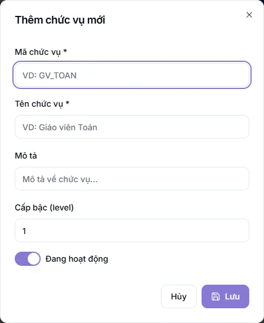
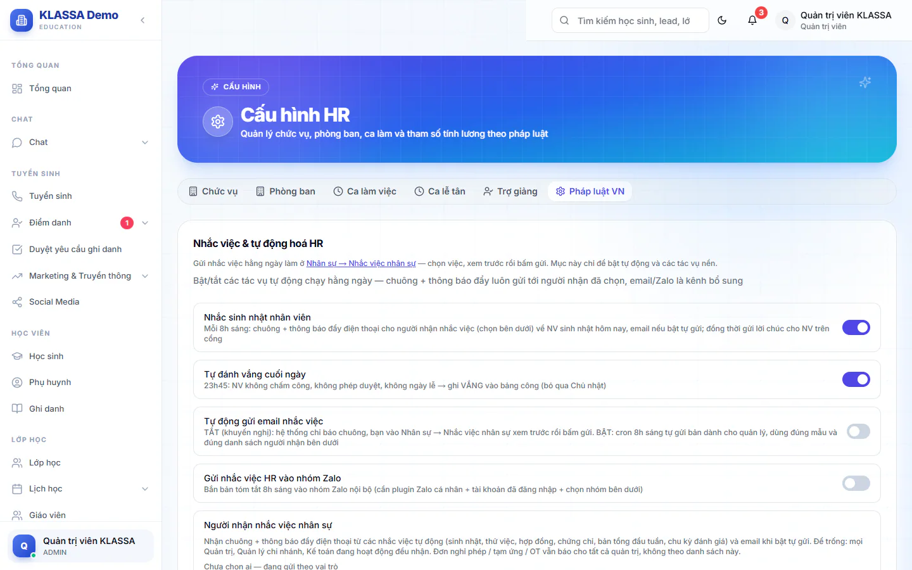

# Cấu hình nhân sự

Trang này giữ những thiết lập nền của khu Nhân sự: danh sách chức vụ, danh sách phòng ban và các công tắc tự động. Bạn cần khai chức vụ trước khi thêm nhân viên, vì ô **Chức vụ** trong hồ sơ lấy từ đây.

Trang có sáu thẻ: **Chức vụ**, **Phòng ban**, **Ca làm việc**, **Ca lễ tân**, **Trợ giảng** và **Pháp luật VN**. Bài này nói về **Chức vụ**, **Phòng ban** và **Pháp luật VN**. Ba thẻ còn lại thuộc phần ca làm và chấm công.

## Thêm chức vụ

::: steps
1. Vào **Quản lý HR → Cấu hình HR**, mở thẻ **Chức vụ**.
2. Bấm **Thêm chức vụ**. Hộp **Thêm chức vụ mới** hiện ra.
3. Điền **Mã chức vụ** và **Tên chức vụ** (hai ô bắt buộc).
4. Tuỳ ý điền **Mô tả** và **Cấp bậc (level)** từ 1 đến 10 (1 là thấp nhất).
5. Giữ công tắc **Đang hoạt động** nếu chức vụ còn dùng.
6. Bấm nút lưu ở cuối hộp.
:::

Muốn sửa, bấm biểu tượng bút ở dòng chức vụ, hộp đổi tên thành **Cập nhật chức vụ**. Biểu tượng thùng rác để xoá. Mã chức vụ không được trùng.

::: tip Mẹo
Chức vụ nào không dùng nữa thì tắt **Đang hoạt động** thay vì xoá, để hồ sơ cũ vẫn giữ tên chức vụ.
:::

## Thêm phòng ban

::: steps
1. Mở thẻ **Phòng ban**, bấm **Thêm phòng ban**.
2. Điền **Mã phòng ban** và **Tên phòng ban** (bắt buộc).
3. Ở ô **Trưởng phòng**, chọn một nhân viên nếu muốn người đó duyệt phép và tăng ca của phòng tại trang [Đội của tôi](doi-nhom.md). Để **Chưa gán** nếu chưa có.
4. Tuỳ ý điền **Mô tả**, rồi bấm lưu.
:::

Phòng ban đang có nhân viên thì không xoá được. Hãy chuyển nhân viên sang phòng khác trước.

## Thẻ Pháp luật VN

Thẻ này gom các công tắc chung của nhân sự. Ba khối đầu thuộc quyền Quản trị viên: Quản lý chi nhánh xem được nhưng khi lưu sẽ bị báo không đủ quyền.

### Nhắc việc và tự động hoá HR

| Công tắc | Mặc định | Tác dụng |
|---|---|---|
| **Nhắc sinh nhật nhân viên** | Bật | 8 giờ sáng báo cho người nhận nhắc việc về nhân viên có sinh nhật hôm nay |
| **Tự đánh vắng cuối ngày** | Bật | 23 giờ 45, nhân viên không chấm công, không có phép được duyệt, không rơi vào ngày lễ sẽ được ghi Vắng vào bảng công (bỏ qua Chủ nhật) |
| **Tự động gửi email nhắc việc** | Tắt | Tắt thì hệ thống chỉ báo chuông, bạn vào [Nhắc việc nhân sự](nhac-viec.md) xem trước rồi bấm gửi. Bật thì 8 giờ sáng tự gửi, không ai xem trước |
| **Gửi nhắc việc HR vào nhóm Zalo** | Tắt | Gửi bản tóm tắt 8 giờ sáng vào nhóm Zalo nội bộ. Cần gói Zalo cá nhân, tài khoản Zalo đã đăng nhập và đã chọn nhóm |

Khi bật gửi Zalo, bấm **Tải danh sách nhóm** rồi chọn nhóm nhận.

Khối **Người nhận nhắc việc nhân sự** cho bạn tick những tài khoản nhận chuông, thông báo đẩy và email tự gửi (nhắc sinh nhật, thử việc, hợp đồng, chứng chỉ, bản tổng đầu tuần, chu kỳ đánh giá). Để trống thì mọi Quản trị viên, Quản lý chi nhánh và Kế toán đang hoạt động đều nhận. Đơn nghỉ phép, tạm ứng và tăng ca luôn báo cho tất cả quản trị, không theo danh sách này.

::: warning Lưu ý
Chỉ bật **Tự động gửi email nhắc việc** khi mẫu email và danh sách người nhận đã chuẩn. Bật mà chưa tick ai thì email không gửi cho ai cả.
:::

### Giao việc nội bộ

Công tắc **Cho phép nhân viên tự giao việc cho nhau** mặc định tắt. Tắt thì chỉ quản trị viên và quản lý giao việc xuống. Bật thì mọi nhân viên giao được cho đồng nghiệp cùng chi nhánh và giao ngược lên quản lý. Xem [Giao việc](giao-viec.md).

### Thông số luật

Phần cuối là các thông số tính lương theo luật Việt Nam, chia bốn khối: **Thuế TNCN (PIT)** (kèm biểu thuế lũy tiến), **Bảo hiểm xã hội (NV đóng)**, **Hệ số tăng ca (OT)** và **Chấm công & ngày công**. Mỗi thông số có nút lưu và nút đặt lại về mặc định. Cách các thông số này vào bảng lương xem ở [Cấu hình lương](cau-hinh-luong.md).

## Câu hỏi thường gặp

::: details Sao không thấy chức vụ vừa tạo khi thêm nhân viên?
Kiểm tra chức vụ đó còn bật **Đang hoạt động** không, rồi tải lại trang **Nhân viên**.
:::

::: details Tôi là Quản lý chi nhánh, lưu công tắc báo lỗi?
Các công tắc ở thẻ **Pháp luật VN** chỉ Quản trị viên lưu được. Nhờ Quản trị viên bật hoặc tắt giúp.
:::
