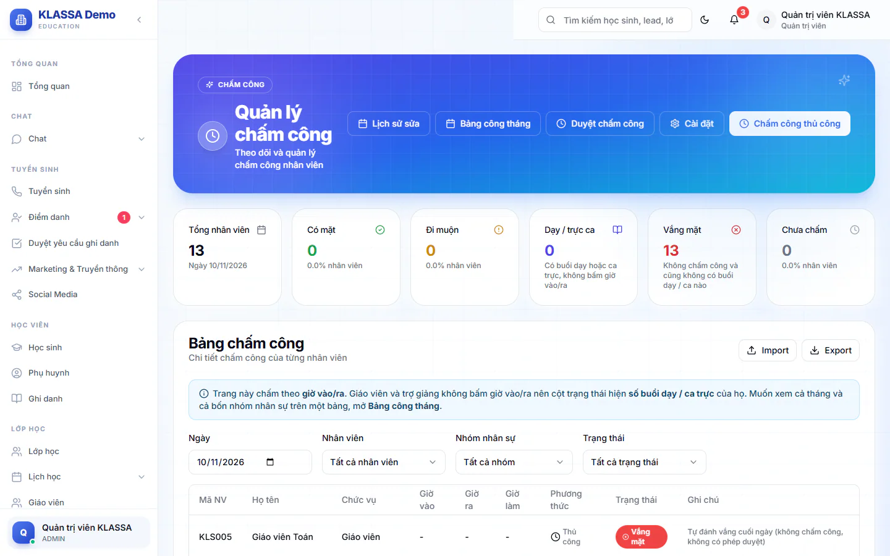
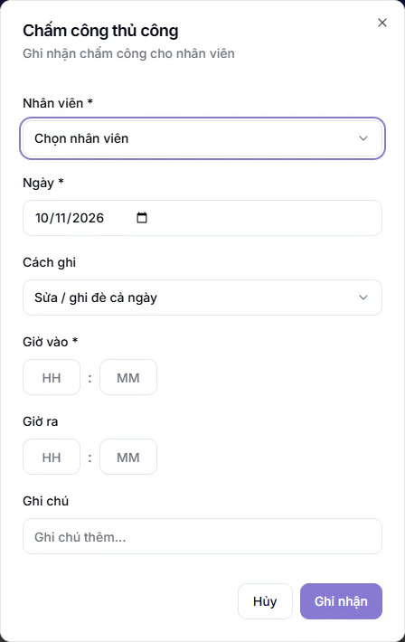

# Điểm danh nhân viên

Trang này cho bạn thấy ai đã chấm công trong một ngày, giờ vào giờ ra ra sao, và cho phép bạn chấm hộ hoặc sửa khi nhân viên quên. Đây là chấm công của nhân viên, khác với điểm danh học sinh trong buổi học.

Vào **Quản lý HR → Điểm danh nhân viên**. Nhân viên tự chấm công ở Cổng nhân viên, xem [Chấm công của tôi](../cong-nhan-vien/cham-cong.md).

## Đọc bảng chấm công

Sáu ô số ở đầu trang cho biết **Tổng nhân viên**, **Có mặt**, **Đi muộn**, **Dạy / trực ca**, **Vắng mặt** và **Chưa chấm** của ngày đang chọn.

Bảng có các cột **Mã NV**, **Họ tên**, **Chức vụ**, **Giờ vào**, **Giờ ra**, **Giờ làm**, **Phương thức**, **Trạng thái**, **Ghi chú**. Cột **Phương thức** cho biết lần chấm là **Thủ công**, **Vân tay** hay chấm bằng WiFi hoặc GPS. Nhãn **Chỉ GPS** nghĩa là lần chấm đó chỉ có định vị, không nối được WiFi của trung tâm.

Giáo viên và trợ giảng không bấm giờ vào ra, nên cột **Trạng thái** của họ hiện số buổi dạy, số ca trợ giảng hoặc ca trực lễ tân trong ngày, ví dụ **Dạy 2 buổi**. Muốn xem cả tháng và cả bốn nhóm nhân sự trên một bảng, bấm **Bảng công tháng** (xem [Bảng công tháng](bang-cong-thang.md)).

Dùng bộ lọc **Ngày**, **Nhân viên**, **Nhóm nhân sự** (**Giáo viên**, **Trợ giảng**, **Lễ tân / Tư vấn**, **Văn phòng**) và **Trạng thái** để thu hẹp danh sách.

## Chấm công thủ công

Dùng khi nhân viên quên chấm công hoặc chấm sai giờ.

::: steps
1. Vào **Quản lý HR → Điểm danh nhân viên**, bấm **Chấm công thủ công**. Hộp **Chấm công thủ công** hiện ra.
2. Chọn **Nhân viên** và **Ngày** (cả hai bắt buộc).
3. Chọn **Cách ghi**: **Sửa / ghi đè cả ngày**, hoặc **Thêm ca**. Xem mục bên dưới.
4. Nhập **Giờ vào** (bắt buộc) và **Giờ ra**. Ghi **Ghi chú** nếu cần.
5. Bấm **Ghi nhận**.
:::

### Thêm ca cho người làm nhiều ca trong ngày

Chọn **Thêm ca, giữ các ca đã chấm trong ngày** khi một người làm nhiều ca trong cùng một ngày, ví dụ trợ giảng dạy sáng và chiều. Cần nhập đủ cả giờ vào và giờ ra, và ca mới không được chồng giờ lên ca đã chấm. Chọn **Sửa / ghi đè cả ngày** thì bản chấm cũ của ngày đó bị thay bằng giờ bạn nhập.

### Chấm bù ca trợ giảng

Khi nhân viên là trợ giảng có ca trong ngày, hộp hiện thêm mục **Ca trợ giảng ngày này**. Tích ca để xác nhận trợ giảng có mặt ở ca đó thay vì nhập giờ. Ca đã chọn hiện **Có mặt** trên app trợ giảng và trên bảng công. Chỉ Quản trị viên và quản lý cơ sở xác nhận được ca trợ giảng. Chi tiết xem [Ca trợ giảng](ca-tro-giang.md).

## Duyệt chấm công

Một số lần chấm công hệ thống không xác thực được vị trí: WiFi hỏng, định vị lỗi, đi công tác, dạy ở cơ sở khác, hoặc nhân viên quên chấm ra và tự khai giờ ra. Những lần này chờ bạn duyệt.

::: steps
1. Bấm **Duyệt chấm công** ở đầu trang.
2. Chọn tab **Chờ duyệt**. Mỗi thẻ cho biết ai chấm, lúc nào, lý do nhân viên ghi, và bằng chứng như cách khu vực chấm công bao xa hoặc mạng đang dùng. Thẻ ghi rõ nếu máy báo vị trí giả lập.
3. Ghi **Ghi chú** nếu muốn (nhân viên đọc được).
4. Bấm **Duyệt** hoặc **Từ chối**.
:::

Với lần quên chấm ra, duyệt thì ca được tính đến giờ ra nhân viên đã khai. Hai tab còn lại là **Đã duyệt** và **Đã từ chối**.

::: warning Giới hạn khi duyệt
Kế toán chỉ xem được, không duyệt. Người không phải Quản trị viên cũng không tự duyệt lần chấm của chính mình, cần người khác duyệt.
:::

## Xem lịch sử sửa

Bấm **Lịch sử sửa** để xem 50 thao tác chấm công tay và sửa bảng công gần nhất: ai chấm hộ, lúc nào, giá trị cũ và mới. Thao tác **Thêm ca** được đánh dấu riêng.

## Cài đặt chấm công

Bấm **Cài đặt** để khai WiFi, vùng GPS và thiết bị. Xem [Cấu hình chấm công](cau-hinh-cham-cong.md).

## Câu hỏi thường gặp

::: details Giáo viên không chấm công mà trạng thái không phải vắng, vì sao?
Giáo viên và trợ giảng được tính có mặt theo buổi dạy hoặc ca trợ giảng trong ngày. Hệ thống không đánh vắng người có buổi dạy hoặc ca đã chốt trong ngày đó.
:::

::: details Chấm hộ có làm thay đổi lương không?
Có, với nhân viên tính lương theo ngày công hoặc theo giờ. Sau khi sửa, bấm tính lại phiếu của người đó ở kỳ còn **Nháp** hoặc **Chờ duyệt** (xem [Quản lý lương](bang-luong.md)).
:::

::: details Khi nào dùng Thêm ca, khi nào dùng ghi đè?
Dùng **Thêm ca** để cộng thêm một ca mới mà không đụng ca đã chấm. Dùng ghi đè khi bản chấm cũ sai hẳn và bạn muốn thay toàn bộ.
:::
