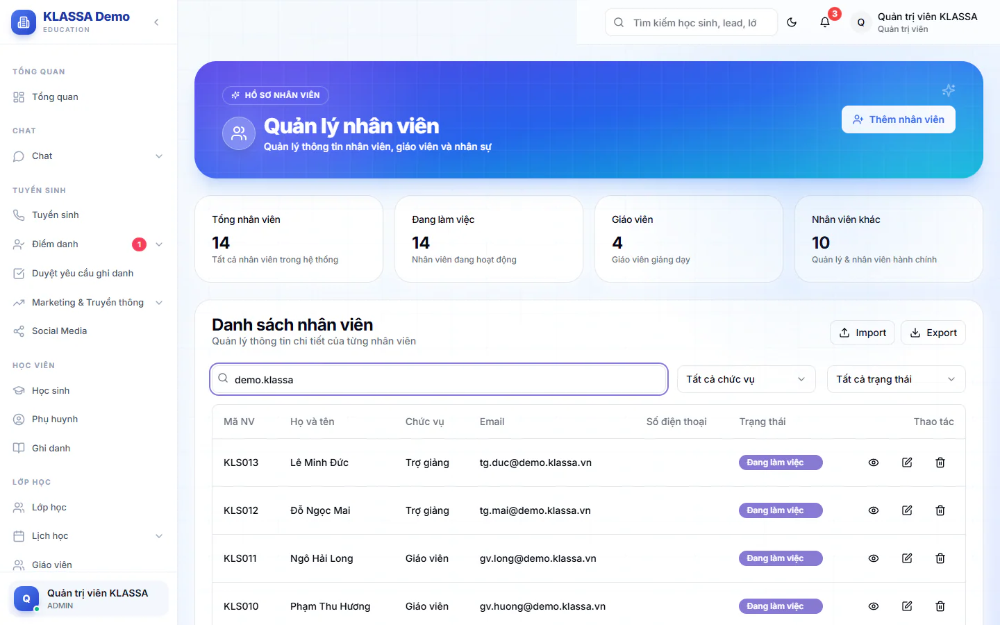
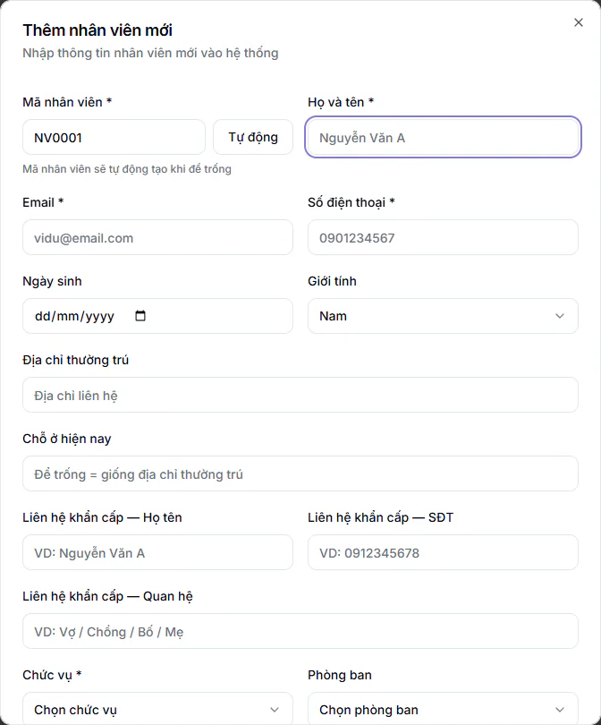
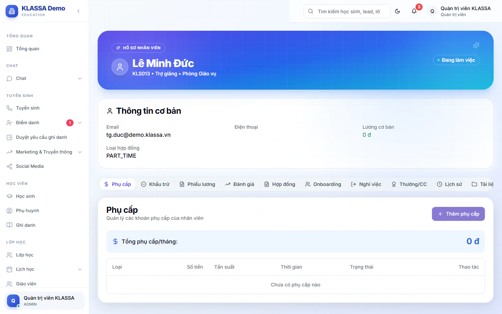

# Danh sách và hồ sơ nhân viên

Trang này là nơi lưu hồ sơ của mọi nhân viên: giáo viên, trợ giảng, lễ tân, kế toán và các vai khác. Bạn thêm người mới, sửa thông tin, cho nghỉ việc và mở hồ sơ chi tiết từ đây.

## Xem và tìm nhân viên

::: steps
1. Vào **Quản lý HR → Nhân viên**. Tiêu đề trang là **Quản lý nhân viên**.
2. Gõ vào ô **Tìm kiếm theo tên, mã NV, email...** để tìm nhanh.
3. Dùng hai ô lọc, mặc định hiện **Tất cả chức vụ** và **Tất cả trạng thái**. Ô thứ nhất chọn một chức vụ cụ thể. Ô thứ hai chọn **Đang làm việc**, **Nghỉ phép** hoặc **Đã nghỉ việc**.
4. Bảng có các cột **Mã NV**, **Họ và tên**, **Chức vụ**, **Email**, **Số điện thoại**, **Trạng thái**. Mỗi trang hiện 20 người.
:::

Bốn ô số liệu ở đầu trang là **Tổng nhân viên**, **Đang làm việc**, **Giáo viên** và **Nhân viên khác**. Ô **Giáo viên** đếm những người có chức vụ chứa chữ "giáo viên" hoặc mã chức vụ chứa "GV".

Người còn trong thời gian thử việc có thêm nhãn vàng **Thử việc đến ...** dưới trạng thái.

## Thêm nhân viên mới

Hộp **Thêm nhân viên mới** là hộp riêng, khác với hộp sửa. Khi tạo hồ sơ, hệ thống tạo luôn tài khoản đăng nhập nếu email chưa có tài khoản.

::: steps
1. Bấm **Thêm nhân viên** ở đầu trang. Hộp **Thêm nhân viên mới** hiện ra.
2. Mục **Mã nhân viên** tự điền dạng NV0001, NV0002... Bấm **Tự động** nếu muốn lấy lại mã kế tiếp, hoặc tự gõ mã khác.
3. Điền **Họ và tên**, **Email**, **Số điện thoại**.
4. Chọn **Chức vụ**, rồi tuỳ ý chọn **Phòng ban** và **Cơ sở**.
5. Chọn **Loại hình làm việc** (Toàn thời gian, Bán thời gian, Hợp đồng) và **Loại hợp đồng** (Không xác định thời hạn, Có thời hạn, Thử việc).
6. Chọn **Ngày bắt đầu**. Nếu đang thử việc, điền thêm **Ngày hết thử việc**.
7. Nhập **Lương cơ bản** (được để 0).
8. Bấm **Thêm nhân viên** ở cuối hộp.
:::

Ô bắt buộc: **Mã nhân viên**, **Họ và tên**, **Email** (đúng dạng email), **Số điện thoại** (9-11 chữ số), **Chức vụ**, **Loại hình làm việc**, **Loại hợp đồng**, **Ngày bắt đầu**, **Lương cơ bản**.

### Các ô riêng cho giáo viên, trợ giảng và lễ tân

- **Cách tính lương dạy (GV/Trợ giảng)**: **Theo mặc định trung tâm**, **Theo sĩ số học sinh**, **Cố định mỗi buổi** hoặc **Cố định theo giờ**. Hai kiểu cố định hiện thêm ô nhập số tiền. Bậc sĩ số riêng cho từng người chỉ đặt được sau khi đã lưu: mở lại bằng nút sửa để cấu hình.
- **Ca làm việc (để tính đi trễ khi chấm công)**: nếu để **Chưa gán ca**, hệ thống lấy mốc 8:00 mặc định.
- **Đăng ký ca lễ tân (part-time)**: tick để nhân viên tự đăng ký ca trên cổng nhân viên.

### Thông tin pháp lý và ngân hàng

Phần **Thông tin pháp lý (CCCD / MST / BHXH)** gồm CCCD (12 số), ngày và nơi cấp, mã số thuế, sổ BHXH, thẻ BHYT, số người phụ thuộc, số tài khoản và ngân hàng. Các ô này không bắt buộc nhưng cần để in hợp đồng và tính thuế sau này.

::: warning Lưu ý
Tài khoản đăng nhập mới được tạo với mật khẩu mặc định chung của hệ thống, vai **Giáo viên**, và bị buộc đổi mật khẩu lần đầu. Hãy đặt lại mật khẩu riêng cho người đó ở **Quản lý Users** rồi mới báo họ đăng nhập. Nếu người này làm vai khác, hãy đổi vai trong [Quản lý người dùng](../cai-dat/nguoi-dung.md).

Email đã có tài khoản thì hồ sơ gắn vào tài khoản đó. Tài khoản đã có hồ sơ nhân viên rồi thì hệ thống báo trùng và không tạo thêm.
:::

## Sửa thông tin nhân viên

::: steps
1. Ở dòng nhân viên, bấm biểu tượng bút (gợi ý hiện chữ **Chỉnh sửa**).
2. Hộp **Cập nhật thông tin nhân viên** hiện ra, có đủ các ô như hộp thêm mới.
3. Sửa xong bấm **Cập nhật**.
:::

Hộp sửa kiểm tra các ô bắt buộc giống hộp thêm: họ tên, email, số điện thoại, chức vụ, loại hình, ngày bắt đầu.

## Mở hồ sơ chi tiết

Bấm biểu tượng con mắt (**Xem chi tiết**) ở dòng nhân viên. Trang hồ sơ hiện thông tin cơ bản (email, điện thoại, lương cơ bản) và các thẻ:

| Thẻ | Nội dung |
|---|---|
| **Phụ cấp**, **Khấu trừ**, **Phiếu lương** | Khoản cộng, khoản trừ và phiếu lương, xem [Quản lý lương](bang-luong.md) |
| **Đánh giá** | Các đợt đánh giá hiệu suất của người này |
| **Hợp đồng** | Lịch sử hợp đồng lao động, xem [Hợp đồng lao động](hop-dong.md) |
| **Onboarding** | Danh sách việc khi nhận người mới, xem [Onboarding](onboarding.md) |
| **Nghỉ việc** | Danh sách việc khi người nghỉ việc (bàn giao, thu hồi tài khoản...) |
| **Thưởng/CC** | **Khen thưởng & Kỷ luật** và **Chứng chỉ & Đào tạo** |
| **Lịch sử** | Nhật ký thay đổi lương, chức vụ, hợp đồng; lọc được theo loại thay đổi |
| **Tài liệu** | Tải lên giấy tờ (PDF, JPG, PNG, DOC, DOCX, tối đa 10MB mỗi tệp) |

Khi tải tài liệu, chọn **Loại tài liệu** (Hợp đồng lao động, CMND/CCCD/Passport, Bằng cấp/Chứng chỉ, Giấy khám sức khỏe, Khác). Ngày hết hạn và ghi chú là tuỳ chọn.

Ở thẻ **Thưởng/CC**, bấm **Thêm** để ghi nhận. Khen thưởng và kỷ luật cần **Tiêu đề**; chứng chỉ cần **Tên chứng chỉ**.

## Cho nhân viên nghỉ việc hoặc xoá hồ sơ

Biểu tượng thùng rác ở cuối dòng có hai cách hoạt động:

- Với người đang làm hoặc đang nghỉ phép: chuyển trạng thái sang **Đã nghỉ việc**. Hồ sơ vẫn còn và khôi phục được.
- Với người đã **Đã nghỉ việc**: **Xóa vĩnh viễn**.

::: danger Không thể hoàn tác
Xoá vĩnh viễn làm mất hồ sơ nhân viên, không khôi phục được. Hệ thống luôn hỏi xác nhận trước khi làm. Nếu chưa chắc, chỉ cần chuyển sang **Đã nghỉ việc**.
:::

## Nhập từ Excel và xuất danh sách

- Bấm **Import** để nhập nhiều người một lần: chọn tệp hoặc dán bảng, đối chiếu cột, xem lại rồi tạo hồ sơ. Cột bắt buộc là **Họ tên nhân viên** và **Chức vụ** (phải khớp tên chức vụ đã khai ở [Cấu hình nhân sự](cau-hinh-hr.md)). Người có email được tạo luôn tài khoản đăng nhập. Chi tiết các bước ở [Nhập dữ liệu hàng loạt từ Excel](../tai-khoan/nhap-du-lieu-hang-loat.md).
- Bấm **Export** để tải tệp **danh-sach-nhan-vien.csv**.

Hai nút này ẩn khi bạn dùng trang trên điện thoại.

## Câu hỏi thường gặp

::: details Tôi bấm Thêm nhân viên mà báo tài khoản đã có hồ sơ?
Email đó đã thuộc về một nhân viên khác. Thông báo cho biết mã và tên người đó. Hãy tìm họ trong danh sách và sửa hồ sơ thay vì tạo mới.
:::

::: details Chức vụ trong danh sách chọn ở đâu ra?
Từ mục chức vụ ở [Cấu hình nhân sự](cau-hinh-hr.md). Chưa có chức vụ thì tạo trước khi thêm nhân viên.
:::
