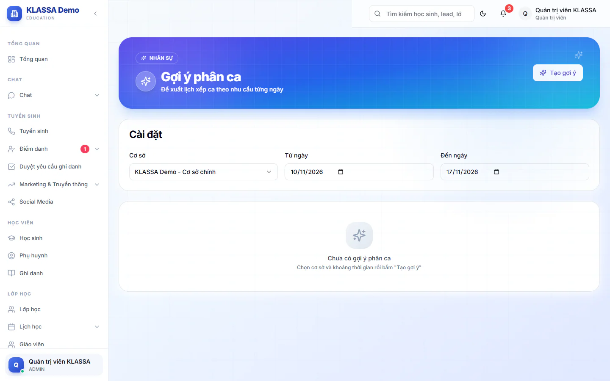

# Gợi ý Phân ca AI

Khi cần xếp ca cho nhiều ngày liền, bạn có thể nhờ hệ thống đề xuất người cho từng ca thay vì chọn tay từng ô. Gợi ý dựa trên các ca làm việc đang hoạt động và các nhân viên đang làm tại cơ sở bạn chọn.

Vào **Quản lý HR → Gợi ý Phân ca AI**. Trang cần hai gói mở rộng: **Nền tảng AI** và **AI — Gợi ý & Trợ lý Vận hành**. Gợi ý chạy theo quy tắc cố định, không phải do người soạn.

Trang này gợi ý cho các ca ở **Cấu hình HR → Ca làm việc** (xem [Phân ca tuần](phan-ca-tuan.md)). Nó không gợi ý cho ca lễ tân hay buổi dạy của giáo viên.

## Tạo gợi ý

::: steps
1. Vào **Quản lý HR → Gợi ý Phân ca AI**.
2. Trong thẻ **Cài đặt**, chọn **Cơ sở** (bắt buộc), **Từ ngày** và **Đến ngày**.
3. Bấm **Tạo gợi ý**. Hệ thống báo số gợi ý đã tạo.

   
:::

Kết quả chia theo từng ngày. Mỗi dòng là một ca của một ngày, gồm **Ca**, **Thời gian**, **Nhân viên đề xuất** (kèm lý do), **Điểm** và **Ghi chú**. Ô số ở đầu trang cho biết **Tổng gợi ý**, **Đã chọn**, **Có xung đột** và **Số ngày**. Dòng nền vàng là ca có xung đột, ghi ở cột **Ghi chú**, ví dụ ngày cuối tuần cần cân nhắc chính sách tăng ca hoặc đã có người được xếp ca khác trong ngày.

## Hệ thống chấm điểm thế nào

Nhân viên đã có dòng trong bảng công của ngày đó (đã xếp ca, đã chấm công hoặc đã nghỉ phép) bị loại khỏi gợi ý của ngày đó. Những người còn lại bắt đầu ở 100 điểm cho mỗi ca, rồi cộng trừ:

- Trừ 30 nếu đã làm 3 ngày liên tiếp gần đây, cộng 20 nếu chưa làm trong 3 ngày gần đây.
- Cộng 15 nếu tháng này chưa đủ giờ làm, trừ 20 nếu đã làm quá nhiều giờ.
- Cộng thêm điểm nhỏ khi nhân viên phù hợp với bộ phận và cấp bậc.

Mỗi ca giữ tối đa 5 người điểm cao nhất. Nhãn **Xuất sắc**, **Tốt**, **Khá**, **Thấp** ứng với điểm của người đứng đầu gợi ý (từ 80, 60, 40 trở lên, và dưới 40).

## Áp dụng gợi ý

::: steps
1. Tích hoặc bỏ tích ô đầu mỗi dòng. Mặc định tất cả gợi ý đều được chọn. Bấm **Chọn tất cả** để chọn lại toàn bộ.
2. Bấm **Áp dụng**, số gợi ý đã chọn hiện trong ngoặc, ví dụ **Áp dụng (8)**.
3. Hệ thống xếp ca vào lịch. Các dòng đã áp dụng biến mất khỏi danh sách.
:::

::: warning Áp dụng xếp cả nhóm người của dòng đó
Khi áp dụng một dòng, tất cả nhân viên đề xuất của dòng đó (tối đa 5 người, trang chỉ hiện 3 người đầu và dòng "+N nhân viên khác") đều được xếp vào ca. Bạn không bỏ được từng người trong một dòng. Nếu chỉ cần 1-2 người cho ca, hãy bỏ tích dòng đó và xếp tay ở [Phân ca tuần](phan-ca-tuan.md). Người đã có lịch của ngày đó sẽ không bị xếp đè.
:::

Sau khi áp dụng, bạn xem và chỉnh lại ở **Quản lý HR → Phân ca tuần**.

## Câu hỏi thường gặp

::: details Gợi ý có xét ngày nghỉ phép không?
Có, với những ngày nghỉ phép đã duyệt và đã ghi vào bảng công, người đó bị loại khỏi gợi ý của ngày đó. Đơn mới nộp chưa duyệt thì chưa được xét, nên hãy xem [Nghỉ phép](ngay-phep.md) trước khi áp dụng.
:::

::: details Vì sao không có gợi ý nào?
Cần có ít nhất một ca làm việc đang **Hoạt động** và nhân viên đang làm việc ở cơ sở đã chọn.
:::
