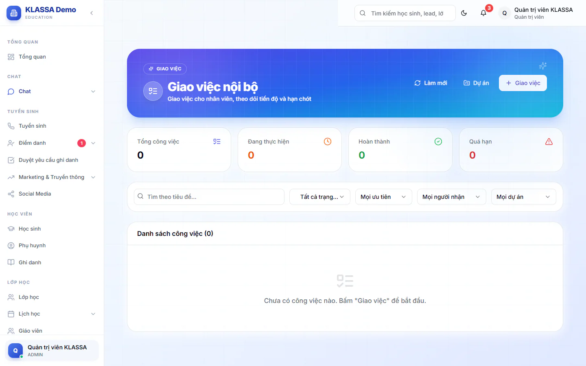

# Giao việc nội bộ

Công cụ này giúp quản lý giao việc cho nhân viên, đặt độ ưu tiên và hạn chót, chia việc thành các bước nhỏ và trao đổi ngay trong từng việc. Nhân viên có màn riêng để xem và hoàn thành việc của mình.

Cần gói mở rộng **Giao việc Nội bộ**. Cùng một địa chỉ nhưng nội dung khác theo vai: Quản trị viên, Quản lý chi nhánh và Quản lý thấy màn quản lý (**Giao việc**), các vai còn lại thấy màn **Việc của tôi** (mục **Công việc** trong menu).

## Quản lý giao việc cho nhân viên

::: steps
1. Vào **Quản lý HR → Giao việc**. Tiêu đề trang là **Giao việc nội bộ**.
2. Bấm **Giao việc**. Hộp **Giao việc mới** hiện ra.
3. Điền **Tiêu đề** (bắt buộc) và **Mô tả**.
4. Chọn **Giao cho** (bắt buộc), **Độ ưu tiên** (**Thấp**, **Trung bình**, **Cao**, **Gấp**) và **Hạn chót**.
5. Nếu việc thuộc một nhóm, chọn **Dự án**. Mặc định là **Không thuộc dự án**.
6. Muốn chia nhỏ, bấm thêm ô trong mục **Các bước con (tuỳ chọn)** và gõ từng bước. Bấm biểu tượng xoá để bỏ một bước.
7. Bấm **Giao việc**.
:::

Quản trị viên giao được cho nhân viên mọi chi nhánh. Quản lý chi nhánh và Quản lý giao được trong chi nhánh của mình.

### Theo dõi các việc đã giao

- Bốn ô số liệu: **Tổng công việc**, **Đang thực hiện**, **Hoàn thành**, **Quá hạn**.
- Ô tìm **Tìm theo tiêu đề...** và các bộ lọc **Tất cả trạng thái** (**Chưa làm**, **Đang làm**, **Hoàn thành**, **Đã huỷ**), **Mọi ưu tiên**, **Mọi người nhận**, **Mọi dự án**.
- Bấm vào một việc để mở chi tiết: đổi trạng thái, tick các bước con, thêm bước con, đọc và viết bình luận.
- Nút **Làm mới** tải lại danh sách.

### Quản lý dự án

Bấm **Dự án** để mở hộp **Quản lý dự án**. Gõ **Tên dự án mới...** rồi bấm **Thêm**. Mỗi dự án có nút **Đổi tên** và **Lưu trữ** (hoặc **Khôi phục**). Dự án đã lưu trữ có nhãn **Lưu trữ** và vẫn giữ các việc cũ.

## Nhân viên xem việc của mình

Nhân viên vào **Công việc** trong menu, trang **Việc của tôi**.

::: steps
1. Xem ba ô: **Tổng công việc**, **Đang thực hiện**, **Đã hoàn thành**.
2. Chọn thẻ **Tất cả**, **Đang làm** hoặc **Đã xong**, hoặc gõ vào **Tìm kiếm công việc...**.
3. Bấm vào việc để xem chi tiết, đổi trạng thái, tick bước con và bình luận.
4. Việc hết hạn mà chưa xong có nhãn đỏ. Việc xong có nhãn **Đã hoàn thành**. Việc do người khác giao ghi **Giao bởi** kèm tên.
:::

Nhân viên cũng tạo được việc cho mình: bấm nút tạo, hộp **Tạo công việc mới** gồm **Tiêu đề**, **Mô tả**, **Hạn chót**, **Độ ưu tiên**, rồi bấm **Tạo công việc**. Ô **Giao cho** chỉ hiện khi Quản trị viên đã cho phép nhân viên giao việc cho nhau.

::: tip Mẹo
Quản trị viên bật công tắc **Cho phép nhân viên tự giao việc cho nhau** ở [Cấu hình nhân sự](cau-hinh-hr.md) (thẻ **Pháp luật VN**). Mặc định tắt, chỉ quản lý giao xuống. Bật thì nhân viên giao được cho đồng nghiệp cùng chi nhánh và giao ngược lên quản lý.
:::

::: danger Không thể hoàn tác
Ở màn quản lý, biểu tượng thùng rác ở dòng việc xoá hẳn công việc đó sau khi bạn xác nhận. Nếu chỉ muốn dừng việc, hãy đổi trạng thái sang **Đã huỷ**.
:::

## Câu hỏi thường gặp

::: details Giao việc khác gì Nhắc việc nhân sự?
Giao việc là việc cụ thể giao cho một người. [Nhắc việc nhân sự](nhac-viec.md) là các cảnh báo tự động về hợp đồng, thử việc, sinh nhật gửi cho bộ phận nhân sự.
:::

::: details Việc dành riêng cho phòng Truyền thông thì làm ở đâu?
Dùng [Quản lý Truyền thông](truyen-thong-noi-bo.md), có bảng, kanban và lịch đăng riêng.
:::
