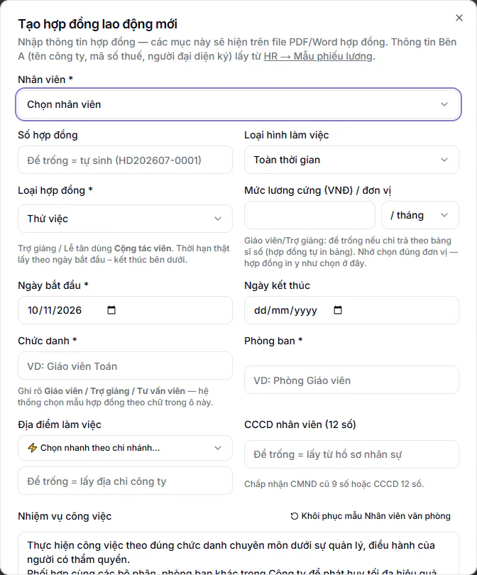
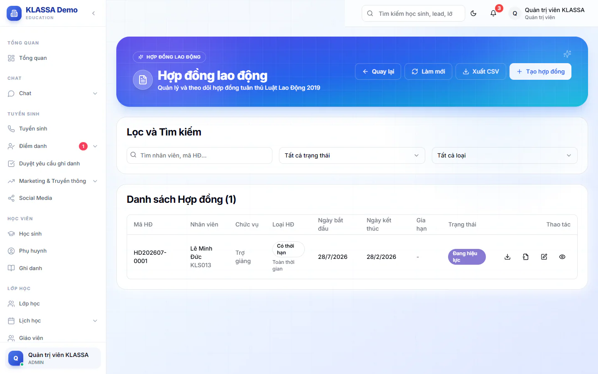

# Hợp đồng lao động

Trang này giúp bạn lập hợp đồng cho nhân viên, xuất file để in hoặc sửa, rồi lưu bản đã ký. Hệ thống cũng nhắc khi hợp đồng sắp hết hạn để bạn kịp gia hạn.

Bạn dùng được ở hai nơi, cùng một hộp nhập: trang **Hợp đồng lao động** (mọi nhân viên) và thẻ **Hợp đồng** trong hồ sơ từng người.

## Tạo hợp đồng

::: steps
1. Vào **Quản lý HR → Hợp đồng lao động**, bấm **Tạo hợp đồng**. Hộp **Tạo hợp đồng lao động mới** hiện ra.
2. Chọn **Nhân viên**. Chức danh, phòng ban, CCCD và loại hình làm việc được điền sẵn từ hồ sơ.
3. Chọn **Loại hợp đồng**: **Thử việc**, **Có thời hạn**, **Không thời hạn**, **Cộng tác viên** hoặc **Thời vụ**.
4. Chọn **Ngày bắt đầu**, tuỳ ý chọn **Ngày kết thúc**.
5. Kiểm tra **Chức danh** và **Phòng ban**, rồi nhập **Mức lương cứng (VNĐ) / đơn vị** (giờ, ca hoặc tháng).
6. Bấm **Tạo hợp đồng**.
:::

Ô bắt buộc: **Nhân viên**, **Loại hợp đồng**, **Ngày bắt đầu**, **Chức danh**, **Phòng ban**. Nếu điền CCCD thì phải đủ 9 số (CMND cũ) hoặc 12 số.

::: tip Mẹo
Trợ giảng và Lễ tân dùng loại **Cộng tác viên**. Hộp có nhắc ngay dưới ô **Loại hợp đồng**. Hợp đồng mới luôn bắt đầu ở **Thử việc**, bạn cần đổi sang loại đúng.
:::

### Các ô nên xem lại trước khi in

- **Số hợp đồng**: để trống thì hệ thống tự sinh (dạng HD202607-0001).
- **Đơn vị lương**: tự gợi ý theo chức danh (văn phòng theo tháng, trợ giảng theo ca, giáo viên và lễ tân theo giờ). Bạn đổi được.
- **Địa điểm làm việc**: dùng ô **Chọn nhanh theo chi nhánh** hoặc gõ tay. Để trống thì lấy địa chỉ công ty.
- **Nhiệm vụ công việc**: tự ra mẫu theo chữ trong ô **Chức danh** (giáo viên, trợ giảng, lễ tân, văn phòng). Sửa tự do, bấm **Khôi phục mẫu** để quay lại bản chuẩn.
- **Môn giảng dạy (in vào Điều 2)**: chỉ hiện với hợp đồng giáo viên.
- **Hình thức trả lương** (Chuyển khoản hoặc Tiền mặt), **Ngày trả lương**, **Giờ làm/ngày**, **Báo trước khi chấm dứt (ngày)**.
- **Phụ lục hợp đồng**: tick **In kèm phụ lục kiêm nhiệm vị trí khác** để nhập chức danh, bộ phận, thời hạn, thù lao và nhiệm vụ kiêm nhiệm.
- **Thời giờ nghỉ ngơi**, **Chế độ bảo hiểm**, **Phúc lợi khác**, **Ngày ký**, **Ghi chú**.

Thông tin Bên A (tên công ty, mã số thuế, người đại diện ký) lấy từ trang **Mẫu phiếu lương**. Hãy điền đủ ở đó trước khi in hợp đồng.

## In, sửa file và lưu bản đã ký

Mỗi dòng hợp đồng có các nút biểu tượng (rê chuột để thấy tên). Ở trang **Hợp đồng lao động** chỉ có **Tải PDF (bản nháp)**, **Tải Word để sửa**, **Sửa** và **Xem hồ sơ nhân viên**. Nút **Tải lên bản đã ký**, **Gia hạn** và **Xoá** chỉ có ở thẻ **Hợp đồng** trong hồ sơ nhân viên.

| Nút | Làm gì |
|---|---|
| **Tải PDF (bản nháp)** | Tải file PDF để in |
| **Tải Word để sửa** | Tải file Word nếu cần chỉnh nội dung |
| **Tải lên bản đã ký** | Lưu bản ký (PDF, JPG, PNG, DOC, DOCX, tối đa 10MB) |
| **Sửa** | Mở lại hộp nhập để đổi thông tin |
| **Xem hồ sơ nhân viên** | Mở hồ sơ người đó |

Trong hồ sơ nhân viên, bấm **Xem chi tiết** để thấy đủ thông tin hợp đồng và mục **Bản chính thức đã ký**.

## Gia hạn

Chỉ hợp đồng **Đang hiệu lực** mới có nút **Gia hạn** (trong thẻ **Hợp đồng** của hồ sơ nhân viên).

::: steps
1. Mở hồ sơ nhân viên, thẻ **Hợp đồng**, bấm **Gia hạn** ở hợp đồng cần nối.
2. Điền **Số hợp đồng mới**, **Ngày bắt đầu**, **Ngày kết thúc** và **Mức lương mới (VND)** nếu có đổi.
3. Bấm **Gia hạn**.
:::

Hệ thống tạo hợp đồng mới sao chép từ hợp đồng cũ, tăng số lần gia hạn lên 1 và chuyển hợp đồng cũ sang **Đã gia hạn**.

## Theo dõi và tìm hợp đồng

- Ô tìm theo tên nhân viên, mã nhân viên hoặc mã hợp đồng. Lọc được theo **Trạng thái** (**Đang hiệu lực**, **Nháp**, **Hết hạn**, **Đã chấm dứt**, **Đã gia hạn**) và theo loại hợp đồng.
- Hợp đồng đang hiệu lực mà hết hạn trong 30 ngày tới thì trang hiện khung cảnh báo "hợp đồng sắp hết hạn". Số này cũng hiện ở [Tổng quan nhân sự](tong-quan.md).
- Bấm **Xuất CSV** để tải danh sách đang lọc.
- Bảng có các cột **Mã HĐ**, **Nhân viên**, **Chức vụ**, **Loại HĐ**, **Ngày bắt đầu**, **Ngày kết thúc**, **Gia hạn**, **Trạng thái**.

::: danger Không thể hoàn tác
Nút **Xoá** (thùng rác, trong hồ sơ nhân viên) xoá hẳn hợp đồng sau khi bạn xác nhận. Hãy tải file về trước nếu còn cần.
:::

## Câu hỏi thường gặp

::: details Hợp đồng mới tạo có trạng thái gì?
**Đang hiệu lực**. Tải lên bản đã ký không đổi trạng thái.
:::

::: details Nhân viên chưa có trong danh sách chọn?
Danh sách chỉ gồm nhân viên đang làm việc. Thêm hồ sơ ở [Danh sách nhân viên](danh-sach-nhan-vien.md) rồi tạo hợp đồng.
:::
