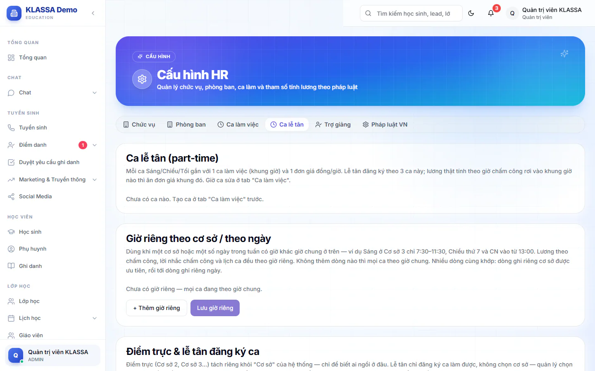

# Lịch ca lễ tân

Lễ tân bán thời gian làm theo ca Sáng, Chiều, Tối. Mỗi tháng lễ tân tự đăng ký ca mình muốn, quản lý xếp lại cho đủ người và chia điểm trực, rồi chốt và công bố để cả đội cùng xem. Trang này là nơi quản lý làm việc đó.

Vào **Quản lý HR → Lịch ca lễ tân**. Quản trị viên luôn vào được. Người khác chỉ vào được khi được thêm vào danh sách quản lý ca (xem bên dưới). Lương lễ tân vẫn tính theo chấm công thật, không phải theo lịch đã xếp.

## Chuẩn bị một lần trước khi dùng

Vào **Quản lý HR → Cấu hình HR**, tab **Ca lễ tân**. Tab gồm bốn khối.

### Ca lễ tân (part-time)

Gắn mỗi ca **Sáng**, **Chiều**, **Tối** với một ca làm việc (khung giờ, tạo ở tab **Ca làm việc**, xem [Phân ca tuần](phan-ca-tuan.md)) và một **Đơn giá (đồng/giờ)**. Khối hiện luôn số giờ và tiền mỗi ca. Bấm **Lưu khung giờ & đơn giá**. Chỉ Quản trị viên lưu được đơn giá.

Lương thật tính theo giờ chấm công rơi vào khung giờ nào thì nhân với đơn giá của khung đó.

### Giờ riêng theo cơ sở / theo ngày

Dùng khi một cơ sở hoặc vài ngày trong tuần có giờ khác giờ chung, ví dụ ca Sáng ở một cơ sở bắt đầu muộn hơn, hoặc ca Chiều thứ Bảy và Chủ nhật vào sớm hơn.

::: steps
1. Bấm **+ Thêm giờ riêng**.
2. Chọn ca, **Cơ sở** (hoặc **Mọi cơ sở**), **Giờ vào (24h)**, **Giờ ra (24h)** và các ngày áp dụng. Không chọn ngày nào nghĩa là mọi ngày.
3. Bấm **Lưu giờ riêng**.
:::

Không thêm dòng nào thì mọi ca theo giờ chung. Khi nhiều dòng cùng khớp, dòng ghi riêng cơ sở được ưu tiên, rồi tới dòng ghi riêng ngày. Lương, lời nhắc chấm công và lịch ca đều theo giờ riêng.

### Điểm trực và lễ tân đăng ký ca

- **Điểm trực**: thêm các điểm như "CS2 - Cơ sở 2" bằng **+ Thêm điểm trực** (mã và tên). Điểm trực tách riêng khỏi cơ sở của hệ thống, chỉ để biết ai ngồi ở đâu.
- **Hạn chót đăng ký hàng tháng**: nhập ngày để hệ thống tự khoá đăng ký lúc 0h ngày đó của tháng trước. Để 0 là tắt, quản lý tự bấm khoá.
- **Nhắc lễ tân quên chấm công**: 8h10 sáng mỗi ngày, ai có ca đã chốt hôm qua mà không thấy chấm công sẽ nhận thông báo để báo quản lý bổ sung. Chỉ nhắc, không tự ghi công hay đánh vắng.
- **Ai được đăng ký ca và trực ở đâu**: danh sách gồm mọi tài khoản vai trò Lễ tân và những người đã bật ô **Đăng ký ca lễ tân** trong hồ sơ nhân viên. Mỗi người có một **Điểm trực mặc định** để gợi ý.

### Người được xếp và quản lý ca lễ tân

Khối **Người được xếp & quản lý ca lễ tân** cho chọn những tài khoản được vào trang **Lịch ca lễ tân**. Chỉ hiện tài khoản vai trò Quản trị, Quản lý, Quản lý chi nhánh. Chọn rồi bấm **Lưu danh sách**.

## Xếp lịch một tháng

Chọn tháng ở ô **Tháng**. Nhãn tình trạng cho biết tháng đang **Đang nhận đăng ký**, **Đã khoá đăng ký** hoặc **Đã chốt**. Bốn ô số cho biết **Người đã đăng ký**, **Ca đã xếp/chốt**, **Ô còn trống** và **Tiền dự kiến**.

Lịch tháng là lưới ngày và ca. Mỗi ô có thể xếp nhiều người. Mỗi người trong ô có trạng thái:

| Trạng thái | Ý nghĩa |
|------------|---------|
| **Đã đăng ký** | Lễ tân tự đăng ký, chưa xếp. |
| **Đã xếp** | Quản lý đã xếp, chưa công bố. |
| **Đã chốt** | Đã chốt và công bố, lễ tân đã được báo. |
| **Không xếp** | Đăng ký nhưng không được xếp. |

Màu nền giúp bạn thấy việc cần làm: ô nền vàng có nhiều người đăng ký cần bạn chọn, ô nền đỏ chưa có ai trực.

::: steps
1. Khi lễ tân đăng ký xong, bấm **Xếp nhanh (N)**. Hệ thống chỉ xếp những ô có đúng một người đăng ký và chưa xếp ai. Ô nhiều người đăng ký hay ô trống được giữ nguyên.
2. Với ô nhiều người, bấm mã điểm trực (ví dụ CS2, CS3) cạnh tên để xếp người đó và chọn cơ sở trong một lần bấm. Hoặc bấm biểu tượng **Xếp ca**. Bấm biểu tượng **Không xếp** nếu không nhận.
3. Với ô trống, chọn người ở ô **+ Thêm người chưa đăng ký…**.
4. Bấm vào mã điểm trực cạnh tên để đổi điểm trực của người đó.
:::

Bạn cũng đánh dấu vắng cho một ca đã xếp: hệ thống tự suy ra vắng khi không thấy chấm công trong khung giờ ca (hiện **Vắng?**), còn bạn xác nhận thì thành **Vắng**. Ca vắng không tính vào tiền dự kiến.

## Khoá đăng ký, chốt và công bố

- **Khoá đăng ký** hoặc **Mở đăng ký**: chặn hoặc cho lễ tân sửa ca của mình. Tháng quá hạn chót sẽ tự khoá.
- **Chốt & công bố**: xếp ca **Đã xếp** thành **Đã chốt**, các ô đã đăng ký mà chưa xếp thành **Không xếp**, khoá đăng ký và báo cho từng lễ tân có ca bằng thông báo trong ứng dụng và thông báo đẩy. Lễ tân xem lịch cả đội ở Cổng nhân viên, mục **Đăng ký ca**, phần **Lịch cả đội**.
- **Mở lại tháng**: đưa lịch về **Đã xếp**. Các ô bị tự loại lúc chốt trở về **Đã đăng ký**. Đăng ký vẫn khoá, bấm **Mở đăng ký** nếu muốn lễ tân sửa. Lễ tân đã nhận thông báo trước đó không được báo lại.
- **Sao chép text** và **In**: lấy lịch dưới dạng chữ để gửi ra ngoài, hoặc in.

Sau khi chốt bạn vẫn thêm, bỏ người, đổi điểm trực và đánh vắng được.

## Tab Tổng hợp

Tab **Tổng hợp** cho mỗi lễ tân một dòng: **Điểm trực**, **Ca ĐK**, **Ca xếp/chốt**, **Giờ dự kiến**, **Tiền dự kiến**, **Vắng**, **Giờ chấm công** và **Tiền theo chấm công**. Dùng để đối chiếu lịch với giờ chấm công thật.

::: tip Mẹo
Chốt lịch trước đầu tháng để lễ tân kịp xem. Cuối tháng, đối chiếu **Giờ dự kiến** với **Giờ chấm công** rồi mới tính lương. Xem [Quản lý lương](bang-luong.md).
:::

## Câu hỏi thường gặp

::: details Lễ tân đăng ký ca ở đâu?
Ở Cổng nhân viên, mục **Đăng ký ca**. Lễ tân chỉ chọn ca, quản lý mới chọn cơ sở lúc xếp.
:::

::: details Tiền dự kiến có phải số trả lương không?
Không. Đó là lịch ca nhân đơn giá khung giờ. Số trả lương tính theo chấm công thật.
:::

::: details Sao tôi không thấy trang này trong menu?
Bạn cần là Quản trị viên, hoặc được thêm vào danh sách ở khối **Người được xếp & quản lý ca lễ tân**.
:::
