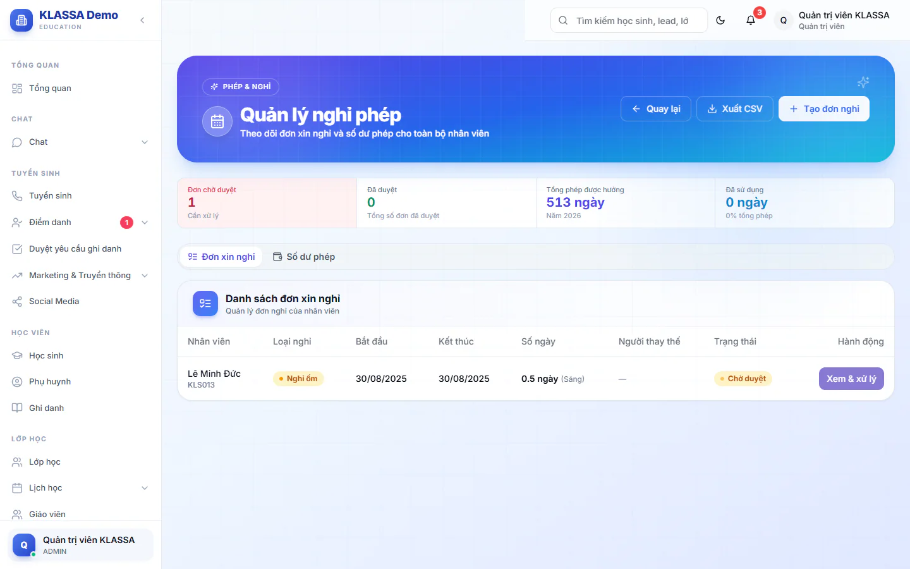

# Nghỉ phép

Trang này giúp bạn xử lý đơn xin nghỉ của nhân viên và theo dõi số ngày phép còn lại. Khi đơn được duyệt, số dư phép tự trừ và những ngày nghỉ được ghi vào bảng công, nên ngày nghỉ có lương được tính như ngày công khi tính lương.

Vào **Quản lý HR → Nghỉ phép**. Trang có hai tab: **Đơn xin nghỉ** và **Số dư phép**. Nhân viên tự nộp đơn ở Cổng nhân viên, mục **Nghỉ phép**. Đơn của nhân viên một phòng ban còn được trưởng phòng duyệt ở trang **Đội của tôi**.

## Duyệt hoặc từ chối đơn

::: steps
1. Vào tab **Đơn xin nghỉ**. Số **Đơn chờ duyệt** hiện ở đầu trang.
2. Ở dòng đơn **Chờ duyệt**, bấm **Xem & xử lý**. Hộp **Xử lý đơn nghỉ phép** hiện ra với ngày bắt đầu, kết thúc, số ngày, loại nghỉ, người thay thế và lý do.
3. Ghi **Ghi chú** nếu muốn (không bắt buộc).
4. Bấm **Duyệt** hoặc **Từ chối**.
:::

Bảng đơn có các cột **Nhân viên**, **Loại nghỉ**, **Bắt đầu**, **Kết thúc**, **Số ngày**, **Người thay thế**, **Trạng thái** và **Hành động**. Đơn nghỉ nửa ngày hiện thêm nhãn **(Sáng)** hoặc **(Chiều)**.

::: warning Không tự duyệt đơn của mình
Chỉ Quản trị viên được tự duyệt đơn của chính mình. Người khác cần nhờ quản lý khác duyệt.
:::

### Huỷ một đơn đã duyệt

Ở dòng đơn **Đã duyệt**, bấm **Huỷ duyệt**. Hệ thống hỏi xác nhận: số ngày phép đã trừ được hoàn lại và các ngày chấm công **Nghỉ phép** tương ứng bị gỡ.

## Tạo đơn hộ nhân viên

::: steps
1. Bấm **Tạo đơn nghỉ** ở góc trên. Hộp **Tạo đơn nghỉ phép** hiện ra.
2. Chọn **Nhân viên**.
3. Chọn **Loại nghỉ**: **Phép năm**, **Nghỉ ốm**, **Không lương**, **Thai sản**, **Công tác (không trừ phép)**, **Nghỉ chăm con** hoặc **Hiếu hỉ**.
4. Chọn **Thời lượng nghỉ**: **Cả ngày**, hoặc nghỉ nửa ngày buổi sáng hoặc buổi chiều (tính 0.5 ngày). Với nghỉ nửa ngày, chỉ chọn một **Ngày nghỉ**. Với cả ngày, chọn **Ngày bắt đầu** và **Ngày kết thúc**.
5. Chọn **Nhân viên thay thế** nếu có. Người thay thế phải khác người xin nghỉ.
6. Ghi **Lý do**.
7. Bấm **Gửi đơn**. Đơn vào trạng thái **Chờ duyệt**.
:::

Nếu số dư không đủ cho loại nghỉ đã chọn, đơn bị từ chối ngay khi gửi.

## Quản lý số dư phép

Vào tab **Số dư phép** để xem **Được hưởng**, **Đã dùng**, **Đang chờ**, **Còn lại** và **Chuyển từ năm trước** của từng người theo loại nghỉ.

### Khởi tạo số dư cho cả năm

::: steps
1. Ở tab **Số dư phép**, bấm **Khởi tạo số dư**. Hộp **Khởi tạo số dư phép** của năm hiện tại hiện ra.
2. Tích loại phép cần tạo: **Phép năm**, **Nghỉ ốm**, **Thai sản**. Với nghỉ ốm và thai sản, bạn nhập số ngày. Bỏ chọn loại mà trung tâm không theo dõi.
3. Bấm **Khởi tạo**.
:::

**Phép năm** tự tính theo Luật Lao động 2019: 12 ngày cộng 1 ngày mỗi 5 năm thâm niên. Người vào làm giữa năm được tính theo số tháng còn lại. Nhân viên đã có số dư thì giữ nguyên, không bị ghi đè.

### Sửa hoặc xoá số dư

- Bấm **Sửa** ở một dòng để đổi **Số ngày được hưởng** và **Chuyển từ năm trước**. Bấm **Lưu**.
- Bấm biểu tượng xoá để mở hộp **Xoá số dư phép**. Chọn **Xoá dòng này** (chỉ người đó) hoặc **Xoá cho tất cả nhân viên** (loại phép đó trong năm).

Người đã dùng hoặc đang chờ duyệt loại phép đó sẽ không bị xoá. Với họ, hãy bấm **Sửa** và đặt số ngày về 0.

## Xuất danh sách

Bấm **Xuất CSV** để tải danh sách đơn nghỉ về máy.

## Câu hỏi thường gặp

::: details Nghỉ không lương có bị trừ lương không?
Loại **Không lương** không nằm trong các loại nghỉ có lương, nên ngày đó không được tính là ngày công khi tính lương cho nhân viên toàn thời gian. Các loại như phép năm, nghỉ ốm, thai sản, hiếu hỉ và công tác được tính như ngày công.
:::

::: details Nghỉ phép và ca dạy của giáo viên liên quan thế nào?
Đơn nghỉ không tự đổi người dạy. Nếu giáo viên nghỉ vào ngày có buổi dạy, hãy làm [Dạy thay](dan-day-thay.md) cho buổi đó.
:::

::: details Nhân viên xem số dư của mình ở đâu?
Ở Cổng nhân viên, mục **Nghỉ phép**.
:::
