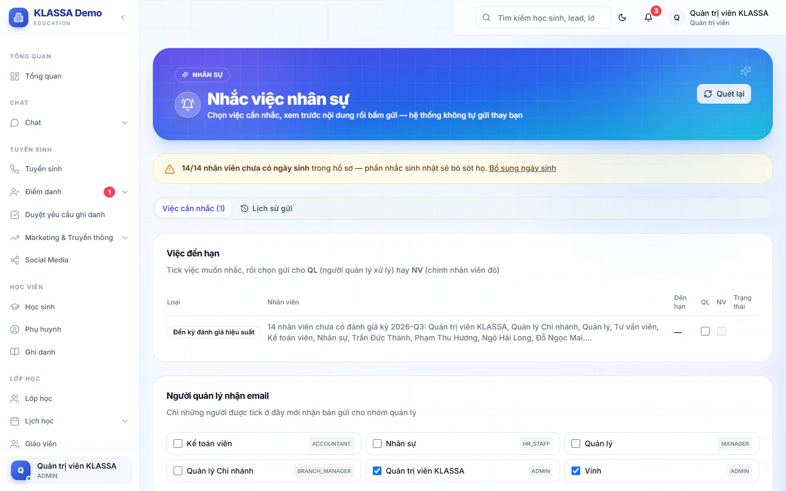

# Nhắc việc nhân sự

Trang này gom những việc nhân sự sắp đến hạn để bạn không bỏ sót: hết thử việc, hợp đồng, chứng chỉ, sinh nhật, kỳ đánh giá. Bạn chọn việc cần nhắc, xem trước nội dung rồi mới bấm gửi. Hệ thống không tự gửi thay bạn, trừ khi bạn tự bật chế độ tự động ở [Cấu hình nhân sự](cau-hinh-hr.md).

## Năm loại việc

| Loại việc | Khi nào xuất hiện |
|---|---|
| **Sắp hết thử việc** | Ngày hết thử việc trong 30 ngày tới |
| **Hợp đồng sắp hết hạn** | Hợp đồng hết hạn trong 30 ngày tới |
| **Chứng chỉ sắp hết hạn** | Chứng chỉ của nhân viên hết hạn trong 30 ngày tới |
| **Sinh nhật nhân viên** | Sinh nhật trong 7 ngày tới |
| **Đến kỳ đánh giá hiệu suất** | Đến kỳ đánh giá, tính cho cả phòng |

Nếu có nhân viên chưa khai ngày sinh, đầu trang hiện khung vàng cho biết số người thiếu. Bấm **Bổ sung ngày sinh** để mở danh sách nhân viên và điền.

## Chọn việc và gửi email

::: steps
1. Vào **Quản lý HR → Nhắc việc nhân sự**. Mở thẻ **Việc cần nhắc**.
2. Ở bảng **Việc đến hạn**, đọc từng dòng: **Loại**, **Nhân viên**, **Đến hạn** (kèm số ngày còn lại) và **Trạng thái**.
3. Tick **QL** để gửi cho người quản lý xử lý. Tick **NV** để gửi cho chính nhân viên đó.
4. Ở khung **Người quản lý nhận email**, tick những tài khoản sẽ nhận bản gửi cho nhóm quản lý.
5. Nếu muốn, tick **Gửi kèm tóm tắt vào nhóm Zalo nội bộ**.
6. Bấm **Xem trước**. Hộp **Xem trước ... email** hiện từng email với người nhận và tiêu đề.
7. Bấm nút **Gửi ... email** ngay trong hộp xem trước, hoặc bấm **Đóng** rồi bấm **Gửi** ở trang.
:::

Nút **Gửi** chỉ bấm được sau khi bạn đã **Xem trước** ít nhất một lần và có chọn ít nhất một việc.

Gửi xong, khung **Kết quả gửi** báo số **Thành công** và **Thất bại**. Dòng nào đã gửi trong ngày hiện dòng "đã gửi" kèm giờ và người gửi, để tránh gửi trùng.

::: warning Lưu ý
- Cột **NV** bị khoá nếu nhân viên chưa có email (dòng ghi **chưa có email NV**). Việc **Đến kỳ đánh giá hiệu suất** là việc của cả phòng nên không gửi riêng cho nhân viên.
- Nếu trung tâm chưa thiết lập gửi email, hộp xem trước báo chưa cấu hình và nút gửi bị khoá. Thiết lập ở phần Email trong mục **Tích hợp**.
:::

## Xem lại lịch sử

Mở thẻ **Lịch sử gửi** để xem **Lịch sử gửi nhắc việc**: ai gửi, gửi việc gì, cho ai, kết quả ra sao (số thành công, số thất bại).

## Chế độ tự động

Ngoài việc gửi tay ở đây, hệ thống còn gửi chuông và thông báo đẩy mỗi sáng cho người nhận nhắc việc. Công tắc **Tự động gửi email nhắc việc** và **Gửi nhắc việc HR vào nhóm Zalo** mặc định tắt, Quản trị viên bật ở [Cấu hình nhân sự](cau-hinh-hr.md).

::: tip Mẹo
Mỗi sáng, mở trang này một lần, tick các việc có chữ đỏ "còn 7n" trở xuống, xem trước rồi gửi. Chỉ mất một phút.
:::

## Câu hỏi thường gặp

::: details Tôi là Quản lý chi nhánh, thấy việc của cơ sở nào?
Chỉ cơ sở của bạn. Quản trị viên thấy mọi cơ sở.
:::

::: details Gửi nhầm thì thu hồi được không?
Không. Email đã gửi không thu hồi được. Đó là lý do hệ thống bắt xem trước trước khi gửi.
:::
