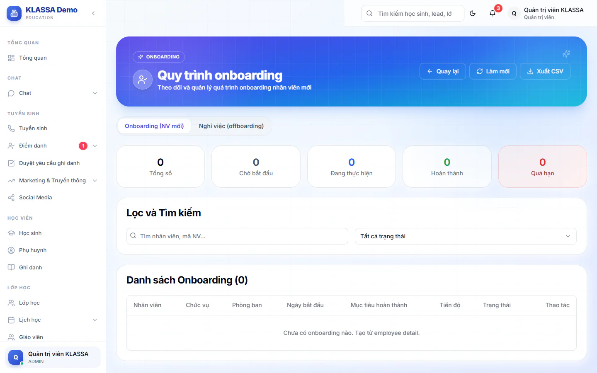

# Onboarding và nghỉ việc

Onboarding là danh sách việc cần làm để nhân viên mới vào việc suôn sẻ (cấp email, thiết bị, hướng dẫn, giấy tờ). Với người nghỉ việc, hệ thống có danh sách tương ứng để bàn giao và thu hồi. Bạn tick từng mục khi xong để theo dõi tiến độ.

## Tạo danh sách cho một nhân viên

Mỗi nhân viên có hai danh sách riêng: một cho lúc vào, một cho lúc nghỉ. Danh sách được tạo trong hồ sơ nhân viên.

::: steps
1. Vào **Quản lý HR → Nhân viên**, bấm biểu tượng con mắt (**Xem chi tiết**) ở dòng nhân viên.
2. Mở thẻ **Onboarding** (hoặc **Nghỉ việc** nếu người này sắp nghỉ).
3. Nếu chưa có danh sách, bấm **Tạo checklist onboarding mặc định** (hoặc **Tạo checklist nghỉ việc mặc định**). Danh sách nghỉ việc được hệ thống tự tạo ngay khi bạn chuyển hồ sơ sang **Đã nghỉ việc**, nên thường đã có sẵn.
4. Tick ô vuông ở từng mục khi đã làm xong. Thanh tiến độ và số mục hoàn thành cập nhật ngay.
:::

Bộ mục mặc định khi vào làm:

- **Tạo email công ty**
- **Cấp laptop/thiết bị**
- **Cấp quyền hệ thống**
- **Orientation training**
- **Assign mentor**
- **Setup bàn làm việc**
- **Tài liệu nhân viên**
- **Hoàn tất giấy tờ** (ký hợp đồng, đăng ký BHXH, mở tài khoản lương)
- **Kế hoạch thử việc**

Bộ mục mặc định khi nghỉ việc:

- **Exit interview**
- **Thu hồi thiết bị**
- **Khóa quyền truy cập**
- **Thanh toán lương cuối**
- **Giấy xác nhận**
- **Clearance form**
- **Chuyển giao công việc**
- **Exit survey**

Khi tick hết các mục, danh sách chuyển sang **Hoàn thành**.

::: warning Lưu ý
Tick một mục chỉ để đánh dấu, không tự làm việc đó. Riêng quyền đăng nhập thì hệ thống đã lo: khi bạn chuyển hồ sơ nhân viên sang trạng thái **Đã nghỉ việc**, tài khoản của người đó tự bị khoá và các phiên đăng nhập, thông báo trên điện thoại bị thu hồi, nên mục **Khóa quyền truy cập** chỉ cần tick lại cho đủ danh sách. Hệ thống cũng tự gỡ người đó khỏi các lớp họ dạy hoặc làm trợ giảng (phân công được đóng lại, buổi đã dạy trước ngày nghỉ vẫn được tính lương). Việc còn lại là giao lớp cho người mới để phụ huynh thấy đúng giáo viên: mở từng lớp người đó từng phụ trách và chọn người thay (xem [Chỉnh sửa lớp học](../lop-hoc/chinh-sua.md)). Mục **Chuyển giao công việc** trong danh sách chỉ để tick, không tự đổi giáo viên ở lớp.
:::

## Theo dõi chung tất cả nhân viên

::: steps
1. Vào **Quản lý HR → Onboarding**. Trang tên **Quy trình onboarding**.
2. Chọn thẻ **Onboarding (NV mới)** hoặc **Nghỉ việc (offboarding)**.
3. Xem các ô đếm: **Tổng số**, **Chờ bắt đầu**, **Đang thực hiện**, **Hoàn thành**, **Quá hạn**.
4. Tìm theo tên hoặc mã nhân viên, hoặc lọc theo **Trạng thái**.
:::

Bảng có các cột **Nhân viên**, **Chức vụ**, **Phòng ban**, **Ngày bắt đầu**, **Mục tiêu hoàn thành**, **Tiến độ** (thanh và số mục đã xong), **Trạng thái**.

Ở cuối mỗi dòng, biểu tượng con mắt mở hồ sơ nhân viên, thùng rác xoá danh sách. Ở đầu trang có **Làm mới**, **Xuất CSV** và **Quay lại**.

::: danger Không thể hoàn tác
Xoá một danh sách xoá cả tiến độ đã tick của nhân viên đó. Hệ thống hỏi xác nhận trước khi xoá. Bạn tạo lại được bản mặc định nhưng phải tick lại từ đầu.
:::

## Câu hỏi thường gặp

::: details Tôi có sửa được các mục trong danh sách không?
Không. Danh sách mặc định cố định như trên, bạn chỉ tick hoàn thành. Việc riêng của trung tâm có thể ghi ở [Giao việc](giao-viec.md).
:::

::: details Thêm nhân viên có tự tạo danh sách onboarding không?
Không. Bạn tạo danh sách trong thẻ **Onboarding** ở hồ sơ nhân viên như hướng dẫn trên.
:::
