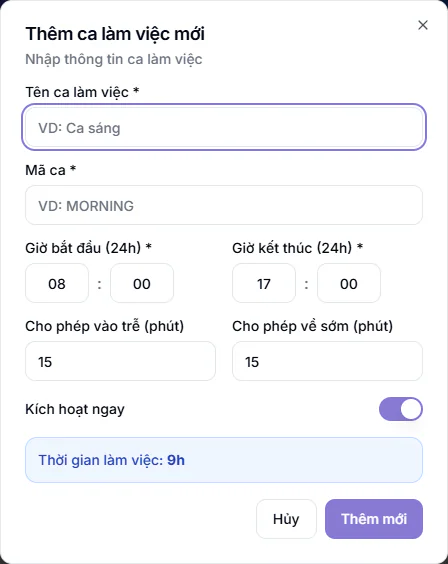
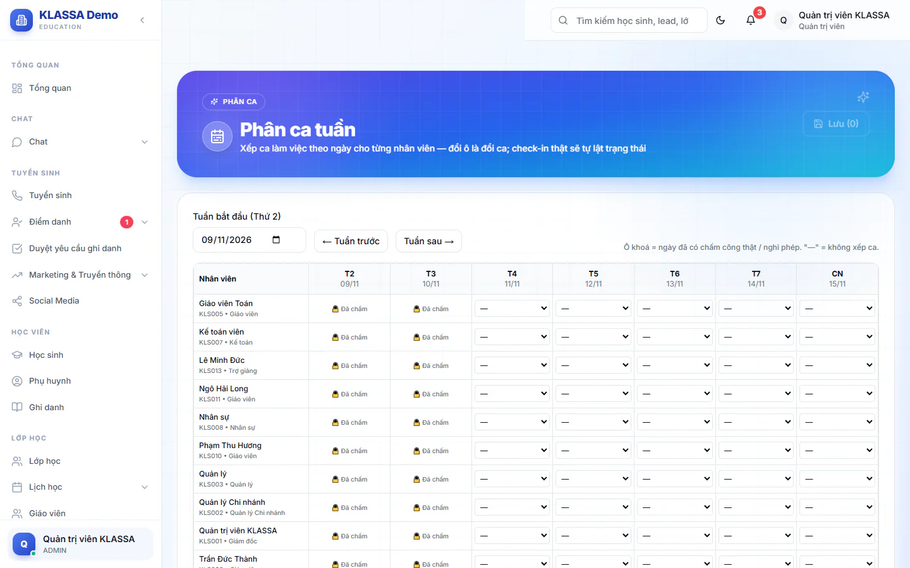

# Phân ca tuần

Nhân viên văn phòng làm theo ca cố định như ca sáng, ca hành chính. Trang này cho bạn xếp ca theo từng ngày của một tuần trên một lưới: mỗi dòng một nhân viên, mỗi cột một ngày. Ca được xếp là mốc để hệ thống xét đi muộn hoặc về sớm khi nhân viên chấm công.

Trang này khác với [Lịch ca lễ tân](lich-ca-le-tan.md): lễ tân bán thời gian tự đăng ký ca Sáng, Chiều, Tối rồi quản lý xếp ở trang đó. Giáo viên và trợ giảng không xếp ở đây, vì họ tính công theo buổi dạy.

## Khai các ca làm việc

Bạn cần có ca làm việc trước khi xếp.

::: steps
1. Vào **Quản lý HR → Cấu hình HR**, tab **Ca làm việc**.
2. Bấm **Thêm ca làm việc**.
3. Điền **Tên ca làm việc** (ví dụ "Ca sáng") và **Mã ca**. Cả hai bắt buộc.
4. Chọn **Giờ bắt đầu (24h)** và **Giờ kết thúc (24h)** (bắt buộc).
5. Điền **Cho phép vào trễ (phút)** và **Cho phép về sớm (phút)**. Ví dụ ca 8:00-17:00 cho phép vào trễ 15 phút thì nhân viên chấm đến 8:15 vẫn tính đúng giờ.
6. Giữ bật **Kích hoạt ngay** nếu muốn dùng ca ngay, rồi bấm **Thêm mới**.

   
:::

Bảng ca hiện **Tên ca**, **Mã**, **Giờ làm việc**, **Thời lượng** và **Trạng thái** (**Hoạt động** hoặc **Tạm dừng**). Chỉ ca **Hoạt động** mới hiện ra để xếp.

## Xếp ca cho một tuần

::: steps
1. Vào **Quản lý HR → Phân ca tuần**.
2. Ở ô **Tuần bắt đầu (Thứ 2)**, chọn ngày thứ Hai của tuần cần xếp. Dùng **Tuần trước** và **Tuần sau** để chuyển tuần.
3. Ở mỗi ô nhân viên và ngày, chọn một ca trong danh sách (hiện tên ca và giờ). Chọn dấu gạch ngang nghĩa là không xếp ca.
4. Bấm **Lưu**. Số ô đã đổi hiện trong ngoặc, ví dụ **Lưu (5)**.
:::

Lưới liệt kê nhân viên đang hoạt động. Một lần lưu tối đa 500 thay đổi.

::: warning Ô bị khoá
Ô có biểu tượng khoá là ngày đã có chấm công thật hoặc đã nghỉ phép (**Phép**, **C.tác**, **Đã chấm**). Bạn không đổi ca ở những ô này, và nếu có thay đổi nào bị bỏ qua thì hệ thống báo số ô bị bỏ qua lúc lưu.
:::

Khi nhân viên chấm công vào ngày đã xếp ca, ô chuyển từ lịch xếp sang trạng thái có mặt hoặc đi muộn tuỳ giờ chấm.

::: tip Mẹo
Cần xếp nhiều ngày giống nhau cho nhiều người thì dùng [Gợi ý Phân ca AI](de-xuat-xep-ca.md): hệ thống đề xuất sẵn, bạn chỉ chọn rồi bấm áp dụng.
:::

## Câu hỏi thường gặp

::: details Xếp ca có làm đổi lương không?
Không trực tiếp. Lương dựa trên chấm công và công chuẩn. Ca chỉ là mốc để xét đi muộn, về sớm.
:::

::: details Ca lễ tân lệch giờ theo cơ sở thì khai ở đâu?
Không tạo ca mới ở tab **Ca làm việc**. Khai ở tab **Ca lễ tân**, mục **Giờ riêng theo cơ sở / theo ngày**. Xem [Lịch ca lễ tân](lich-ca-le-tan.md).
:::

::: details Xoá được ca không?
Ở bảng ca, mỗi dòng có nút sửa và xoá. Hãy tạm dừng thay vì xoá nếu ca đã từng dùng.
:::
