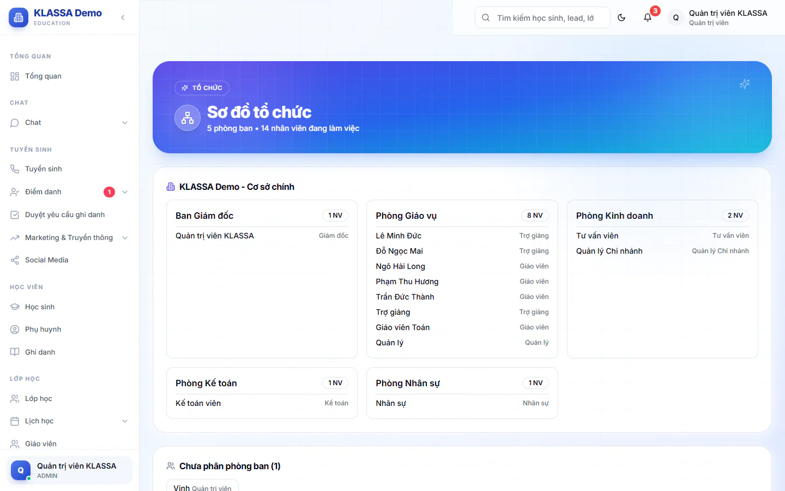

# Sơ đồ tổ chức

Trang này cho bạn nhìn toàn cảnh trung tâm: mỗi cơ sở có những phòng ban nào, ai làm trưởng phòng, ai thuộc phòng nào. Trang chỉ để xem, không có nút sửa.

## Xem sơ đồ

::: steps
1. Vào **Quản lý HR → Sơ đồ tổ chức**.
2. Dòng phụ đề ở đầu trang cho biết số phòng ban và số nhân viên đang làm việc.
3. Mỗi cơ sở là một khung riêng. Trong khung là các thẻ phòng ban, mỗi thẻ ghi tên phòng, số nhân viên (**NV**), dòng **Trưởng phòng** và danh sách nhân viên kèm chức vụ.
4. Bấm tên một nhân viên để mở [hồ sơ chi tiết](danh-sach-nhan-vien.md).
:::

Phòng ban không gắn với cơ sở nào được xếp vào khung **Toàn trung tâm**. Nhân viên chưa có phòng ban nằm ở khung **Chưa phân phòng ban** ở cuối trang, ghi kèm số người.

Chỉ nhân viên đang làm việc mới hiện trên sơ đồ. Người đã nghỉ việc không xuất hiện.

## Muốn đổi sơ đồ thì làm ở đâu

- Thêm, đổi tên phòng ban, chọn trưởng phòng: [Cấu hình nhân sự](cau-hinh-hr.md).
- Chuyển nhân viên sang phòng khác: sửa hồ sơ ở [Danh sách nhân viên](danh-sach-nhan-vien.md) và chọn lại **Phòng ban**.

::: tip Mẹo
Dòng **Trưởng phòng** chỉ hiện khi phòng đã có trưởng phòng. Người này cũng là người duyệt phép và tăng ca của phòng ở trang [Đội của tôi](doi-nhom.md).
:::

## Câu hỏi thường gặp

::: details Nhân viên của tôi nằm ở "Chưa phân phòng ban", sửa thế nào?
Mở hồ sơ nhân viên, bấm sửa và chọn **Phòng ban**, rồi bấm **Cập nhật**.
:::

::: details Trưởng phòng không hiện tên?
Tên chỉ hiện khi người được chọn làm trưởng phòng còn nằm trong danh sách nhân viên đang làm việc. Kiểm tra lại ở thẻ **Phòng ban** trong [Cấu hình nhân sự](cau-hinh-hr.md).
:::
