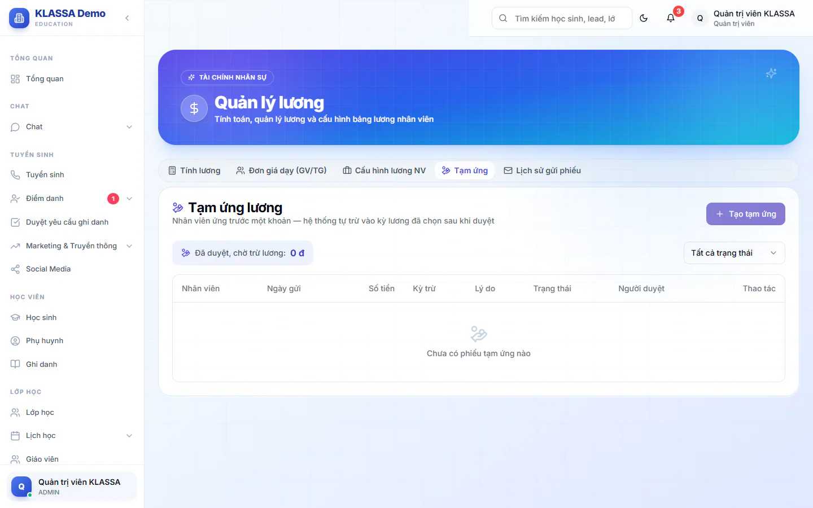

# Tạm ứng lương

Khi nhân viên ứng trước một khoản lương, bạn ghi lại bằng một phiếu tạm ứng. Sau khi phiếu được duyệt, khoản này tự trừ vào phiếu lương của kỳ bạn chọn, nên không phải nhớ trừ tay.

Vào **Quản lý HR → Quản lý lương**, tab **Tạm ứng**. Tab cần cả hai gói mở rộng **Nhân sự (HRIS)** và **Lương giáo viên**.

## Tạo phiếu tạm ứng

::: steps
1. Ở tab **Tạm ứng**, bấm **Tạo tạm ứng**. Hộp **Tạo phiếu tạm ứng** hiện ra.
2. Chọn **Nhân viên** (bắt buộc).
3. Nhập **Số tiền (VND)** lớn hơn 0 (bắt buộc).
4. Chọn **Kỳ lương sẽ trừ** theo tháng (bắt buộc).
5. Ghi **Lý do** nếu muốn.
6. Bấm **Tạo phiếu**. Phiếu hiện trong danh sách với trạng thái **Chờ duyệt**.
:::

Ở màn này, phiếu do người quản trị nhập hộ nhân viên.

## Duyệt hoặc từ chối

Ở dòng của phiếu **Chờ duyệt** có ba nút: duyệt, từ chối và xoá. Bấm duyệt hoặc từ chối, hệ thống hỏi lại số tiền, tên nhân viên và kỳ trừ, bạn xác nhận để hoàn tất.

| Trạng thái | Ý nghĩa |
|------------|---------|
| **Chờ duyệt** | Mới tạo. Còn xoá được. |
| **Đã duyệt** | Sẽ trừ vào kỳ lương đã chọn. Số liệu bị khoá. |
| **Từ chối** | Không trừ. |
| **Đã trừ lương** | Phiếu lương của nhân viên đã được ghi là đã chuyển khoản, khoản đã trừ thật. |

Ở đầu bảng có số tổng **Đã duyệt, chờ trừ lương**. Dùng ô trạng thái để lọc theo từng nhóm.

::: warning Không tự duyệt phiếu của mình
Quản lý chi nhánh không duyệt được phiếu tạm ứng của chính mình, cũng không sửa được số tiền hoặc kỳ trừ của phiếu đó. Hãy nhờ người khác duyệt. Quản trị viên không bị giới hạn này.
:::

## Khoản tạm ứng xuất hiện trên phiếu lương thế nào

Khi bạn tính hoặc tính lại kỳ lương, mỗi phiếu tạm ứng **Đã duyệt** của kỳ đó thành một dòng khấu trừ **Khấu trừ: Tạm ứng lương** (kèm lý do) trên phiếu lương của nhân viên. Phiếu PDF và email hiện đúng dòng này.

Khi phiếu lương của nhân viên được đánh dấu đã chuyển khoản, hoặc khi bạn bấm **Xác nhận chi trả** cho cả kỳ, các phiếu tạm ứng đã duyệt tương ứng chuyển sang **Đã trừ lương**. Nếu bạn bỏ đánh dấu chuyển khoản của một phiếu lương, khoản tạm ứng đó trở về **Đã duyệt**.

::: tip Mẹo
Duyệt tạm ứng trước khi tính lương của tháng cần trừ. Nếu duyệt sau, hãy bấm **Tính lại riêng người này** ở phiếu của nhân viên đó để dòng khấu trừ xuất hiện. Xem [Quản lý lương](bang-luong.md).
:::

## Câu hỏi thường gặp

::: details Phiếu đã duyệt nhập sai số tiền thì sao?
Phiếu đã duyệt không sửa và không xoá được, để còn đối soát. Bạn có thể sửa trực tiếp dòng khấu trừ trên phiếu lương của kỳ đó, hoặc tạo phiếu bù nếu cần.
:::

::: details Tạm ứng trừ vào tháng sau được không?
Được. Ô **Kỳ lương sẽ trừ** cho chọn bất kỳ tháng nào, khoản sẽ trừ vào kỳ lương của tháng đó.
:::
