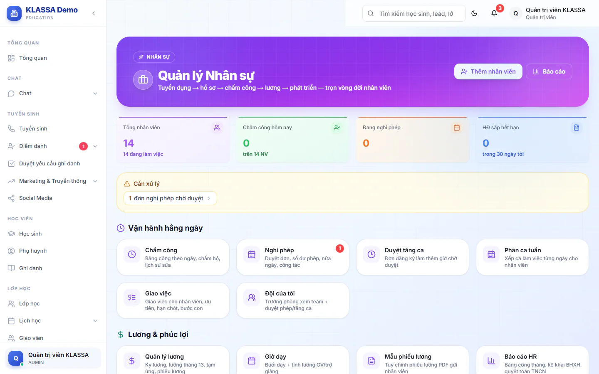

# Tổng quan nhân sự

Đây là trang bạn mở đầu tiên mỗi sáng để biết hôm nay nhân sự có việc gì cần xử lý. Từ đây bạn nhảy được tới mọi chức năng nhân sự mà không phải tìm trong menu.

Khu này cần gói mở rộng **Nhân sự (HRIS)**. Chỉ Quản trị viên và Quản lý chi nhánh vào được. Các vai khác dùng [Cổng nhân viên](../cong-nhan-vien/gioi-thieu.md) cho việc của riêng mình.

Trong menu **Quản lý HR**, mục nào thuộc gói trung tâm chưa có thì không hiện. **Quản lý lương** và **Mẫu phiếu lương** thuộc gói **Lương giáo viên**, **Giao việc** thuộc gói **Giao việc Nội bộ**, các trang AI nhân sự thuộc gói **AI — Gợi ý & Trợ lý Vận hành**, còn lại thuộc gói **Nhân sự (HRIS)**. Mục **Dạy thay** luôn hiện.

## Mở trang tổng quan

::: steps
1. Vào **Quản lý HR → Dashboard HR**. Tiêu đề trang là **Quản lý Nhân sự**.
2. Xem bốn ô số liệu ở đầu trang.
3. Nếu có ô vàng **Cần xử lý**, bấm vào từng mục để mở đúng trang xử lý.
4. Kéo xuống để chọn chức năng trong bốn nhóm.
:::

## Bốn ô số liệu

| Ô | Cho biết |
|---|---|
| **Tổng nhân viên** | Tổng số hồ sơ, kèm số người đang làm việc |
| **Chấm công hôm nay** | Số người đã chấm công trong ngày, trên tổng số đang làm việc |
| **Đang nghỉ phép** | Số người đang trong kỳ nghỉ phép |
| **HĐ sắp hết hạn** | Số hợp đồng hết hạn trong 30 ngày tới |

## Dải "Cần xử lý"

Dải này chỉ hiện những mục đang có việc thật. Mỗi mục là một nút bấm được:

- Đơn nghỉ phép chờ duyệt.
- Đơn tăng ca chờ duyệt.
- Yêu cầu đổi hồ sơ chờ duyệt, xem [Yêu cầu chỉnh hồ sơ](yeu-cau-chinh-ho-so.md).
- Nhân viên hết thử việc trong 7 ngày.
- Hợp đồng hết hạn trong 30 ngày, xem [Hợp đồng lao động](hop-dong.md).

Không có việc nào thì dải này không hiện.

## Bốn nhóm chức năng

Mỗi thẻ là một lối tắt, có chấm đỏ báo số việc đang chờ ở những thẻ có việc duyệt.

- **Vận hành hằng ngày**: **Chấm công**, **Nghỉ phép**, **Duyệt tăng ca**, **Phân ca tuần**, **Giao việc**, **Đội của tôi**.
- **Lương & phúc lợi**: **Quản lý lương**, **Giờ dạy**, **Mẫu phiếu lương**, **Báo cáo HR**.
- **Nhân sự & phát triển**: **Nhân viên**, **Tuyển dụng**, **Hợp đồng lao động**, **Onboarding**, **Đánh giá hiệu suất**, **Yêu cầu hồ sơ**, **Sơ đồ tổ chức**.
- **Công cụ & AI**: **Cấu hình HR**, **Lịch nghỉ lễ**, **Kiểm tra lương AI**, **Gợi ý phân ca AI**, **Rủi ro nghỉ việc**, **Dạy thay**.

Hai nút ở đầu trang giúp đi nhanh: **Thêm nhân viên** mở trang **Nhân viên**, **Báo cáo** mở **Báo cáo HR**.

::: tip Mẹo
Thẻ **Nhân viên** có chấm đỏ khi có người sắp hết thử việc. Bấm vào để xem danh sách và quyết định có ký hợp đồng chính thức hay không.
:::

## Các bài liên quan

- [Danh sách nhân viên](danh-sach-nhan-vien.md)
- [Tuyển dụng](tuyen-dung.md)
- [Hợp đồng lao động](hop-dong.md)
- [Cấu hình nhân sự](cau-hinh-hr.md)

## Câu hỏi thường gặp

::: details Quản lý (vai Quản lý) có vào được trang này không?
Không. Trong menu **Quản lý HR**, vai Quản lý chỉ thấy **Dạy thay** (luôn hiện), **Giao việc** (cần gói **Giao việc Nội bộ**), **Đội của tôi** và **Lịch ca lễ tân** (cần gói **Nhân sự (HRIS)**). **Lịch ca lễ tân** chỉ mở được khi bạn đã được thêm vào danh sách **Người được xếp & quản lý ca lễ tân**. Mục **Quản lý Truyền thông** nằm ở nhóm **Chat** và cần gói **Quản lý Truyền thông**. Quản trị viên và Quản lý chi nhánh mới mở được trang tổng quan.
:::

::: details Nhân viên hết thử việc được tính theo ngày nào?
Trang cảnh báo những người có ngày hết thử việc trong 7 ngày tới. Ngày này lấy từ hồ sơ nhân viên, xem [Danh sách nhân viên](danh-sach-nhan-vien.md).
:::
