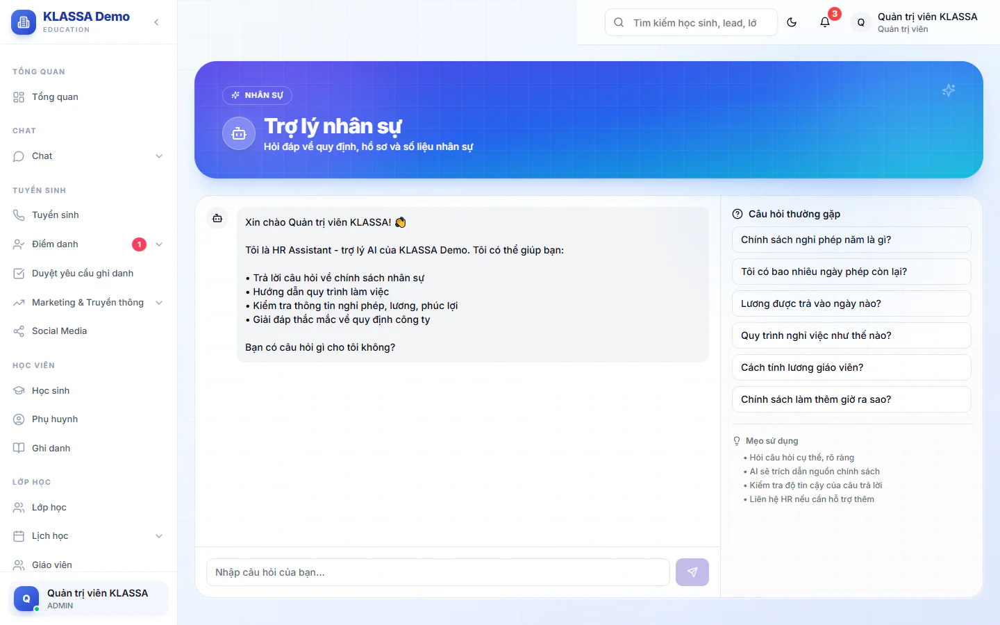

# Trợ lý nhân sự (HR AI Assistant)

Trợ lý trả lời câu hỏi về chính sách và quy trình nhân sự bằng ngôn ngữ thường ngày, ví dụ chính sách nghỉ phép, ngày trả lương, quy trình nghỉ việc. Câu trả lời dựa trên tài liệu chính sách trung tâm đã nạp và có ghi nguồn để bạn kiểm tra.

Cần gói mở rộng **AI — Gợi ý & Trợ lý Vận hành**. Trợ lý chỉ trả lời, không tự làm thay: nó không tạo đơn, không gửi email, không sửa dữ liệu.

## Đặt câu hỏi

::: steps
1. Vào **Quản lý HR → HR AI Assistant**. Tiêu đề trang là **Trợ lý nhân sự**.
2. Gõ câu hỏi vào ô **Nhập câu hỏi của bạn...** rồi bấm nút gửi. Hoặc bấm một câu trong khung **Câu hỏi thường gặp** bên cạnh.
3. Đợi dòng "Đang suy nghĩ..." biến mất rồi đọc câu trả lời.
4. Xem phần **Nguồn tham khảo** và **Độ tin cậy** (Cao, Trung bình, Thấp) dưới câu trả lời.
:::

Các câu gợi ý có sẵn:

- Chính sách nghỉ phép năm là gì?
- Tôi có bao nhiêu ngày phép còn lại?
- Lương được trả vào ngày nào?
- Quy trình nghỉ việc như thế nào?
- Cách tính lương giáo viên?
- Chính sách làm thêm giờ ra sao?

Trợ lý cũng đọc được một phần dữ liệu nhân viên (như số ngày phép) để trả lời, trong phạm vi quyền của người đang đăng nhập.

## Nội dung chính sách lấy ở đâu

Trợ lý tra trong nhóm tài liệu chính sách nhân sự của **Kho tri thức** thuộc AI Hub. Muốn trợ lý trả lời đúng quy định của trung tâm bạn, hãy thêm hoặc sửa tài liệu ở đó. Xem [Kho tri thức](../ai-hub/knowledge.md). Nội dung bạn sửa có hiệu lực ngay cho các câu hỏi sau.

::: tip Mẹo
Hỏi cụ thể, một ý một câu. Câu như "Nhân viên bán thời gian nghỉ ốm có được trả lương không?" cho kết quả tốt hơn câu "Chế độ nghỉ thế nào?".
:::

::: warning Lưu ý
Hãy luôn xem **Độ tin cậy** và **Nguồn tham khảo**. Câu trả lời độ tin cậy thấp hoặc không có nguồn nghĩa là kho tri thức chưa có tài liệu phù hợp. Khi đó hãy đối chiếu quy chế thật hoặc hỏi người phụ trách nhân sự.
:::

## Câu hỏi thường gặp

::: details Lịch sử trò chuyện có được lưu không?
Không. Đóng hoặc tải lại trang thì cuộc trò chuyện mất, bạn bắt đầu lại từ lời chào.
:::

::: details Nhân viên có dùng được trợ lý này không?
Không. Trang này chỉ dành cho Quản trị viên và Quản lý chi nhánh.
:::

::: details Muốn trợ lý tính lương hay soạn văn bản thì sao?
Trợ lý này chỉ hỏi đáp chính sách. Tính lương làm ở [Quản lý lương](bang-luong.md).
:::
