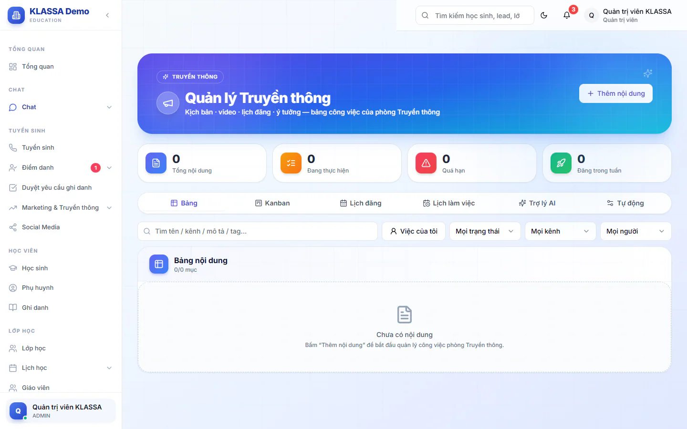
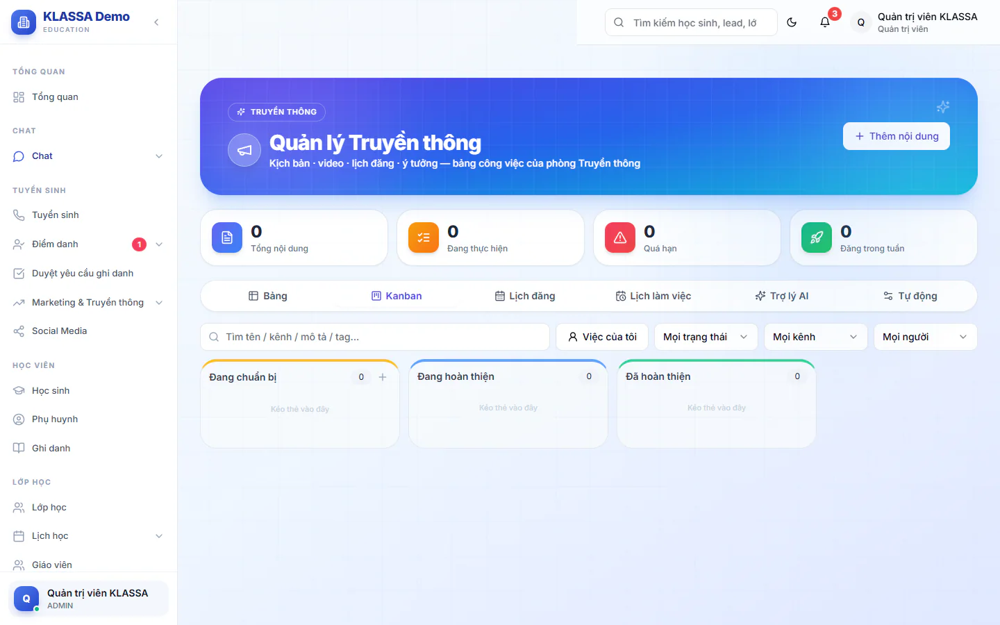

# Quản lý Truyền thông

Trang này là bảng làm việc của phòng Truyền thông: mỗi video, bài đăng hay kịch bản là một "nội dung" có người phụ trách, hạn hoàn thành và lịch đăng. Bạn xem được dưới dạng bảng, kanban hoặc lịch.

Cần gói mở rộng **Quản lý Truyền thông**. Quản trị viên, Quản lý chi nhánh và Quản lý luôn vào được. Nhân viên khác chỉ vào được khi hồ sơ nằm trong phòng ban được chọn là phòng Truyền thông (xem phần Tự động bên dưới).

## Thêm một nội dung

::: steps
1. Vào **Quản lý Truyền thông** trong menu, bấm **Thêm nội dung**. Hộp **Thêm nội dung** hiện ra.
2. Gõ **Tên nội dung** (bắt buộc).
3. Chọn **Dạng** (Giảng bài, Reel, Hậu trường, Review, Thông báo, Khác), **Ưu tiên** (**Cao**, **Vừa**, **Thấp**), **Trạng thái** và **Kênh đăng**.
4. Chọn **Người phụ trách**, **Hạn hoàn thành** và **Lịch đăng** (ngày giờ).
5. Điền **Yêu cầu / mô tả ngắn** rồi bấm nút tạo.
:::

Ba trạng thái mặc định: **Đang chuẩn bị**, **Đang hoàn thiện**, **Đã hoàn thiện**. Trạng thái cuối được tính là xong.

## Các thẻ làm việc

| Thẻ | Dùng để |
|---|---|
| **Bảng** | Xem mọi nội dung dạng bảng, đổi nhanh trạng thái và người phụ trách ngay trên dòng. Cột gồm **Nội dung**, **Dạng**, **Trạng thái**, **Kênh**, **Brief / Ý tưởng**, **Đạo cụ**, **Drive**, **Thành viên**, **Phụ trách**, **Hạn**, **Đăng** |
| **Kanban** | Kéo thả thẻ nội dung giữa các cột trạng thái |
| **Lịch đăng** | Xem hôm nào đăng gì trên kênh nào |
| **Lịch làm việc** | Xem **Ca trực phòng Truyền thông** từng tuần, kèm tình trạng Có mặt, Muộn, Nghỉ phép, Vắng. Dùng nút lùi, tiến và **Tuần này** để chuyển tuần |
| **Trợ lý AI** | Chat, lập kế hoạch và gợi ý ý tưởng bằng AI |
| **Tự động** | Cấu hình phòng ban, kho Drive, nhắc hạn (chỉ quản lý thấy) |

Ở đầu trang có bốn ô: **Tổng nội dung**, **Đang thực hiện**, **Quá hạn**, **Đăng trong tuần**. Trên thẻ **Bảng** và **Kanban** có ô tìm và bộ lọc theo trạng thái, kênh, thành viên, tag, và nút **Việc của tôi** để chỉ xem việc mình phụ trách.

## Mở chi tiết một nội dung

Bấm vào một nội dung để mở ngăn chi tiết bên phải. Trong đó bạn sửa:

- Thông tin chung: **Dạng**, **Trạng thái**, **Ưu tiên**, **Kênh đăng**, **Người phụ trách**, **Người duyệt**, **Hạn hoàn thành**, **Lịch đăng**, **Thành viên tham gia**.
- **Yêu cầu / mô tả**, **Đạo cụ**, **Link tham khảo**, **Link Drive video**, **Link Google Drive / Docs / Sheets** (bấm **Thêm link Drive**). Hãy dán link đã cấp quyền sửa để cả nhóm cùng làm trong Drive.
- **Kịch bản**: soạn trực tiếp. Bấm **AI viết kịch bản** để AI soạn nháp từ tên nội dung.
- **Ghi chú** và **Checklist công đoạn** (quay, dựng, duyệt, đăng): tick từng bước.
- **Bình luận**: gõ `@` để nhắc tên một người.

Bấm lưu để giữ thay đổi. Nút **Xoá** xoá nội dung sau khi bạn xác nhận.

## Trợ lý AI

Thẻ **Trợ lý AI** có ba chế độ: **Trợ lý chat**, **Kế hoạch nội dung** và **Ý tưởng**. Cần gói **Nền tảng AI** và đã cấu hình khoá AI của trung tâm.

- **Ý tưởng**: nhập chủ đề và kênh, bấm **Gợi ý**. Với mỗi gợi ý, bấm **Lưu** (vào kho ý tưởng), **Tạo** (thành nội dung ngay), **Phát triển** (AI viết sẵn kịch bản, caption, checklist) hoặc **Đa kênh** (tạo bản cho từng kênh). Trong **Kho ý tưởng**, bấm **Thành nội dung** để đưa một ý tưởng lên bảng.
- **Kế hoạch nội dung**: nhập **Mục tiêu chiến dịch**, chọn số ngày (7, 14 hoặc 30) và kênh ưu tiên, bấm **Lập kế hoạch**. Tick những mục muốn giữ rồi bấm nút tạo để đưa lên **Bảng** và **Lịch đăng**.

::: tip Mẹo
Nội dung AI viết chỉ là bản nháp. Hãy đọc và sửa lại cho đúng giọng của trung tâm trước khi đăng.
:::

## Cấu hình phòng, kho Drive và nhắc hạn

Thẻ **Tự động** chỉ Quản trị viên, Quản lý chi nhánh và Quản lý thấy.

::: steps
1. Ở khung **Phòng Truyền thông**, chọn phòng ban được tính là phòng Truyền thông. Nhân sự thuộc phòng này vào được trang và nhận nhắc việc.
2. Ở khung **Kho Drive phòng Truyền thông**, dán link thư mục Drive gốc. Khi có link, nút **Kho Drive** hiện ở đầu trang để cả nhóm xem ngay.
3. Ở khung **Nhắc deadline & lịch đăng**, bật **Bật nhắc việc tự động**, chọn kênh gửi (**Thông báo app** và/hoặc **Zalo nhóm**) và **Giờ nhắc mỗi ngày**.
4. Nếu gửi Zalo, chọn **Tài khoản Zalo gửi** và **Nhóm Zalo nhận nhắc việc**. Cần đăng nhập Zalo cá nhân trước, xem [Zalo](../tin-nhan/zalo.md).
5. Bấm lưu. Bấm nút gửi thử để kiểm tra, kết quả cho biết số việc, số người và kênh đã gửi.
:::

Mặc định nhắc việc bật, kênh thông báo trong app bật, kênh Zalo tắt, giờ nhắc 8 giờ sáng.

## Câu hỏi thường gặp

::: details Nhân viên của tôi không thấy mục này trong menu?
Menu hiện cho nhiều vai nhưng trang chỉ mở với quản lý hoặc người thuộc phòng Truyền thông. Chọn đúng phòng ban ở thẻ **Tự động**, và kiểm tra hồ sơ nhân viên đã gắn phòng ban đó trong [Danh sách nhân viên](danh-sach-nhan-vien.md).
:::

::: details Khác gì Giao việc nội bộ?
[Giao việc](giao-viec.md) dùng cho việc chung giữa các nhân viên. Trang này chuyên cho nội dung truyền thông, có kịch bản, lịch đăng và kanban riêng.
:::
