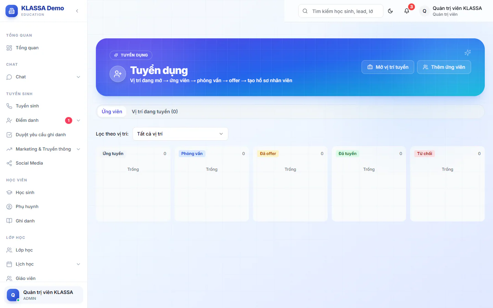

# Tuyển dụng

Trang này giúp bạn quản lý chuyện tuyển người: mở vị trí, ghi nhận ứng viên, đưa họ qua từng giai đoạn và khi chốt tuyển thì tạo luôn hồ sơ nhân viên. Mọi ứng viên do bạn nhập tay, trang không có biểu mẫu công khai cho ứng viên tự điền.

## Mở một vị trí tuyển

::: steps
1. Vào **Quản lý HR → Tuyển dụng**.
2. Bấm **Mở vị trí tuyển**. Hộp **Mở vị trí tuyển dụng** hiện ra.
3. Điền **Tên vị trí** (bắt buộc).
4. Ở ô **Chức vụ tương ứng (dùng khi tạo hồ sơ NV)**, chọn chức vụ nếu đã biết. Có thể để **Chọn sau**.
5. Điền **Khoảng lương** (ví dụ 8-12 triệu), **Số lượng cần** và **Mô tả**.
6. Bấm **Tạo vị trí**.
:::

Thẻ **Vị trí đang tuyển** liệt kê vị trí kèm số người cần, khoảng lương, số ứng viên và số người đã tuyển. Mỗi vị trí có nút **Đóng vị trí** (đổi thành **Mở lại** khi đã đóng) và nút thùng rác.

::: danger Không thể hoàn tác
Xoá một vị trí xoá luôn toàn bộ ứng viên của vị trí đó. Hệ thống hỏi xác nhận và ghi rõ số ứng viên sẽ mất. Muốn dừng tuyển mà vẫn giữ lịch sử, hãy dùng **Đóng vị trí**.
:::

## Thêm ứng viên

::: steps
1. Bấm **Thêm ứng viên**. Hộp **Thêm ứng viên** hiện ra.
2. Chọn **Vị trí ứng tuyển** (chỉ liệt kê vị trí đang tuyển) và điền **Họ tên**. Hai ô này bắt buộc.
3. Điền **Điện thoại**, **Email**, **Nguồn** (ví dụ Facebook, giới thiệu, TopCV) và **Ghi chú** nếu có.
4. Bấm **Thêm ứng viên**.
:::

## Đưa ứng viên qua các giai đoạn

Thẻ **Ứng viên** chia thành năm cột: **Ứng tuyển**, **Phỏng vấn**, **Đã offer**, **Đã tuyển**, **Từ chối**. Mỗi ứng viên là một thẻ nhỏ ghi tên, vị trí, điện thoại và ghi chú. Dùng ô **Lọc theo vị trí** để xem một vị trí.

Cách chuyển giai đoạn là bấm nút trên thẻ, không phải kéo thả:

- **Tiến bước** chuyển sang giai đoạn kế (Ứng tuyển, Phỏng vấn, Đã offer).
- **Lùi bước** quay lại giai đoạn trước.
- **Từ chối** (thùng rác đỏ) chuyển ứng viên sang cột **Từ chối** sau khi bạn xác nhận.
- **Chốt tuyển** chỉ hiện ở cột **Đã offer**.

## Chốt tuyển và tạo hồ sơ nhân viên

::: steps
1. Ở thẻ ứng viên trong cột **Đã offer**, bấm **Chốt tuyển**. Hộp **Chốt tuyển** kèm tên ứng viên hiện ra.
2. Chọn **Chức vụ** (bắt buộc, tự điền nếu vị trí tuyển đã gắn chức vụ).
3. Chọn **Loại hình**: **Thử việc**, **Toàn thời gian** hoặc **Bán thời gian**.
4. Chọn **Ngày vào làm**. Ô **Hết thử việc** để trống thì hệ thống tính thêm 2 tháng.
5. Nhập **Lương cơ bản (VNĐ)**, bấm **Tạo hồ sơ nhân viên**.
:::

Ứng viên chuyển sang cột **Đã tuyển** và có liên kết **Xem hồ sơ NV**. Nếu ứng viên có email, hệ thống tạo luôn tài khoản đăng nhập với mật khẩu mặc định chung của hệ thống, bắt đổi khi vào lần đầu. Hãy đặt lại mật khẩu riêng cho người đó ở **Quản lý Users** rồi mới báo họ đăng nhập.

::: warning Lưu ý
Chốt tuyển chỉ tạo hồ sơ nhân viên. Việc ký hợp đồng và danh sách hội nhập bạn làm tiếp ở [Hợp đồng lao động](hop-dong.md) và [Onboarding](onboarding.md). Ứng viên đã có hồ sơ thì không chốt lại được.
:::

## Câu hỏi thường gặp

::: details Ứng viên đã bị từ chối có đưa lại được không?
Thẻ ở cột **Từ chối** không còn nút chuyển giai đoạn. Bạn thêm lại họ bằng **Thêm ứng viên** nếu muốn xét lần nữa.
:::

::: details Có gửi thư mời nhận việc (offer) cho ứng viên từ đây không?
Không. **Đã offer** chỉ là nhãn giai đoạn để bạn theo dõi, trang không gửi thư.
:::
