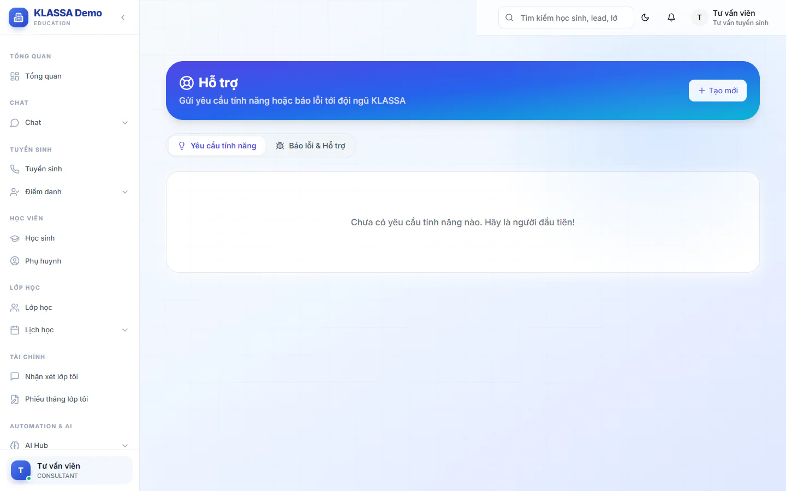
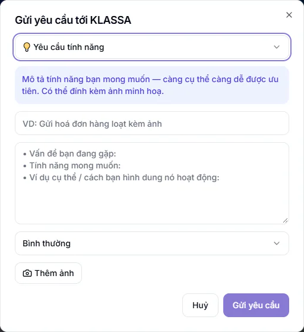

# Gửi yêu cầu hỗ trợ tới KLASSA

Khi gặp lỗi hoặc muốn có thêm một tính năng, bạn gửi thẳng cho đội ngũ KLASSA từ trang **Hỗ trợ**, không cần gọi hay nhắn riêng. Mỗi yêu cầu có trạng thái và luồng trao đổi để bạn theo dõi câu trả lời.

Phụ huynh và học sinh không có mục này. Họ nhờ trung tâm hỗ trợ.

## Gửi một yêu cầu mới

::: steps
1. Vào **Hỗ trợ** trong menu. Có hai tab: **Yêu cầu tính năng** và **Báo lỗi & Hỗ trợ**.
   
   
2. Bấm **Tạo mới**. Hộp **Gửi yêu cầu tới KLASSA** hiện ra.
   
   
3. Chọn loại: **Yêu cầu tính năng** hoặc **Báo lỗi & Hỗ trợ**.
4. Nhập tiêu đề (bắt buộc), ví dụ "Bấm xuất PDF báo lương bị trắng trang".
5. Viết nội dung (bắt buộc). Ô nội dung hiện sẵn các gạch đầu dòng gợi ý (chữ mờ, biến mất khi bạn gõ), hãy viết theo các ý đó.
6. Chọn mức ưu tiên: **Thấp**, **Bình thường** (mặc định), **Cao** hoặc **Khẩn (đang chặn công việc)**.
7. Bấm **Thêm ảnh** nếu có ảnh chụp màn hình. Mỗi ảnh tối đa 5MB, tối đa 5 ảnh.
8. Bấm **Gửi yêu cầu**. Thông báo "Đã gửi tới KLASSA" hiện ra.
:::

Với **Báo lỗi & Hỗ trợ**, nội dung nên có đủ: bạn đang làm gì ở trang nào, kết quả mong đợi, kết quả thực tế (báo lỗi gì), các bước để tái hiện và ảnh chụp màn hình. Càng đủ, bạn càng được trả lời nhanh.

::: tip Mẹo
Chỉ chọn **Khẩn** khi công việc đang bị chặn hẳn, ví dụ không đăng nhập được hoặc không xuất được phiếu học phí đang cần gửi.
:::

## Theo dõi và trao đổi

::: steps
1. Ở trang **Hỗ trợ**, bấm vào yêu cầu bạn đã gửi.
2. Xem trạng thái cạnh tiêu đề: **Mới**, **Đang xử lý**, **Đã xong** hoặc **Đã đóng**.
3. Câu trả lời của đội ngũ hiện trong luồng bình luận, ghi tên **KLASSA Support**.
4. Muốn bổ sung thông tin, viết vào ô **Viết bình luận / bổ sung thông tin...**, bấm **Ảnh** nếu cần đính kèm, rồi bấm **Gửi**.
:::

Bấm **Quay lại** để về danh sách.

## Ai thấy yêu cầu nào

- Tab **Yêu cầu tính năng**: mọi người dùng trong trung tâm đều xem được. Bấm biểu tượng ngón tay cái bên trái để bình chọn cho yêu cầu bạn cũng cần. Bấm lần nữa để bỏ bình chọn.
- Tab **Báo lỗi & Hỗ trợ**: nhân viên chỉ thấy yêu cầu do mình gửi. Quản trị viên, Quản lý chi nhánh và Quản lý thấy tất cả.

## Câu hỏi thường gặp

::: details Tôi cần trả lời gấp, có kênh nào khác không?
Xem [Liên hệ hỗ trợ](../faq/lien-he.md) để lấy email của đội ngũ.
:::

::: details Gửi nhầm thì sao, có sửa hoặc xoá được không?
Trang không có nút sửa hay xoá yêu cầu. Hãy viết thêm một bình luận trong yêu cầu đó để đính chính.
:::

::: details Khác gì với Góp ý nhân viên?
**Hỗ trợ** gửi tới đội ngũ KLASSA, về lỗi và tính năng phần mềm. **Góp ý nhân viên** là mục riêng để nhân viên góp ý cho trung tâm, chỉ Quản trị viên xem.
:::
