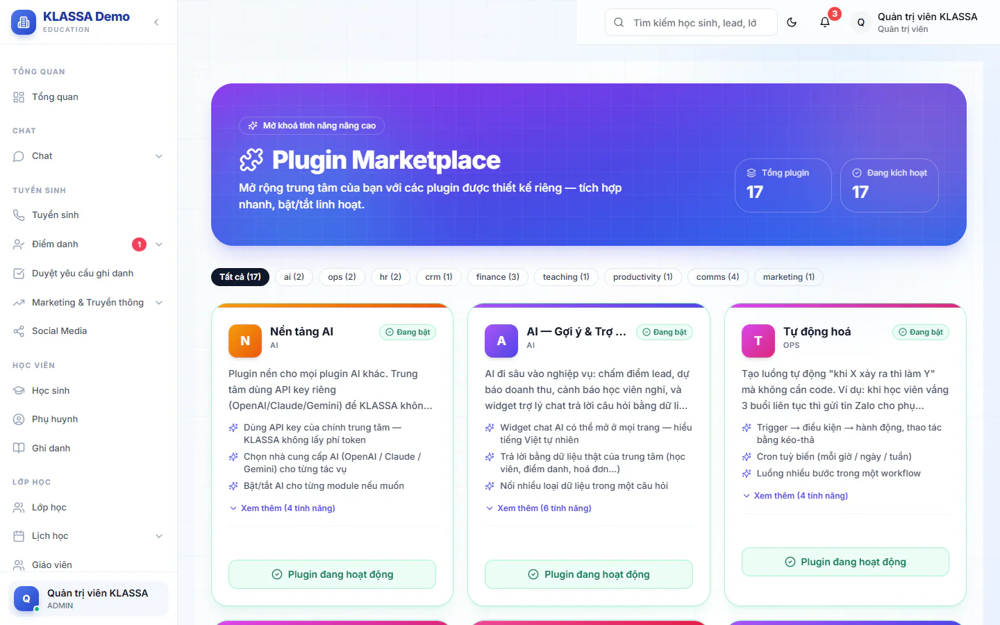

# Giới thiệu Plugin Marketplace và gói mở rộng

KLASSA có phần lõi dùng cho mọi trung tâm, và các **gói mở rộng** bổ sung chức năng chuyên sâu như Zalo, tuyển sinh có AI, học online. Trang **Plugin Marketplace** cho bạn thấy gói nào đang bật, gói nào chưa.

## Mở trang

Vào **Cài đặt → Plugin Marketplace**. Quản trị viên, Quản lý chi nhánh, Quản lý và Lễ tân mở được trang này.

Đầu trang có hai số: **Tổng plugin** (số gói đang bán) và **Đang kích hoạt** (số gói trung tâm đang dùng). Bên dưới là dòng nhãn đếm số gói theo nhóm (chỉ để xem, không bấm lọc được) và lưới các thẻ gói. Mỗi thẻ gói cho biết:

- Tên gói, nhóm, mô tả và danh sách tính năng (bấm **Xem thêm** để mở rộng, **Thu gọn** để đóng).
- Trạng thái **Đang bật** hoặc **Chưa bật**.
- Gói đang bật hiện dòng **Plugin đang hoạt động**. Gói chưa bật có nút **Liên hệ KLASSA**.

Trang không hiện giá. Muốn biết giá, bấm **Liên hệ KLASSA** ở gói đó (xem [Bật một gói mở rộng](cai-dat.md)).

## Các gói hiện có

| Gói | Dùng để |
|---|---|
| **Hoá đơn điện tử** | Xuất hoá đơn điện tử theo Thông tư 78 ngay trong KLASSA |
| **Tự động hoá đơn học phí** | Đầu tháng tự tạo hoá đơn cho học viên đang học và gửi cho phụ huynh |
| **Lương giáo viên** | Tính lương giáo viên và đối chiếu với buổi dạy thực tế |
| **CRM Tuyển sinh + AI** | Quản lý lead, xếp thi thử, tư vấn báo giá, chuyển thành học viên, kèm trợ lý AI |
| **Zalo (Cá nhân + OA)** | Nhắn tin hai chiều với phụ huynh qua Zalo cá nhân, gửi thông báo qua Zalo OA |
| **Facebook Page Chat** | Chat với phụ huynh qua Messenger và trả lời bình luận theo từ khoá |
| **Cổng Phụ huynh** | Phụ huynh xem tình hình học của con, hoá đơn và thanh toán trực tuyến |
| **Ứng dụng Di động (PWA)** | Ứng dụng chung cho giáo viên, phụ huynh, nhân viên và quản lý |
| **Nhân sự (HRIS)** | Hồ sơ, hợp đồng lao động, phép năm, chấm công |
| **Quản lý Truyền thông** | Bảng việc cho phòng truyền thông: kịch bản, video, lịch đăng |
| **Giao việc Nội bộ** | Bảng giao việc cho nhân viên: ai làm gì, hạn khi nào |
| **Nền tảng AI** | Nền cho các tính năng AI, gồm cả sáng tạo nội dung media |
| **AI — Gợi ý & Trợ lý Vận hành** | Chấm điểm lead, dự báo doanh thu, cảnh báo học viên nghỉ, trợ lý chat. Cần **Nền tảng AI** |
| **Đa chi nhánh** | Chạy nhiều chi nhánh, mỗi chi nhánh có báo cáo và phân quyền riêng |
| **Tự động hoá** | Tạo luồng "khi việc này xảy ra thì làm việc kia" không cần code |
| **Học online** | Trang học trực tuyến riêng của trung tâm: bài giảng, bài tập, khoá học |

Danh sách thật trên màn hình của bạn có thể ngắn hơn hoặc khác, tuỳ KLASSA đang mở bán gói nào cho trung tâm.

## Câu hỏi thường gặp

::: details Gói nào mặc định có sẵn?
Trang cho biết chính xác: gói có nhãn **Đang bật** là đang dùng. Các gói còn lại hiện nhãn **Chưa bật**.
:::

::: details Tôi vào một màn hình mà thấy báo "chưa được kích hoạt"?
Màn hình đó thuộc một gói mở rộng chưa bật. Xem [Quản lý gói mở rộng](quan-ly.md).
:::
