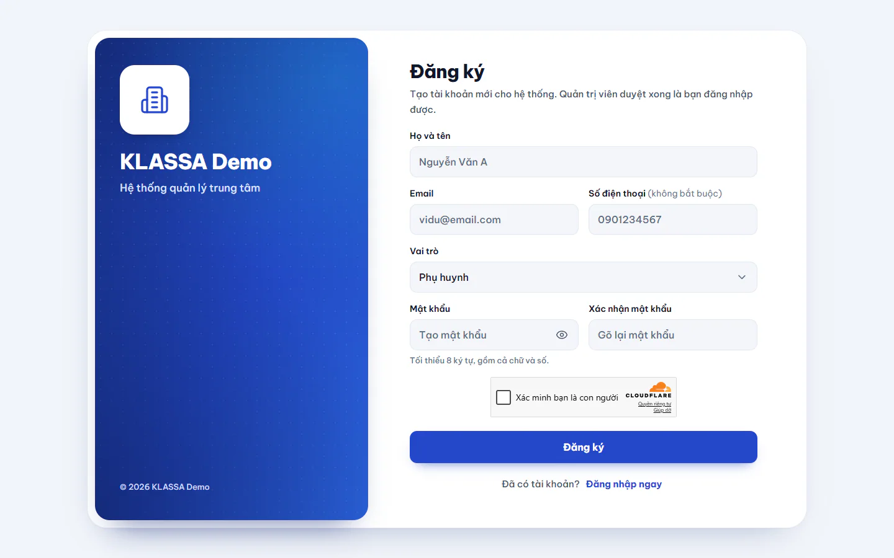

# Đăng ký tài khoản

Dùng khi bạn chưa có tài khoản và trung tâm muốn bạn tự đăng ký. Tài khoản mới chưa dùng được ngay: Quản trị viên phải duyệt trước.

## Tự đăng ký

::: steps
1. Ở trang **Đăng nhập**, bấm **Đăng ký ngay**.
2. Điền **Họ và tên** (ít nhất 2 ký tự) và **Email**.
3. Điền **Số điện thoại** nếu muốn. Ô này không bắt buộc.
4. Chọn **Vai trò** trong danh sách thả xuống. Mặc định là **Phụ huynh**. Các lựa chọn khác: **Giáo viên**, **Trợ giảng**, **Lễ tân**, **Nhân sự**.
5. Đặt **Mật khẩu**: tối thiểu 8 ký tự, gồm cả chữ và số. Nhập lại vào **Xác nhận mật khẩu**.
6. Nếu có ô xác nhận "Tôi không phải máy", hoàn thành ô đó.
7. Bấm **Đăng ký**.
:::

Gửi xong, màn hình báo **Đăng ký thành công!**: tài khoản đã tạo và đang chờ Quản trị viên phê duyệt. Bấm **Về trang đăng nhập** để quay lại.

::: tip Mẹo
Ô "Tôi không phải máy" chỉ xuất hiện khi trung tâm bật chức năng kiểm tra người thật.
:::

## Sau khi đăng ký

1. Quản trị viên vào duyệt tài khoản, xem [Duyệt đăng ký người dùng](../cai-dat/duyet-dang-ky-nguoi-dung.md).
2. Khi được duyệt, bạn đăng nhập bằng email và mật khẩu vừa tạo. Phần mềm không gửi thư báo duyệt, nên hãy hỏi lại trung tâm nếu chờ lâu.
3. Trong lúc chờ duyệt, đăng nhập sẽ báo "Tài khoản đang chờ phê duyệt từ quản trị viên".

## Những điều cần biết

- Danh sách vai trong form không có Quản trị viên, Quản lý chi nhánh, Quản lý hay Kế toán. Các vai này do Quản trị viên tạo, xem [Quản lý người dùng](../cai-dat/nguoi-dung.md).
- Học sinh không tự đăng ký ở đây. Trung tâm tạo tài khoản học sinh cho các em.
- Phụ huynh thường được trung tâm tạo tài khoản khi lập hồ sơ học sinh, xem [Phụ huynh](../hoc-sinh/phu-huynh.md). Chỉ tự đăng ký khi trung tâm hướng dẫn.

## Câu hỏi thường gặp

::: details Tôi điền sai email thì sao?
Email không đổi được trong Hồ sơ cá nhân. Hãy nhờ Quản trị viên sửa hoặc tạo lại tài khoản.
:::

::: details Thấy báo lỗi dưới một ô?
Phần mềm báo lỗi ngay dưới ô đó, ví dụ "Email không hợp lệ", "Mật khẩu phải có ít nhất 1 chữ số" hoặc "Mật khẩu xác nhận không khớp". Sửa ô đó rồi bấm **Đăng ký** lại.
:::

::: details Đăng ký bằng email đã có thì sao?
Phần mềm báo "Email này đã có tài khoản" và không tạo tài khoản mới. Hãy đăng nhập bằng tài khoản đã có, hoặc liên hệ Quản trị viên.
:::
