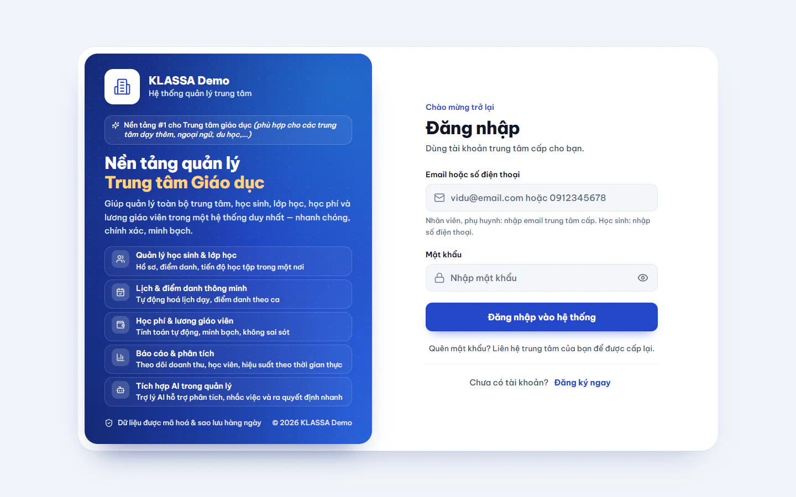

# Đăng nhập

Đăng nhập là bước đầu tiên mỗi khi dùng KLASSA. Sau khi vào, bạn chỉ thấy những chức năng đúng với vai của mình. Xem thêm [Vai trò người dùng](vai-tro-nguoi-dung.md).

## Đăng nhập bằng email hoặc số điện thoại

Ô đăng nhập dùng chung cho mọi người. Nhập gì tuỳ vai:

| Vai | Nhập vào ô đầu tiên |
|---|---|
| Nhân viên (Quản trị viên, Quản lý, Lễ tân, Giáo viên, Trợ giảng, Kế toán, Nhân sự) | Email do trung tâm cấp |
| Phụ huynh | Email do trung tâm cấp |
| Học sinh | Số điện thoại |

::: steps
1. Mở địa chỉ phần mềm của trung tâm bạn bằng trình duyệt (Chrome, Edge, Cốc Cốc, Safari đều dùng được). Trang **Đăng nhập** hiện ra.
2. Nhập email hoặc số điện thoại vào ô **Email hoặc số điện thoại**.
3. Nhập mật khẩu vào ô **Mật khẩu**. Bấm biểu tượng con mắt cạnh ô nếu muốn xem lại mật khẩu đang gõ.
4. Bấm **Đăng nhập vào hệ thống**.
:::

Đăng nhập thành công, phần mềm báo **Đăng nhập thành công!** rồi chuyển bạn đến trang đầu tiên của vai mình. Xem [Trang chủ theo vai](trang-chu.md).

::: tip Mẹo
Nếu trung tâm cấp tài khoản mới, mật khẩu ban đầu là mật khẩu tạm. Lần đầu vào, phần mềm sẽ buộc bạn đổi sang mật khẩu của riêng mình. Xem [Đổi mật khẩu](doi-mat-khau.md).
:::

## Khi một số điện thoại có nhiều học sinh

Nhiều anh chị em có thể dùng chung một số điện thoại và cùng mật khẩu. Khi đó, sau khi bấm **Đăng nhập vào hệ thống**, phần mềm hỏi **Bạn là ai?** và hiện danh sách các em (kèm khối lớp và lớp đang học). Chọn đúng tên của mình để vào học. Bấm **Không phải bạn? Đăng nhập số khác** nếu muốn quay lại.

## Quên mật khẩu

KLASSA không tự gửi thư đặt lại mật khẩu. Dưới nút đăng nhập có dòng nhắc: liên hệ trung tâm của bạn để được cấp lại. Người cấp lại là Quản trị viên của trung tâm (xem [Quản lý người dùng](../cai-dat/nguoi-dung.md)).

## Khi đăng nhập không được

Phần mềm hiện một hộp thông báo ngay trên form. Các câu thường gặp:

| Thông báo | Nghĩa là | Cách xử lý |
|---|---|---|
| Email hoặc mật khẩu không đúng | Sai email hoặc sai mật khẩu. Học sinh sẽ thấy "Số điện thoại hoặc mật khẩu không đúng" | Kiểm tra lại, chú ý chữ hoa và chữ thường |
| Tài khoản đang chờ phê duyệt từ quản trị viên | Bạn mới tự đăng ký và chưa được duyệt | Chờ hoặc nhờ Quản trị viên duyệt, xem [Đăng ký tài khoản](dang-ky.md) |
| Tài khoản đã bị vô hiệu hóa | Tài khoản bị tắt | Liên hệ Quản trị viên |
| Tài khoản đã bị từ chối. Vui lòng liên hệ hỗ trợ | Đăng ký của bạn bị từ chối | Liên hệ trung tâm |
| Tài khoản tạm khóa 30 phút... | Bạn nhập sai mật khẩu 5 lần | Chờ hết thời gian khoá, hoặc nhờ Quản trị viên mở khoá (xem bên dưới) |
| Quá nhiều lần thử từ mạng này... | Mạng bạn đang dùng thử sai quá nhiều lần | Thử lại sau số phút được báo |
| Có lỗi xảy ra. Vui lòng thử lại. | Lỗi mạng hoặc lỗi bất ngờ | Kiểm tra kết nối rồi thử lại |

### Mở khoá tài khoản (Quản trị viên)

::: steps
1. Vào **Quản trị hệ thống → Quản lý Users**.
2. Ở dòng của người bị khoá, bấm nút ba chấm, chọn **Mở khóa tài khoản**. Lệnh này chỉ hiện khi tài khoản đang bị khoá.
:::

Để bảo vệ tài khoản, phần mềm không cho biết email có tồn tại hay không khi bạn nhập sai.

::: warning Lưu ý
Không dùng chung mật khẩu. Mọi thao tác trong phần mềm được ghi theo tài khoản đăng nhập.
:::

## Câu hỏi thường gặp

::: details Chưa có tài khoản thì làm sao?
Bấm **Đăng ký ngay** ở cuối form, xem [Đăng ký tài khoản](dang-ky.md). Hoặc nhờ Quản trị viên tạo sẵn tài khoản cho bạn.
:::

::: details Có đăng nhập cùng lúc trên nhiều thiết bị được không?
Được. Một tài khoản có thể mở trên máy tính và điện thoại cùng lúc. Phiên đăng nhập giữ được tối đa 30 ngày.
:::

::: details Sau khi đăng nhập, tôi bị đưa đến một trang khác ngoài trang chủ?
Nếu bạn bấm vào một đường dẫn trong phần mềm khi chưa đăng nhập, phần mềm hiện dòng "Vui lòng đăng nhập để tiếp tục" và đưa bạn về đúng trang đó sau khi đăng nhập. Phụ huynh vào cổng phụ huynh, học sinh vào khu học.
:::
