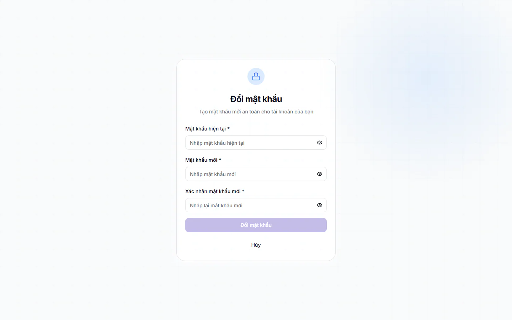

# Đổi mật khẩu

Đổi mật khẩu để giữ tài khoản an toàn, nhất là khi bạn đang dùng mật khẩu tạm do trung tâm cấp. Mật khẩu là của riêng bạn: không ai, kể cả Quản trị viên, nên biết mật khẩu mới.

## Đổi mật khẩu khi đang dùng bình thường

::: steps
1. Bấm tên hoặc ảnh của bạn ở góc trên bên phải, chọn **Hồ sơ cá nhân**.
2. Chuyển sang tab **Bảo mật**.
3. Nhập **Mật khẩu hiện tại**, **Mật khẩu mới** và **Xác nhận mật khẩu mới**.
4. Bấm **Đổi mật khẩu**.
:::

Đổi xong, phần mềm báo "Đã đổi mật khẩu. Vui lòng đăng nhập lại bằng mật khẩu mới." và tự đưa bạn về trang **Đăng nhập** sau khoảng 1-2 giây. Mọi thiết bị đang đăng nhập bằng mật khẩu cũ cũng bị đăng xuất.

## Lần đầu đăng nhập: bắt buộc đổi

Tài khoản được trung tâm cấp với mật khẩu tạm sẽ bị đánh dấu phải đổi. Khi đăng nhập, bạn bị đưa thẳng đến trang **Đổi mật khẩu** với dòng nhắc "Bạn cần đổi mật khẩu mặc định trước khi tiếp tục sử dụng hệ thống". Bạn chưa vào được phần mềm cho tới khi đổi xong, và trang này không có nút **Hủy**.

::: steps
1. Nhập **Mật khẩu hiện tại** (chính là mật khẩu tạm được cấp). Dấu * nghĩa là ô bắt buộc.
2. Nhập **Mật khẩu mới**. Danh sách "Yêu cầu mật khẩu" bên dưới sẽ đánh dấu từng điều kiện bạn đã đạt.
3. Nhập lại vào **Xác nhận mật khẩu mới**. Phần mềm báo **Mật khẩu khớp** hoặc **Mật khẩu không khớp**.
4. Bấm **Đổi mật khẩu**.
5. Đăng nhập lại bằng mật khẩu mới, xem [Đăng nhập](dang-nhap.md).
:::

Danh sách **Yêu cầu mật khẩu** ở trang này hiện đúng những điều kiện mà phần mềm kiểm. Điều kiện nào bạn đã đạt thì có dấu tích xanh:

- Ít nhất 8 ký tự
- Ít nhất 1 chữ HOA
- Ít nhất 1 chữ thường
- Ít nhất 1 số
- Ít nhất 1 ký tự đặc biệt trong: **@ $ ! % * ? &**
- Chỉ gồm chữ không dấu, số và các ký tự **@ $ ! % * ? &**

Dòng cuối chuyển sang màu đỏ nếu mật khẩu có ký tự khác, ví dụ dấu **#**, khoảng trắng hoặc chữ có dấu. Nút **Đổi mật khẩu** chỉ bấm được khi mọi điều kiện đều đạt.

::: tip Mẹo
Nên dùng đúng các yêu cầu trên cả khi đổi ở tab **Bảo mật**. Tab này chỉ đòi tối thiểu 6 ký tự nhưng mật khẩu ngắn và dễ đoán thì dễ bị lộ.
:::

## Những lỗi thường gặp

| Thông báo | Cách xử lý |
|---|---|
| Mật khẩu hiện tại không đúng | Nhập lại mật khẩu đang dùng. Mật khẩu tạm lấy từ người cấp tài khoản |
| Mật khẩu xác nhận không khớp | Gõ lại hai ô mật khẩu mới cho giống nhau |
| Mật khẩu mới phải khác mật khẩu hiện tại | Chọn mật khẩu khác mật khẩu cũ |
| Mật khẩu mới cần ít nhất 8 ký tự, có chữ HOA, chữ thường, số và ký tự đặc biệt (chỉ dùng @ $ ! % * ? &) | Sửa theo yêu cầu ở trên |

::: warning Lưu ý
Nhập sai mật khẩu hiện tại quá 5 lần trong 15 phút thì phần mềm tạm dừng việc đổi mật khẩu, bạn chờ một lúc rồi thử lại.
:::

## Câu hỏi thường gặp

::: details Tôi quên mật khẩu hiện tại thì đổi thế nào?
Bạn không đổi được ở đây vì phải nhập mật khẩu hiện tại. Hãy nhờ Quản trị viên cấp lại mật khẩu, xem [Quản lý người dùng](../cai-dat/nguoi-dung.md).
:::

::: details Sao tôi bị đăng xuất sau khi đổi?
Đây là cách bảo vệ tài khoản: mật khẩu đổi thì các phiên cũ hết hiệu lực. Đăng nhập lại bằng mật khẩu mới là dùng tiếp được.
:::

::: details Phụ huynh có phải đổi mật khẩu không?
Chỉ khi tài khoản được đánh dấu phải đổi mật khẩu. Khi đó phụ huynh cũng thấy trang **Đổi mật khẩu** bắt buộc, đổi xong thì vào cổng phụ huynh.
:::
