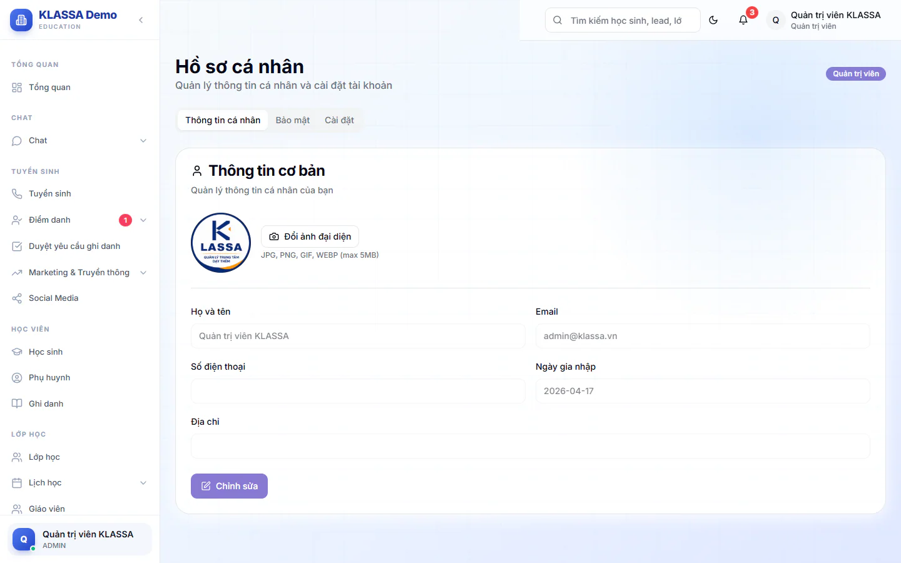

# Hồ sơ cá nhân

Trang này để bạn tự sửa thông tin của chính mình và chọn cách nhận thông báo. Hồ sơ nhân sự (hợp đồng, lương) do bộ phận nhân sự quản lý, xem [Hồ sơ trong Cổng nhân viên](../cong-nhan-vien/ho-so.md).

## Mở trang Hồ sơ cá nhân

::: steps
1. Bấm tên hoặc ảnh của bạn ở góc trên bên phải.
2. Chọn **Hồ sơ cá nhân**. Chọn **Cài đặt** nếu muốn mở thẳng tab **Cài đặt**.
:::

Trang có ba tab: **Thông tin cá nhân**, **Bảo mật**, **Cài đặt**.

## Sửa thông tin cá nhân

::: steps
1. Ở tab **Thông tin cá nhân**, bấm **Chỉnh sửa**.
2. Sửa **Họ và tên** (bắt buộc), **Số điện thoại** hoặc **Địa chỉ**.
3. Bấm **Lưu thay đổi**. Bấm **Hủy** nếu không muốn lưu.
:::

Ô **Ngày gia nhập** chỉ để xem. Ô **Email** hiện ra nhưng không đổi được: dù bạn gõ gì, phần mềm vẫn giữ email cũ khi lưu. Cần đổi email thì nhờ Quản trị viên.

## Đổi ảnh đại diện

::: steps
1. Ở tab **Thông tin cá nhân**, bấm **Đổi ảnh đại diện**.
2. Chọn ảnh JPG, PNG, GIF hoặc WEBP, dung lượng tối đa 5MB.
:::

Ảnh được tải lên và cập nhật ngay.

## Đổi mật khẩu

Làm ở tab **Bảo mật**, xem [Đổi mật khẩu](doi-mat-khau.md).

## Cài đặt thông báo

Ở tab **Cài đặt**, bạn gạt bật hoặc tắt bốn loại thông báo: **Email notifications**, **SMS notifications**, **Thông báo học phí** và **Thông báo điểm danh**. Bấm nút lưu của khối đó để áp dụng. Khối **Thông báo đẩy** bên dưới cho phép bật thông báo hiện trên thiết bị đang dùng.

::: warning Lưu ý
Tab **Cài đặt** còn có các lựa chọn về giao diện (theme, ngôn ngữ, kích thước chữ, bố cục) và tuỳ chọn khác. Phần mềm chỉ ghi nhớ các lựa chọn này, chưa dùng chúng để đổi cách hiển thị. Để đổi nền sáng hoặc tối, bấm biểu tượng mặt trời hoặc mặt trăng ở thanh trên cùng.
:::

## Câu hỏi thường gặp

::: details Tôi bị báo "Họ và tên không được để trống"?
Ô **Họ và tên** là bắt buộc. Điền lại rồi bấm **Lưu thay đổi**.
:::

::: details Ảnh tải lên không được?
Chỉ nhận ảnh JPG, PNG, GIF, WEBP và tối đa 5MB. Thử ảnh nhỏ hơn hoặc đổi định dạng.
:::

::: details Phụ huynh và học sinh sửa hồ sơ ở đâu?
Phụ huynh vào mục **Hồ sơ** trong cổng phụ huynh, xem [Hồ sơ của phụ huynh](../cong-phu-huynh/ho-so.md). Học sinh dùng khu học của mình.
:::
