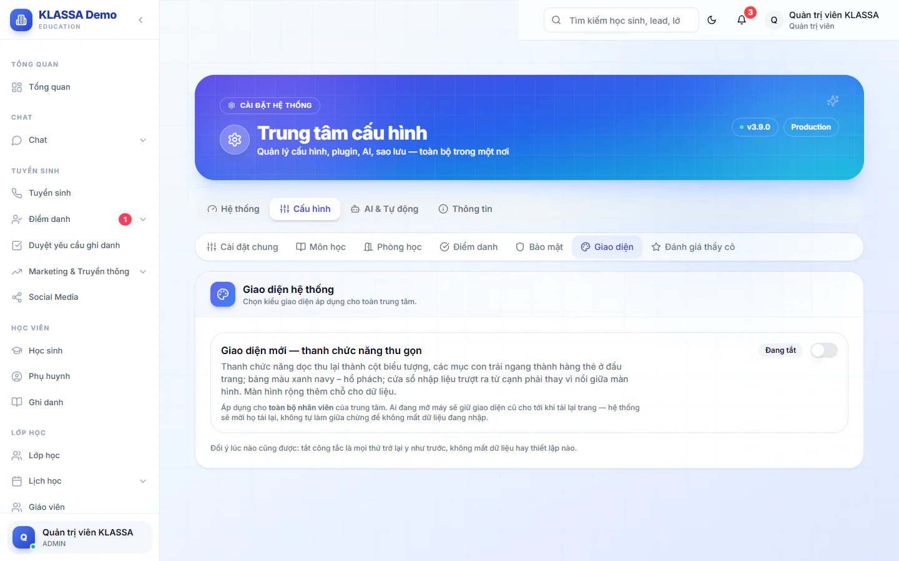

# Menu và giao diện

Menu là nơi bạn đi tới mọi chức năng. Mỗi vai chỉ thấy các mục mình dùng được, nên menu của người này có thể khác người kia. KLASSA có hai kiểu giao diện, tên mục giống nhau ở cả hai.

## Các nhóm trong menu

Menu chia thành nhóm. Mục nào trung tâm chưa mua gói mở rộng thì không hiện hoặc không vào được.

| Nhóm | Gồm các mục chính |
|---|---|
| Tổng quan | **Tổng quan** (trang chủ, xem [Trang chủ theo vai](trang-chu.md)) |
| CHAT | **Tin nhắn**, **Chat Zalo**, **Chat Facebook**, **Công việc** |
| TUYỂN SINH | **Tuyển sinh**, **Điểm danh**, **Duyệt yêu cầu ghi danh**, **Marketing & Truyền thông** |
| HỌC VIÊN | **Học sinh**, **Phụ huynh**, **Ghi danh** |
| LỚP HỌC | **Lớp học**, **Lịch học** (**Thời khóa biểu**, **Lịch học thử**), **Giáo viên**, **Đề kiểm tra**, **Bài tập về nhà**, **Nhận xét buổi học**, **Phiếu tháng**, **Học online** |
| TÀI CHÍNH | **Tài chính** (**Tổng quan tài chính**, **Học phí**, **Thanh toán**, **Phiếu phụ thu**...), **Báo cáo** |
| NHÂN SỰ | **Quản lý HR** |
| AUTOMATION & AI | **AI Hub**, **Tích hợp**, **Công cụ**, **Mobile** |
| Quản trị hệ thống | **Quản lý Users**, **Thương hiệu**, **Quản lý Chi nhánh**, **Cấu hình Hệ thống**, **Quản lý Đăng ký**, **Thông báo Popup** |
| Cổng nhân viên | **Phiếu lương**, **Chấm công của tôi**, **Đăng ký ca**, **Nghỉ phép**, **Phúc lợi**, **Hồ sơ cá nhân** |
| CẤU HÌNH HỆ THỐNG | **Quản lý Kho**, **Chi nhánh**, **Cài đặt**, **Hỗ trợ** |

Phụ huynh có menu riêng: **Tổng quan**, **Điểm danh con**, **Điểm số**, **Hóa đơn**, **Lịch học**, **Hồ sơ**.

Giáo viên và trợ giảng còn có các mục dành riêng như **Báo cáo Tiến độ**, **Báo cáo điểm danh**, **Nhận xét lớp tôi**, **Phiếu tháng lớp tôi**.

::: tip Mẹo
Không thấy một mục bạn cần? Có thể vai của bạn không được dùng chức năng đó, hoặc trung tâm chưa bật gói mở rộng tương ứng. Hỏi Quản trị viên, xem [Vai trò người dùng](vai-tro-nguoi-dung.md) và [Quản lý người dùng](../cai-dat/nguoi-dung.md).
:::

## Thanh trên cùng

- **Ô tìm kiếm** "Tìm kiếm học sinh, lead, lớp học..." hiện ở thanh trên cùng. Ô này hiện chưa tìm được dữ liệu. Muốn tìm học sinh, lead hay lớp, hãy mở trang danh sách tương ứng và dùng ô tìm kiếm của trang đó.
- **Biểu tượng mặt trời hoặc mặt trăng**: đổi giữa nền sáng và nền tối.
- **Biểu tượng chuông**: mở trang **Thông báo**. Số đỏ cho biết số thông báo chưa đọc.
- **Tên và ảnh của bạn**: mở menu có **Hồ sơ cá nhân**, **Cài đặt** và **Đăng xuất**. Xem [Hồ sơ cá nhân](ho-so-ca-nhan.md).

Để thu nhỏ hoặc mở rộng thanh menu dọc, bấm nút **Thu gọn sidebar** hoặc **Mở rộng sidebar** ở giao diện cũ.

## Hai kiểu giao diện

| | Giao diện cũ | Giao diện mới |
|---|---|---|
| Menu | Thanh dọc bên trái, mở rộng được | Thanh biểu tượng dọc nhỏ gọn, các mục con của nhóm đang mở nằm thành hàng thẻ ở đầu trang |
| Cửa sổ nhập liệu | Hiện giữa màn hình | Trượt ra từ cạnh phải |
| Màu | Như bản trước | Xanh navy và hổ phách |

Ở giao diện mới, rê chuột vào biểu tượng để xem tên nhóm. Tên khối ở hàng thẻ cũng là menu liệt kê đủ mọi mục của khối, dùng khi hàng thẻ dài quá màn hình. Trên điện thoại, menu mở ra dạng ngăn kéo.

### Bật hoặc tắt giao diện mới (chỉ Quản trị viên)

Giao diện áp dụng cho toàn bộ nhân viên của trung tâm, không chọn riêng từng người. Mặc định là giao diện cũ.

::: steps
1. Vào **Cài đặt → Tổng quan**.
2. Chọn tab **Cấu hình**, rồi chọn mục **Giao diện**.
3. Gạt công tắc **Giao diện mới, thanh chức năng thu gọn**. Nhãn bên cạnh hiện **Đang bật** hoặc **Đang tắt**.

   

4. Chờ trang tự tải lại.
:::

Ai đang mở máy vẫn giữ giao diện cũ cho tới khi tải lại trang. Phần mềm sẽ mời họ tải lại, không tự đổi giữa chừng để khỏi mất dữ liệu đang nhập.

::: tip Mẹo
Đổi ý lúc nào cũng được. Tắt công tắc là mọi thứ trở lại như trước, không mất dữ liệu hay thiết lập nào.
:::

## Câu hỏi thường gặp

::: details Sao menu của tôi ít mục hơn của đồng nghiệp?
Menu theo vai. Hai người khác vai thì thấy khác nhau. Quản trị viên thấy đầy đủ nhất.
:::

::: details Tôi bấm vào một mục thì bị đưa về trang chủ?
Phần mềm báo "Bạn không có quyền mở trang đó". Nhờ Quản trị viên cấp quyền nếu công việc cần.
:::

::: details Trên điện thoại dùng thế nào?
Mở bằng trình duyệt điện thoại, bấm nút menu để mở ngăn kéo. Với app điện thoại KLASSA, xem phần hướng dẫn app điện thoại.
:::
