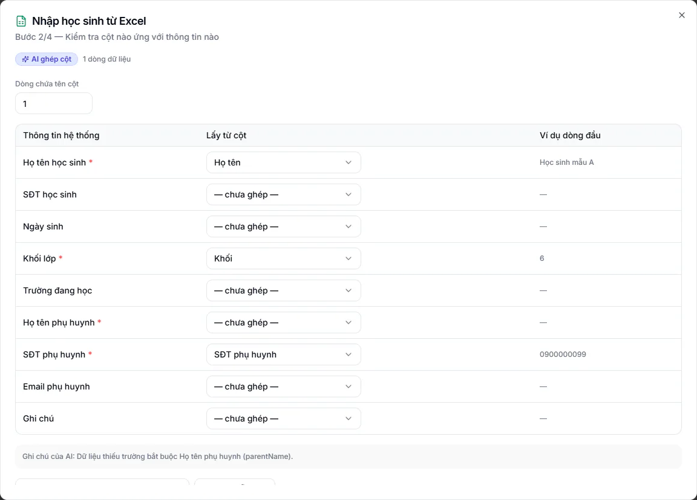

# Nhập dữ liệu hàng loạt từ Excel

Dùng khi bạn có sẵn một danh sách dài, ví dụ chuyển từ phần mềm cũ, sổ Excel của trung tâm hay danh sách trường gửi sang, và muốn đưa hết vào KLASSA trong một lần. Bạn không cần sửa file cho giống file mẫu: phần mềm tự đoán cột nào là gì rồi cho bạn xem lại trước khi lưu.

## Nhập ở đâu

| Loại dữ liệu | Cách mở hộp nhập | Tối đa mỗi lần | Ai được nhập |
|---|---|---|---|
| Học sinh | **Học sinh**, bấm **Nhập Excel** | 500 dòng | Quản trị viên, Quản lý chi nhánh, Quản lý, Lễ tân |
| Lead (khách quan tâm) | **Tuyển sinh**, bấm **Excel**, chọn **Nhập lead từ Excel** | 500 dòng | Như học sinh, và trung tâm phải có gói mở rộng **CRM Tuyển sinh + AI** |
| Nhân viên | **Nhân sự → Quản lý HR → Nhân viên**, bấm **Import** | 200 dòng | Quản trị viên, Quản lý chi nhánh |

Hộp thoại mang tên **Nhập học sinh từ Excel**, **Nhập khách hàng tiềm năng từ Excel** hoặc **Nhập nhân viên từ Excel**. Hộp có 4 bước.

## Bước 1: Đưa dữ liệu vào

::: steps
1. Chọn một trong hai cách: **Chọn file** hoặc **Dán bảng**.
2. Với **Chọn file**: dùng file .xlsx, .xls hoặc .csv, tối đa 10MB. Học sinh và lead có nút **Tải file mẫu** nếu bạn muốn dùng khuôn chuẩn. Nhân viên chưa có file mẫu.
3. Với **Dán bảng**: bôi đen vùng dữ liệu trong Excel hoặc Google Sheet, bấm Ctrl+C rồi dán vào ô. Dòng đầu nên là tên cột. Tiện cho danh sách ngắn.
4. Bấm **Tiếp tục**.
:::

Những kiểu file khó vẫn đọc được: tên cột đặt tự do, họ và tên tách hai cột, một ô ghi chung tên lẫn số điện thoại, dòng tên bảng ở phía trên tiêu đề, nhiều trang tính, số điện thoại bị mất số 0 đầu, khối lớp ghi kèm tên lớp như "6A1".

## Bước 2: Xem lại việc ghép cột

Phần mềm hiện bảng **Thông tin hệ thống**, **Lấy từ cột**, **Ví dụ dòng đầu** để bạn đối chiếu.

- Ghép sai thì bấm vào ô chọn cột và chọn lại. Chưa ghép thì chọn "chưa ghép".
- Ô ghép phức tạp hiện dạng chữ, ví dụ "Ghép: Họ + Tên". Muốn bỏ thì bấm **Bỏ** rồi chọn cột khác.
- File nhiều trang tính thì chọn đúng trang ở ô **Trang tính**.
- Phần mềm nhận nhầm dòng tiêu đề thì sửa số ở ô **Dòng chứa tên cột**.
- Trường bắt buộc mà chưa ghép thì phần mềm báo "Còn thiếu cột bắt buộc" và chưa cho đi tiếp.

**Lưu mẫu để lần sau khỏi làm lại:** gõ tên mẫu vào ô bên dưới (ví dụ "Mẫu trường Nguyễn Trãi"), bấm **Lưu mẫu này**. Lần sau gặp file cùng dạng, phần mềm tự ghép sẵn.

Xong bấm **Xem bảng duyệt**. Bấm **Quay lại** để về bước 1.

## Bước 3: Duyệt và sửa trước khi lưu

Bảng liệt kê từng dòng kèm nhãn trạng thái:

- **Hợp lệ**: được tích chọn sẵn.
- **Cần lưu ý**: vẫn nhập được, có điều nên biết. Dòng này cũng được tích sẵn.
- **Trùng**: đã có trong phần mềm, không tích sẵn.
- **Lỗi**: thiếu hoặc sai thông tin bắt buộc, chưa nhập được.

Bạn sửa thẳng vào từng ô trên bảng, ví dụ gõ lại tên hoặc thêm số điện thoại còn thiếu. Nhãn trạng thái tự cập nhật.

Có dòng **Lỗi** thì bấm **Nhờ AI đề xuất cho dòng lỗi**. Phần mềm gợi ý giá trị suy ra từ chính dòng đó, hiện trên nền tím kèm giá trị cũ. AI không tự áp: bạn bấm **Nhận đề xuất** ở từng dòng hoặc **Nhận tất cả đề xuất**.

Cuối cùng bấm **Xác nhận nhập N dòng** (N là số dòng đang chọn). Cần chỉnh lại cột thì bấm **Sửa ánh xạ cột**.

::: warning Lưu ý
Nếu gói của trung tâm giới hạn số lượng, bảng duyệt có dải cảnh báo cho biết gói còn bao nhiêu chỗ. Chọn nhiều hơn số chỗ còn lại thì nút xác nhận bị khoá cho tới khi bạn bỏ bớt dòng hoặc nâng gói. Áp dụng cho học sinh và nhân viên. Lead không tính vào hạn mức.
:::

## Bước 4: Kết quả

Phần mềm hiện số **dòng đã tạo**, số **dòng bỏ qua** và **Lý do** của từng dòng bị bỏ. Bấm **Nhập tiếp file khác** để làm tiếp, hoặc **Đóng**.

::: danger Không thể hoàn tác
Chưa bấm **Xác nhận nhập** thì chưa có gì được lưu. Sau khi đã lưu, bạn phải xoá từng hồ sơ ở danh sách tương ứng.
:::

## Riêng từng loại dữ liệu

**Học sinh.** Bắt buộc: **Họ tên học sinh**, **Khối lớp**, **Họ tên phụ huynh**, **SĐT phụ huynh**. Không bắt buộc: SĐT học sinh, Ngày sinh, Trường đang học. Tài khoản phụ huynh tạo từ đây dùng mật khẩu mặc định của phần mềm, hỏi Quản trị viên. Xem thêm [Tạo hồ sơ học sinh mới](../hoc-sinh/tao-moi.md).

**Lead.** Bắt buộc: **Họ tên**, **SĐT liên hệ**. Các cột khác như Email, Khối lớp quan tâm, Nguồn, phụ huynh, Ghi chú đều không bắt buộc. Trùng số điện thoại với lead hoặc học sinh đang có thì báo **Trùng**.

**Nhân viên.** Bắt buộc: **Họ tên nhân viên**, **Chức vụ**. Chức vụ phải khớp tên đã khai trong **Nhân sự → Quản lý HR → Cấu hình HR**, chưa có thì tạo chức vụ trước. **Loại hình** ghi tiếng Việt được (Toàn thời gian, Bán thời gian, Thời vụ, Thực tập, Thử việc). Để trống thì lưu là Toàn thời gian, nên kiểm tra kỹ ở bước 3. Có **Email** thì phần mềm tạo luôn tài khoản đăng nhập với vai Giáo viên và mật khẩu tạm (Quản trị viên đổi vai sau nếu cần) và bắt đổi ở lần đăng nhập đầu, xem [Đổi mật khẩu](doi-mat-khau.md).

## Dữ liệu của bạn có bị gửi đi đâu không

Để đoán cột, phần mềm gửi **tên các cột và vài dòng đầu** tới dịch vụ AI mà trung tâm đã cấu hình. Bước gợi ý sửa lỗi thì gửi các dòng đang lỗi. Phần còn lại của file xử lý ngay trong phần mềm.

Muốn tắt: Quản trị viên vào **Cài đặt → Tổng quan**, tab **AI & Tự động**, mục **Tính năng AI**, tắt **Chuẩn hoá dữ liệu khi nhập hàng loạt**. Việc nhập Excel vẫn chạy, chỉ là phần mềm nhận cột theo tên thông dụng và bạn tự chỉnh ở bước 2.

## Câu hỏi thường gặp

::: details AI có tự sửa dữ liệu của tôi không?
Không. Ở bước ghép cột, AI chỉ chọn "lấy cột nào cho thông tin nào", còn dữ liệu do phần mềm đọc nên tên và số điện thoại không bị đổi. Ở bước gợi ý sửa lỗi, mọi đề xuất đều cần bạn bấm nhận.
:::

::: details Cột riêng của trung tâm (mã nội bộ, ghi chú xếp lớp) có được nhập không?
Phần mềm chỉ lấy những thông tin nó quản lý. Nếu cột đó quan trọng, ở bước 2 hãy chọn nó cho trường **Ghi chú**. Mỗi thông tin chỉ nhận một cột.
:::

::: details Hộp báo "Còn thiếu cột bắt buộc"?
Quay lại bước 2, ghép cột cho các trường bắt buộc liệt kê trong thông báo.
:::
