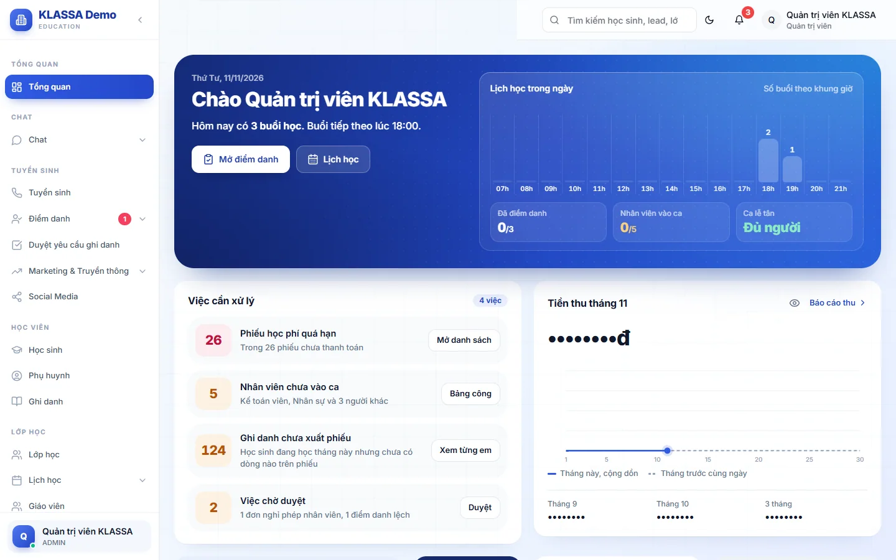
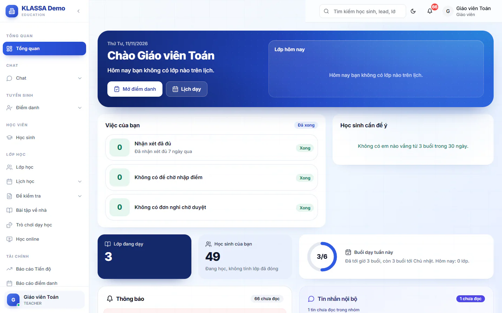
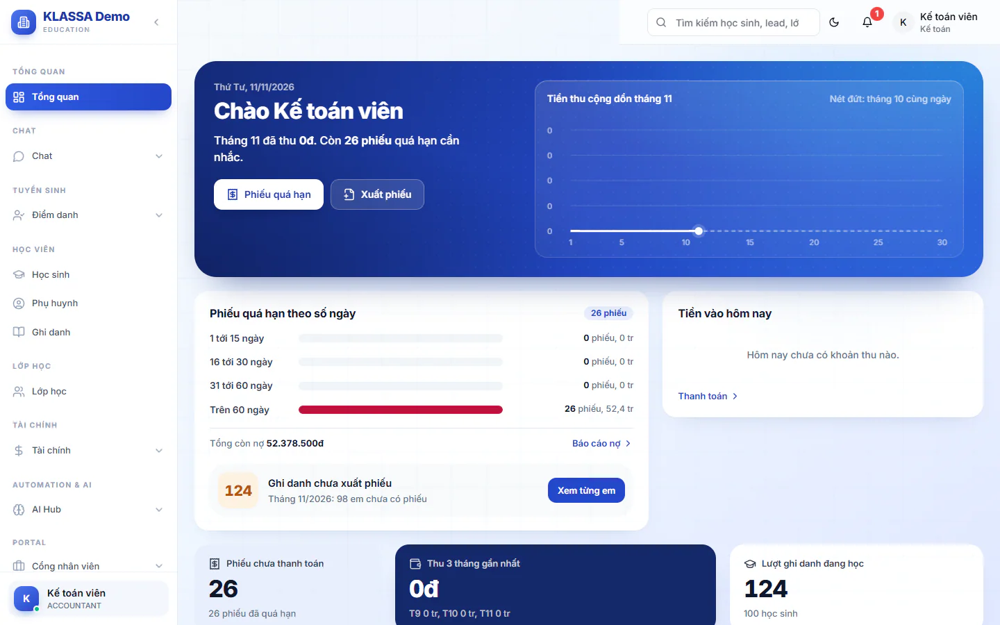

# Trang chủ theo vai

Trang chủ cho bạn thấy ngay việc của hôm nay. Mỗi vai có một trang chủ riêng, chỉ hiện những gì vai đó làm được. Để mở lại trang này, bấm **Tổng quan** trong menu.

Trang nào cũng bắt đầu bằng dải **Chào + tên bạn** kèm ngày hôm nay và một câu tóm tắt, ví dụ số lớp hôm nay hoặc lớp sắp dạy.

## Mỗi vai thấy gì

| Vai | Trang chủ |
|---|---|
| Quản trị viên, Quản lý chi nhánh, Quản lý | Trang quản trị: lịch học trong ngày, việc cần xử lý, tiền thu tháng, các ô số, phễu tuyển sinh |
| Lễ tân | Trang riêng cho lễ tân: lịch học trong ngày, lead cần gọi, học thử, đơn nghỉ |
| Giáo viên | Trang riêng cho giáo viên: lớp hôm nay, việc của bạn, học sinh cần để ý |
| Trợ giảng | Trang riêng cho trợ giảng: ca trợ giảng hôm nay, thu nhập tháng này, việc của bạn |
| Kế toán | Trang riêng cho kế toán: tiền thu, phiếu quá hạn, tiền vào hôm nay |
| Nhân sự | Tự chuyển sang **Cổng nhân viên** |
| Phụ huynh | Tự chuyển sang cổng phụ huynh, xem [Cổng phụ huynh](../cong-phu-huynh/gioi-thieu.md) |
| Học sinh | Vào khu học của học sinh |

## Trang quản trị

Dành cho Quản trị viên, Quản lý chi nhánh và Quản lý. Các khối chính:

- **Lịch học trong ngày**: số buổi theo khung giờ.
- **Việc cần xử lý**: mỗi dòng có một con số và một nút để mở thẳng trang xử lý. Ví dụ **Phiếu học phí quá hạn**, **Buổi đã hết giờ chưa điểm danh**, **Giáo viên còn thiếu nhận xét**, **Nhân viên chưa vào ca**, **Ghi danh chưa xuất phiếu**, **Việc chờ duyệt**. Hai dòng **Buổi đã hết giờ chưa điểm danh** và **Nhân viên chưa vào ca** chỉ hiện khi có việc. Các dòng còn lại, khi hết việc, đổi thành lời báo đã xong như **Không có phiếu quá hạn**, **Nhận xét hôm qua đã đủ**, **Ghi danh đã có phiếu đủ**.
- **Tiền thu tháng** (kèm số tháng, ví dụ **Tiền thu tháng 11**): số tiền thu trong tháng, mặc định che số. Bấm vào số hoặc nút con mắt (**Hiện số tiền**) để xem, bấm lại để che. Tải lại trang thì số tự che lại. Biểu đồ so sánh với tháng trước. Liên kết **Báo cáo thu** ở góc khối mở báo cáo chi tiết.
- Các ô số: **Lượt ghi danh đang học**, **Lớp đang học**, **Lead mới 7 ngày**, **Học thử gần đây**.
- **Phễu tuyển sinh** và **Ca nhân viên hôm nay**.

Hai nút ở dải đầu: **Mở điểm danh** và **Lịch học**.

::: warning Lưu ý
Khối nào bạn không có quyền thì không hiện. Chỉ Quản trị viên và Quản lý chi nhánh thấy phần "Tình hình hôm nay" về nhân viên (nhân viên vào ca, ca lễ tân). Phễu và các ô lead chỉ hiện khi trung tâm có gói mở rộng **CRM Tuyển sinh + AI**. Khối tiền thu chỉ hiện với vai có quyền xem học phí.
:::

## Trang lễ tân

- **Lịch học trong ngày**, có ghi chú đối chiếu sau khi giáo viên điểm danh.
- **Lead cần gọi lại hôm nay**.
- **Học thử hôm nay**.
- **Đơn nghỉ của học sinh**.
- **Phễu tuyển sinh**, kèm nút **Danh sách lead**.

## Trang giáo viên

- **Lớp hôm nay**: số lớp, số học sinh, lớp tiếp theo và giờ dạy.
- **Việc của bạn**: **Buổi chưa nhận xét** (nút **Viết nhận xét**), **Đề chưa công bố điểm** (nút **Công bố điểm**), **Đề chưa nhập điểm** (nút **Nhập điểm**), **Đơn nghỉ chờ bạn duyệt** (nút **Duyệt đơn**).
  Việc nào đã hết thì dòng đổi thành lời báo kèm nhãn **Xong**: **Nhận xét đã đủ**, **Không có đề chờ nhập điểm**, **Không có đơn nghỉ chờ duyệt**. Dòng **Đề chưa công bố điểm** chỉ hiện khi có đề cần công bố.
- **Học sinh cần để ý**: em vắng từ 3 buổi trong 30 ngày.
- Các ô số **Lớp đang dạy** và **Học sinh của bạn**.

## Trang trợ giảng

- Dải đầu cho biết hôm nay bạn có mấy ca trợ giảng và đã báo có mặt bao nhiêu ca.
- **Ca trợ giảng hôm nay**, kèm liên kết **Xem tất cả**. Nếu trung tâm yêu cầu báo có mặt để tính lương ca, bạn phải bấm báo có mặt. Quên thì nhờ quản lý xác nhận giúp.
- **Tháng này**: thu nhập tính tới hôm nay.
- **Việc của bạn**, cùng lối tắt **Phiếu lương** và **Nghỉ phép**.

## Trang kế toán

- **Tiền thu cộng dồn tháng** so với tháng trước cùng ngày.
- **Phiếu quá hạn theo số ngày**.
- **Ghi danh chưa xuất phiếu**.
- **Tiền vào hôm nay**.
- Các ô số **Phiếu chưa thanh toán**, **Thu 3 tháng gần nhất**, **Lượt ghi danh đang học**.

## Khi thấy "Bạn không có quyền mở trang đó"

Bạn bấm vào một trang mà vai của mình không được mở. Phần mềm đưa bạn về trang chủ và báo một dòng. Nếu công việc cần trang đó, nhờ Quản trị viên cấp quyền, xem [Quản lý người dùng](../cai-dat/nguoi-dung.md).

## Câu hỏi thường gặp

::: details Một khối báo "Chưa đọc được" thì sao?
Phần số liệu đó chưa tải được. Bấm nút thử lại ngay trên khối. Các khối khác vẫn dùng bình thường.
:::

::: details Sao con số tiền bị che?
Đó là cách phần mềm giữ riêng tư khi có người đứng cạnh. Bấm vào số tiền để hiện, bấm lại để che.
:::
