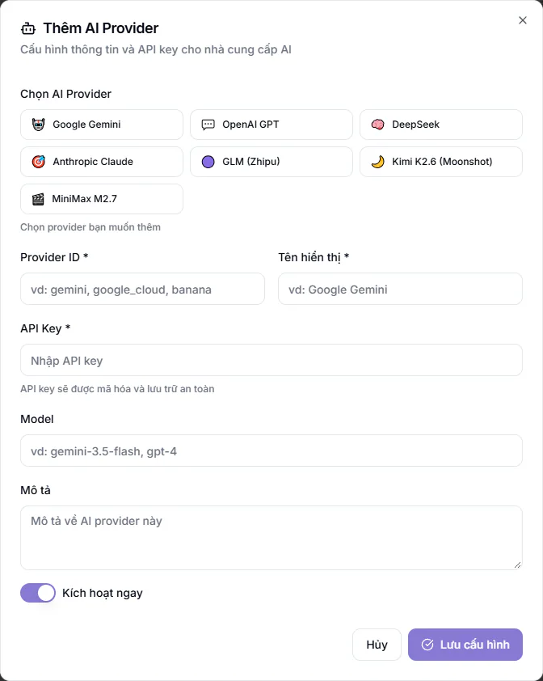

# Kết nối nhà cung cấp AI

Các tính năng AI (trợ lý, tạo nội dung, chấm bài...) cần một khoá truy cập của nhà cung cấp AI. Bài này hướng dẫn nhập khoá riêng của trung tâm. Tiền dùng AI khi đó tính trực tiếp vào tài khoản của bạn ở nhà cung cấp, không qua KLASSA.

Mục này cần gói mở rộng **Nền tảng AI** và chỉ Quản trị viên thấy. Chưa có gói, phần cấu hình sẽ không mở.

## Nhập khoá cho một nhà cung cấp

::: steps
1. Vào **Cài đặt → Tổng quan**, mở tab **AI & Tự động**, rồi mục **Cấu hình API**.
2. Ở khung **Thêm nhanh AI Provider**, bấm vào nhà cung cấp muốn dùng: Google Gemini, OpenAI GPT, DeepSeek, Anthropic Claude, GLM (Zhipu), Kimi K2.6 (Moonshot) hoặc MiniMax M2.7. Cũng có thể bấm **Thêm Provider** để tự nhập.
3. Hộp thêm mới hiện ra. Kiểm tra **Provider ID** và **Tên hiển thị** (bắt buộc), nhập **API Key** (bắt buộc).
   
4. Điền **Model** nếu muốn chỉ định, và **Mô tả** nếu cần.
5. Giữ **Kích hoạt ngay** nếu muốn dùng liền, rồi bấm **Lưu cấu hình**.
:::

Muốn lấy khoá, đăng ký tài khoản trên trang của nhà cung cấp (ví dụ Google AI Studio cho Gemini).

## Bật, tắt, sửa, xoá

Mỗi nhà cung cấp đã lưu hiện thành một thẻ. Dùng công tắc trên thẻ để **bật hoặc tắt**, nút bút chì để **sửa**, nút thùng rác để **xoá** cấu hình.

## Bật hoặc tắt từng tính năng AI

Cùng tab **AI & Tự động**, mục **Tính năng AI** cho bật hoặc tắt các tính năng AI trong hệ thống. Mỗi tính năng có thể chọn nhà cung cấp riêng, hoặc để **Tự động** (dùng nhà cung cấp chính). Xem thêm [Trợ lý AI](../ai-hub/chat.md).

::: warning Lưu ý
Khoá AI là thông tin nhạy cảm, đừng gửi cho người không cần biết. Mỗi lần AI chạy đều có chi phí theo bảng giá nhà cung cấp, nên đặt giới hạn chi tiêu ngay trên tài khoản của nhà cung cấp.
:::

## Câu hỏi thường gặp

::: details Trung tâm không nhập khoá thì AI có chạy không?
Tuỳ cách trung tâm được cấp. Nếu AI báo lỗi khoá không hợp lệ, hãy kiểm tra lại khoá ở đây hoặc liên hệ hỗ trợ KLASSA.
:::

::: details Nên chọn nhà cung cấp nào?
Google Gemini là lựa chọn đầy đủ nhất: một khoá dùng được cho chữ, ảnh và video. Các nhà cung cấp còn lại phù hợp khi trung tâm đã có sẵn tài khoản.
:::
