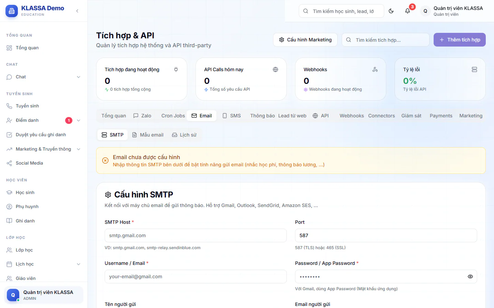
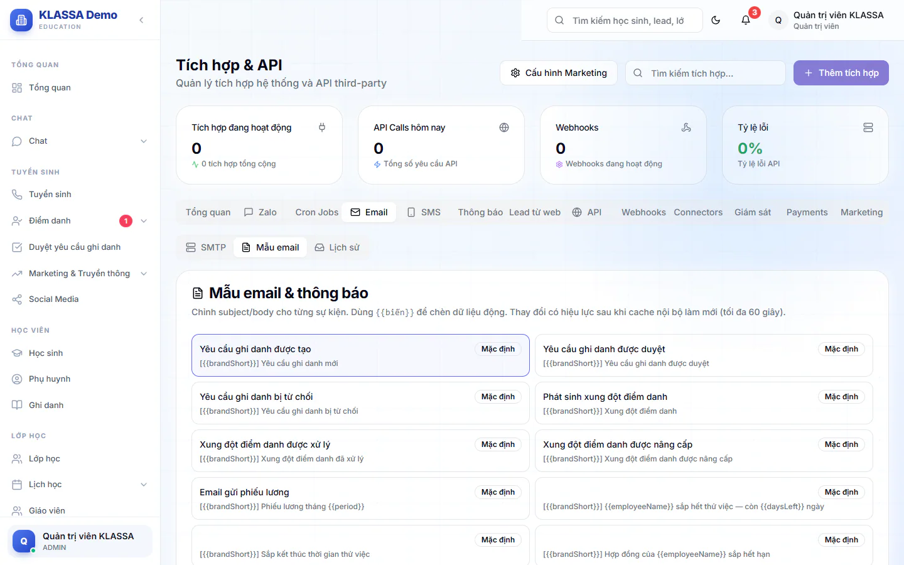

# Kết nối email gửi đi

KLASSA gửi một số email tự động (phiếu lương, thông báo ghi danh, thông báo xung đột điểm danh, nhắc học phí) bằng tài khoản email của chính trung tâm. Bạn cần nhập tài khoản này một lần. Sau đó bạn có thể sửa nội dung từng mẫu email và xem lại email nào đã gửi, email nào lỗi.

Phần này nằm trong trang **Tích hợp**, tab **Email**, và chỉ Quản trị viên thấy. Tab có 3 mục: **SMTP**, **Mẫu email**, **Lịch sử**.

## Nhập tài khoản gửi email

::: steps
1. Vào **AI Hub → Tích hợp**, mở tab **Email**, mục **SMTP**.
2. Điền **SMTP Host** (ví dụ smtp.gmail.com), **Username / Email** và **Password / App Password**. Ba ô này bắt buộc.
3. Điền **Port** nếu cần. Mặc định là 587. Dùng 465 thì bật công tắc **Kết nối bảo mật (SSL)**.
4. Điền **Tên người gửi** và **Email người gửi**. Đây là tên và địa chỉ phụ huynh, nhân viên thấy ở thư nhận được.
5. Bấm **Lưu cấu hình SMTP** (khi đã cấu hình từ trước, nút này đổi tên thành **Cập nhật cấu hình SMTP**).
   
:::

Khi đã lưu, đầu mục hiện dòng "Email đã được cấu hình" kèm máy chủ và người gửi.

::: tip Mẹo
Với Gmail, bạn phải dùng **Mật khẩu ứng dụng** (App Password) của Google, không dùng mật khẩu đăng nhập thường. Email của tên miền riêng của trung tâm thường ít bị đưa vào thư rác hơn email cá nhân.
:::

## Gửi thử để kiểm tra

::: steps
1. Ở mục **Kiểm tra kết nối**, nhập email nhận thử.
2. Bấm **Gửi email test**.
3. Mở hộp thư đó xem đã nhận chưa. Nếu lỗi, màn hình hiện lý do từ nhà cung cấp email.
:::

Nút **Gửi email test** chỉ bấm được sau khi bạn đã lưu cấu hình.

## Gỡ tài khoản email

Bấm **Gỡ tài khoản email** (chỉ hiện khi đã cấu hình), xác nhận. Hệ thống xoá thông tin SMTP và ngừng gửi mọi email tự động cho tới khi bạn nhập lại.

## Sửa mẫu email

Mục **Mẫu email** liệt kê các sự kiện có email tự động:

- Yêu cầu ghi danh được tạo, được duyệt, bị từ chối.
- Phát sinh xung đột điểm danh, xung đột được xử lý, xung đột được nâng cấp.
- Email gửi phiếu lương.
- Nhắc việc nhân sự: sắp hết thử việc, hợp đồng hoặc chứng chỉ sắp hết hạn, sinh nhật, kỳ đánh giá. Mỗi loại có mẫu gửi quản lý và mẫu gửi nhân viên.

::: steps
1. Bấm vào một sự kiện ở danh sách. Phần bên dưới hiện nội dung đang dùng và các biến có thể chèn, dạng `{{tên_biến}}`.
2. Sửa **Subject (dòng tiêu đề email)** và **Body**. Hai ô **In-app: Tiêu đề** và **In-app: Nội dung** là chữ hiện trong chuông thông báo của phần mềm.
3. Bấm **Xem trước** để xem thư trông thế nào.
4. Muốn thử thật: nhập email nhận ở ô gửi thử rồi bấm **Gửi test**. Để trống thì thư gửi về email tài khoản Quản trị viên.
5. Bấm **Lưu template**.
:::

**Khôi phục mặc định** đưa nội dung về mẫu gốc nhưng chưa lưu, bạn vẫn cần bấm **Lưu template**. **Xoá override** bỏ hẳn bản đã sửa và dùng lại mẫu gốc. Nội dung mới có hiệu lực sau tối đa 60 giây.

::: warning Lưu ý
Nếu bạn chuyển sang sự kiện khác khi còn thay đổi chưa lưu, hệ thống hỏi xác nhận vì thay đổi sẽ mất.
:::

## Xem lịch sử email

Mục **Lịch sử** liệt kê email đã gửi: thời gian, trạng thái (**Thành công** hoặc **Thất bại**), sự kiện, người nhận và tiêu đề. Bạn có thể tìm theo tiêu đề hoặc địa chỉ email, và lọc theo trạng thái hoặc sự kiện. Bấm **Làm mới** để tải lại.

## Câu hỏi thường gặp

::: details Có gửi email hàng loạt cho phụ huynh được không?
Chưa. Mục **Truyền thông (Email)** trong menu hiện chỉ là màn minh hoạ, chưa gửi được thư thật. Email thật chỉ là các email tự động ở trên. Muốn nhắn nhiều phụ huynh cùng lúc, dùng [Zalo](../tin-nhan/zalo.md).
:::

::: details Thư không tới, kiểm tra ở đâu?
Mở mục **Lịch sử**, lọc **Thất bại** để xem lý do. Nếu chưa có dòng nào, kiểm tra lại mục **SMTP** đã hiện "Email đã được cấu hình" chưa.
:::

::: details Có gửi hoá đơn học phí qua email không?
Có, ở từng hoá đơn khi gửi cho phụ huynh. Xem [Tạo hoá đơn](../hoc-phi/tao-hoa-don.md).
:::
