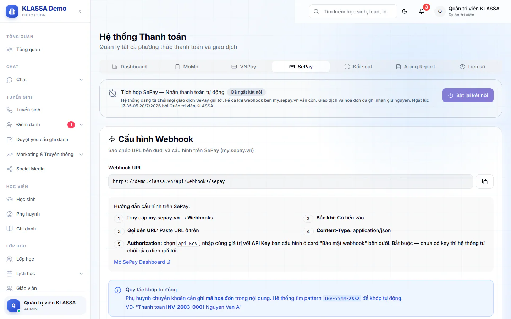

# Kết nối ngân hàng qua SePay

Khi phụ huynh chuyển khoản học phí, KLASSA có thể tự ghi nhận khoản tiền và đánh dấu hoá đơn đã thanh toán, kế toán không phải nhập tay. Việc này làm qua dịch vụ SePay (my.sepay.vn): SePay theo dõi tài khoản ngân hàng của trung tâm và báo cho KLASSA mỗi khi có tiền vào. KLASSA chỉ nhận thông báo, không có quyền lấy tiền từ tài khoản.

Phần cài đặt nằm ở **Tài chính → Thanh toán**, tab **SePay**. Tab này chỉ hiện với người có quyền quản lý thanh toán học phí (mặc định là Quản trị viên, Quản lý chi nhánh và Kế toán). Để dùng được, trung tâm cần có tài khoản SePay đã gắn với ngân hàng.

## Cài đặt lần đầu

::: steps
1. Vào **Tài chính → Thanh toán**, mở tab **SePay**.
2. Ở mục **Bảo mật webhook (API Key)**, bấm **Tạo ngẫu nhiên** để có một khoá. Khoá phải từ 32 ký tự trở lên. Bạn cũng có thể dán khoá của mình. Bấm **Lưu key**.
3. Ở mục **Cấu hình Webhook**, bấm sao chép **Webhook URL**.
4. Đăng nhập my.sepay.vn, mở **Webhooks** và tạo mới: **Bắn khi** chọn "Có tiền vào", **Gọi đến URL** dán đường dẫn vừa sao chép, **Content-Type** là application/json.
5. Ở phần xác thực **Authorization** của SePay, chọn **Api Key** và nhập đúng khoá ở bước 2.
6. Quay lại KLASSA, bấm **Test Webhook** để kiểm tra đường truyền.
:::

Đầu tab có dấu **Đang hoạt động** khi kết nối bật, hoặc **Đã ngắt kết nối** khi tắt. Bấm **Ngắt kết nối** để tạm dừng nhận tiền, **Bật lại kết nối** để chạy tiếp.

::: warning Lưu ý
Chưa có khoá thì hệ thống từ chối mọi giao dịch gửi tới (mặc định an toàn). Nút **Xoá key (tắt xác thực)** chỉ nên dùng khi bạn hiểu rõ, vì khi đó ai biết đường dẫn cũng có thể báo tiền giả.
:::

## Cách hệ thống khớp tiền với hoá đơn

Phụ huynh cần ghi **mã hoá đơn** trong nội dung chuyển khoản. Mã có dạng `INV-YYYYMM-XXXX`, ví dụ: "Thanh toan INV-202603-0001 Nguyen Minh An". Ngân hàng có thể bỏ dấu gạch khi ghi nội dung, hệ thống vẫn nhận ra.

- Chỉ khớp với hoá đơn **chưa thanh toán** hoặc **thanh toán một phần**.
- Chuyển thiếu: hoá đơn ghi nhận phần đã trả, còn nợ phần còn lại.
- Chuyển dư: hoá đơn ghi đúng số cần trả, phần dư thành credit của phụ huynh.
- Giao dịch gửi lặp hai lần chỉ ghi một lần.
- Không tìm thấy mã, hoặc không có hoá đơn phù hợp: giao dịch được lưu ở trạng thái **Chưa khớp** để xử lý tay.

## Xử lý giao dịch chưa khớp

::: steps
1. Vào **Tài chính → Thanh toán**, mở tab **Đối soát**.
2. Lọc **Trạng thái** là **Chưa khớp**, hoặc tìm theo nội dung, mã tham chiếu, mã hoá đơn.
3. Ở giao dịch cần xử lý, bấm **Khớp**. Hộp **Khớp thủ công giao dịch** hiện thông tin giao dịch.
4. Nhập mã hoá đơn, tên học sinh hoặc mã học sinh vào ô **Tìm hoá đơn** rồi tìm.
5. Bấm **Khớp** ở hoá đơn đúng trong danh sách kết quả.
:::

Mỗi giao dịch có nhãn **Đã khớp tự động**, **Khớp thủ công** hoặc **Chưa khớp**. Phiếu đã huỷ hoặc đã gộp không khớp được, hãy chọn phiếu đang có hiệu lực.

## Câu hỏi thường gặp

::: details KLASSA có tự lấy sao kê hay trừ tiền từ ngân hàng không?
Không. KLASSA chỉ nhận thông báo "có tiền vào" từ SePay. Không có thao tác nào rút tiền hay chuyển tiền.
:::

::: details Phụ huynh ghi sai hoặc quên mã hoá đơn thì sao?
Giao dịch ở trạng thái **Chưa khớp**. Người có quyền quản lý học phí khớp tay ở tab **Đối soát** như trên.
:::

::: details Có thanh toán bằng MoMo hoặc VNPay không?
Hai tab đó hiện chỉ lưu thông tin kết nối, phụ huynh chưa thể trả bằng MoMo hay VNPay. Xem [Thanh toán](../hoc-phi/thu-chi.md).
:::
