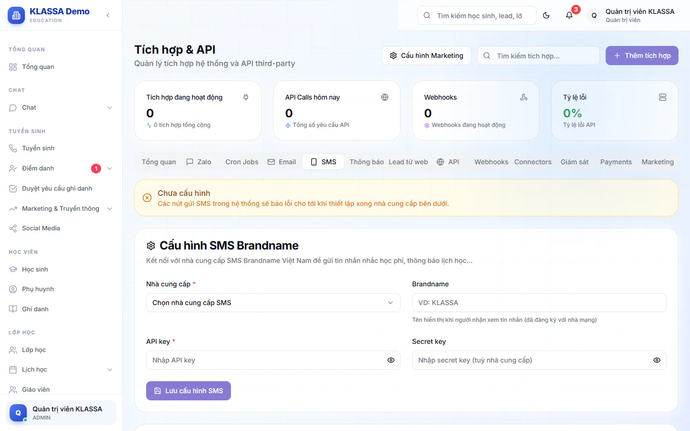

# Kết nối SMS

SMS giúp báo tin cho phụ huynh không dùng Zalo. Hệ thống dùng tài khoản SMS Brandname của trung tâm, nên bạn cần có tài khoản ở một nhà cung cấp trước. Khi chưa cấu hình, mọi nơi gửi SMS sẽ báo chưa cấu hình, không gửi giả.

Cấu hình nằm ở trang **Tích hợp**, tab **SMS**, chỉ Quản trị viên thấy. Gói **SMS Gateway** đã ngừng bán, nhưng phần cấu hình này vẫn dùng được.

## Nhập cấu hình SMS

::: steps
1. Vào **AI Hub → Tích hợp**, mở tab **SMS**.
2. Ở ô **Nhà cung cấp** chọn một trong: **Vietguys**, **eSMS**, **SpeedSMS** hoặc **Tuỳ chỉnh** (ô bắt buộc).
3. Điền **Brandname**, ví dụ tên trung tâm đã đăng ký với nhà cung cấp.
4. Nhập **API Key** (bắt buộc). Có thể cần thêm **Secret Key**, tuỳ nhà cung cấp.
5. Nếu chọn **Tuỳ chỉnh**, điền thêm **API Endpoint** (bắt buộc) theo hướng dẫn của nhà cung cấp.
6. Bấm **Lưu cấu hình SMS**.
   
:::

Sau khi lưu, khoá được ẩn và hiện "đã lưu". Muốn đổi, nhập khoá mới rồi lưu lại.

## Gửi thử

::: steps
1. Ở mục **Gửi SMS test**, nhập số điện thoại nhận thử, ví dụ 0912345678.
2. Bấm **Gửi SMS test**.
3. Kết quả hiện ngay bên dưới, là phản hồi thật từ nhà cung cấp.
:::

Nút này chỉ bấm được sau khi đã lưu cấu hình.

## SMS được dùng ở đâu

- Nhắc học phí cho phụ huynh chưa thanh toán.
- Thông báo lịch học hoặc lịch học thử khi phụ huynh chưa liên kết Zalo.
- Tin nhắn tay từ trang chi tiết phụ huynh.

::: warning Lưu ý
Brandname và nội dung tin thường phải đăng ký với nhà cung cấp trước khi gửi được. Mỗi tin SMS tính phí theo bảng giá của nhà cung cấp, không tính qua KLASSA.
:::

## Câu hỏi thường gặp

::: details Trung tâm có cần dùng SMS không?
Không bắt buộc. Nếu phụ huynh đã nhận tin qua Zalo thì SMS chỉ là phương án dự phòng. Xem [Zalo](../tin-nhan/zalo.md).
:::

::: details Báo "chưa cấu hình SMS" khi gửi thì làm sao?
Vào tab **SMS** theo các bước trên, lưu cấu hình rồi gửi lại.
:::
