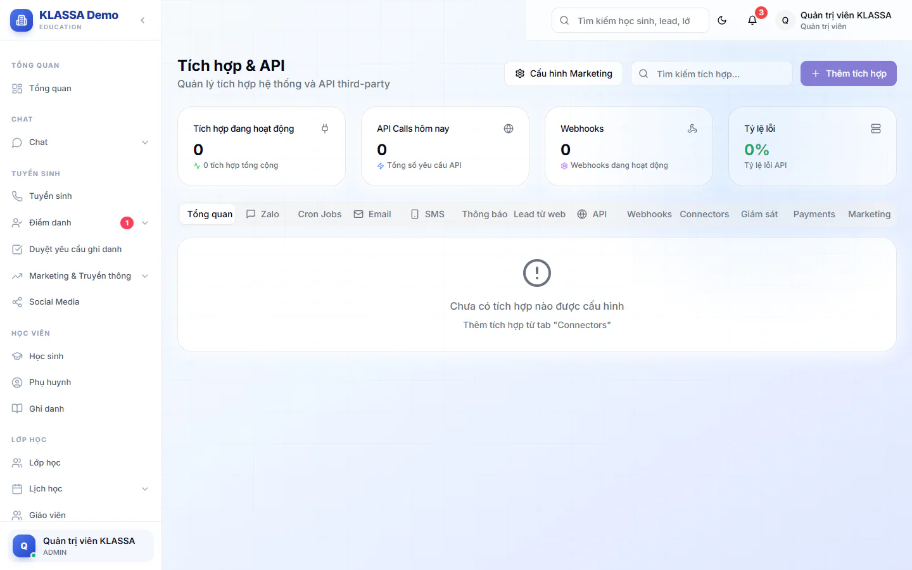

# Trang Tích hợp

Trang **Tích hợp** gom cài đặt kết nối KLASSA với dịch vụ bên ngoài: Zalo, email, SMS, nhận lead từ website và một số kết nối kỹ thuật. Mọi thứ nằm trong một trang chia tab, không phải nhiều trang rời nhau.

Vào **AI Hub → Tích hợp**. Trang mở ra có tiêu đề **Tích hợp & API**. Quản trị viên và Quản lý chi nhánh mở được trang này, nhưng một số tab chỉ Quản trị viên thấy (xem bảng dưới).

## Các tab

| Tab | Dùng để làm gì | Ai thấy |
|-----|----------------|---------|
| **Tổng quan** | Xem nhanh tình trạng các kết nối | Cả hai vai |
| **Zalo** | Kết nối Zalo OA và Zalo cá nhân, xem [Zalo OA](zalo-oa.md) và [Zalo cá nhân](zalo-ca-nhan.md) | Cả hai vai |
| **Cron Jobs** | Xem các tác vụ chạy tự động theo lịch | Quản trị viên |
| **Email** | Tài khoản gửi email, mẫu email, lịch sử gửi, xem [Kết nối email](email.md) | Quản trị viên |
| **SMS** | Tài khoản SMS Brandname, xem [Kết nối SMS](sms.md) | Quản trị viên |
| **Thông báo** | Kênh thông báo và ai nhận thông báo nào, xem [Thông báo](../tin-nhan/thong-bao.md) | Quản trị viên |
| **Lead từ web** | Nhận lead từ biểu mẫu trên website, xem [Yêu cầu đăng ký](../tuyen-sinh/yeu-cau-dang-ky.md) | Quản trị viên, Quản lý chi nhánh |
| **API**, **Webhooks**, **Connectors**, **Giám sát**, **Payments** | Kết nối kỹ thuật với phần mềm khác, cần người có chuyên môn | Cả hai vai |
| **Marketing** | Kết nối Page Facebook cho chat, xem [Chat Facebook](../tin-nhan/facebook.md) | Quản trị viên |

::: warning Lưu ý
Tab **Payments** chỉ lưu thông tin MoMo, VNPay, phụ huynh chưa trả được bằng hai cách này. Muốn nhận tiền chuyển khoản tự động, dùng SePay ở [Kết nối ngân hàng](ngan-hang.md).
:::

## Các kết nối khác ngoài trang này

- **Ngân hàng (SePay)** nằm ở **Tài chính → Thanh toán**, xem [Kết nối ngân hàng](ngan-hang.md).
- **Nhà cung cấp AI** nằm ở **Cài đặt → Tổng quan**, tab **AI & Tự động**, xem [Kết nối nhà cung cấp AI](ai-providers.md).

## Câu hỏi thường gặp

::: details Tôi không thấy tab Email hay SMS?
Hai tab này chỉ dành cho Quản trị viên. Quản lý chi nhánh cần nhờ Quản trị viên.
:::

::: details Menu Quản trị hệ thống cũng có mục Tích hợp & APIs?
Có, mục đó mở thẳng tab **Marketing** của cùng trang này.
:::
