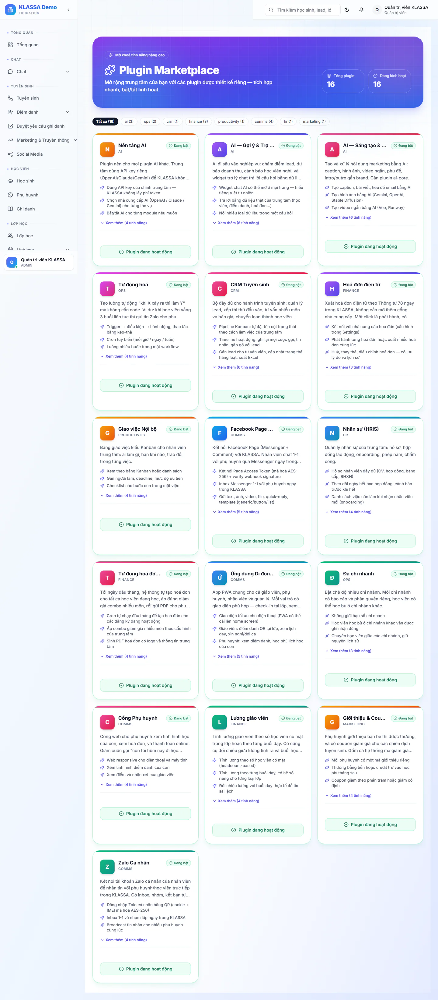
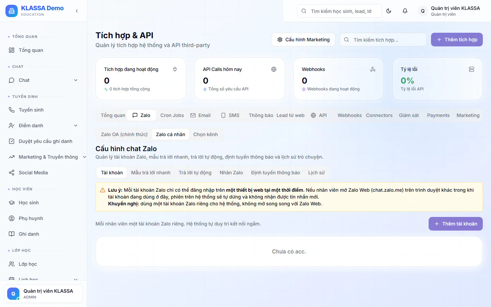
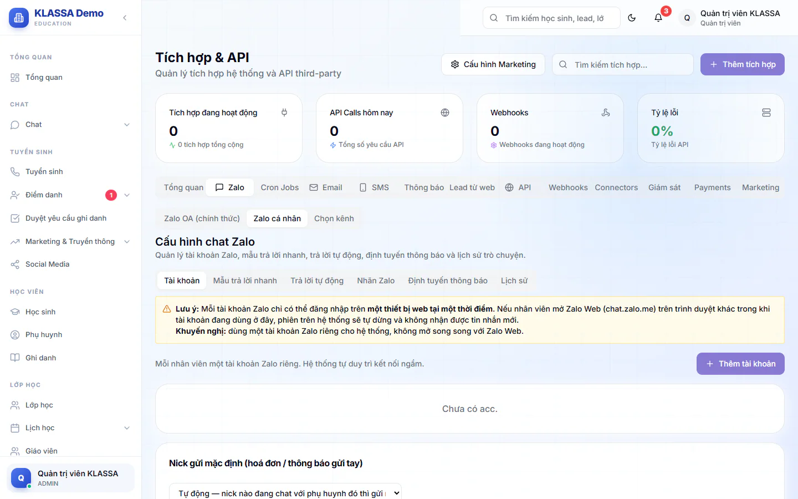

# Kết nối Zalo cá nhân

Zalo cá nhân cho phép nhân viên dùng chính nick Zalo của trung tâm để nhắn tin hai chiều với phụ huynh ngay trong KLASSA. Bạn thêm nick một lần, quét mã QR, sau đó nhân viên chat ở [Chat Zalo](../tin-nhan/zalo.md).

Khác với [Zalo OA](zalo-oa.md) (gửi một chiều theo mẫu đã duyệt, trả phí), Zalo cá nhân miễn phí và phụ huynh nhắn lại được.

## Bật gói mở rộng

Gói **Zalo (Cá nhân + OA)** không tự bật được từ phía trung tâm. Vào **Plugin Marketplace**, thẻ gói chưa bật chỉ có nút **Liên hệ KLASSA**. Đội KLASSA sẽ kích hoạt, sau đó phần cấu hình Zalo mới hiện ra.

## Thêm nick Zalo và đăng nhập bằng QR

::: steps
1. Vào **Tích hợp**, mở tab **Zalo**, chọn **Zalo cá nhân**, rồi mở tab con **Tài khoản**.
2. Bấm **Thêm tài khoản**, hộp **Thêm acc Zalo mới** hiện ra.
3. Nhập **Tên gọi** (bắt buộc, ví dụ "Sale Cầu Giấy") rồi bấm **Tạo**. Nick xuất hiện với trạng thái **Cần quét QR**.
4. Bấm **Quét QR** trên thẻ nick, hộp **Quét QR đăng nhập** hiện mã QR.
5. Trên điện thoại, mở Zalo, vào Cài đặt, chọn Quét QR, quét mã và xác nhận trên điện thoại.
6. Khi trạng thái đổi sang **Đang hoạt động**, hệ thống bắt đầu nhận tin.
:::

Chỉ đăng nhập bằng QR. Bạn không nhập số điện thoại hay mật khẩu Zalo vào KLASSA.

::: warning Mỗi nick chỉ giữ một phiên web
Zalo chỉ cho một nick đăng nhập trên một thiết bị web tại một thời điểm. Nếu có người mở Zalo Web (chat.zalo.me) bằng cùng số, phiên trong KLASSA sẽ tự dừng và không nhận tin mới. Nên dùng một số Zalo riêng cho trung tâm, không dùng số cá nhân của nhân viên.
:::

## Kiểm tra trạng thái nick

Nếu tin phụ huynh không về, hoặc tin không gửi đi được, việc đầu tiên là vào **Tích hợp → Zalo → Zalo cá nhân → Tài khoản** xem trạng thái của nick. Trong hộp thư **Chat Zalo**, nick mất phiên cũng hiện dòng cảnh báo đỏ kèm liên kết **Quét QR lại**.

| Trạng thái | Cách xử lý |
|------------|-----------|
| **Đang hoạt động** | Bình thường, không cần làm gì. |
| **Cần quét QR** | Mới tạo hoặc chưa đăng nhập. Bấm **Quét QR**. |
| **Hết phiên** | Nick rớt đăng nhập. Bấm **Login lại** và quét QR. |
| **Bị khoá** | Zalo đang hạn chế nick. Giảm lượng tin gửi, thử đăng nhập lại và kiểm tra nick trên điện thoại. |
| **Tạm dừng** | Nick đang tạm dừng, không nhận và không gửi tin. |

## Các nút trên thẻ nick

- **Quét QR** (hoặc **Login lại** khi nick đang hoạt động): đăng nhập lại bằng mã QR.
- **Chia sẻ**: cho nhiều nhân viên dùng chung một nick. Tick **Bật chia sẻ**, chọn người rồi bấm **Lưu cấu hình chia sẻ**. Quản trị viên và Quản lý chi nhánh luôn có quyền. Danh sách chọn không có Giáo viên, Trợ giảng, Nhân sự, Phụ huynh.
- **Profile** (chỉ khi nick đang hoạt động): đổi tên hiển thị, bio, ảnh đại diện và chế độ hiển thị online.
- **Đăng xuất**: thoát phiên, có thể quét QR lại sau.
- Biểu tượng thùng rác: xoá nick khỏi hệ thống. Tài khoản Zalo thật của bạn không bị ảnh hưởng.

## Hai cài đặt nằm cùng tab Tài khoản

- **Nick gửi mặc định (hoá đơn / thông báo gửi tay)**: để **Tự động** thì tin đi từ nick đang chat với phụ huynh đó. Nếu chọn một nick cụ thể, mọi hoá đơn gửi tay đều đi từ nick này, phụ huynh chưa từng chat với nick đó sẽ bị bỏ qua.
- **Tự động tạo nhóm lớp Zalo**: mặc định tắt, Quản trị viên bật ở đây. Bật thì khi có học sinh ghi danh vào lớp chưa có nhóm, hệ thống tự tạo nhóm Zalo. Lớp đã có nhóm tạo tay thì vào trang lớp, bấm **Gán nhóm có sẵn** để liên kết, tránh tạo trùng. Dù tắt, phụ huynh mới vẫn được thêm vào nhóm đã gắn.

## Các tab con khác

- **Mẫu trả lời nhanh**: soạn sẵn câu hay dùng. Bấm **Thêm mẫu**, nhập **Tên mẫu**, **Nội dung** (chèn được biến như tên phụ huynh, tên học sinh, tên lớp, số tiền), **Phím tắt** và **Loại mẫu**. Một số loại tự gửi khi có sự kiện: chào kết bạn mới, khách hàng tiềm năng mới, học sinh mới, hoá đơn, học sinh vắng, đặt lịch học thử, đổi lịch lớp. Danh sách trống thì bấm nút tạo mẫu mặc định.
- **Trả lời tự động**: khi phụ huynh nhắn tin chứa từ khoá, hệ thống tự gửi câu trả lời. Bấm **Thêm rule**, điền **Tên rule**, **Keywords** (cách nhau bằng dấu phẩy), kiểu khớp, thứ tự ưu tiên (số nhỏ chạy trước), **Response**, và khung giờ nếu cần. Danh sách trống thì bấm nút tạo 6 quy tắc mặc định.
- **Nhãn Zalo**: nhãn đồng bộ với app Zalo. Sửa xong bấm **Đồng bộ về Zalo**. Thao tác này thay toàn bộ danh sách nhãn.
- **Định tuyến thông báo**: với mỗi loại sự kiện (đơn ghi danh được duyệt, có học sinh mới, đã phát hành hoá đơn, đổi lịch học...), chọn các kênh gửi theo thứ tự ưu tiên. Kênh đầu lỗi thì chuyển sang kênh kế tiếp. Bấm **Thêm kênh gửi**, dùng mũi tên để đổi thứ tự, rồi **Lưu cấu hình**.
- **Lịch sử**: nhật ký các tin đã gửi, lọc **Tất cả**, **Đã gửi**, **Lỗi**.

## Ai được dùng Zalo cá nhân

- Quản trị viên, Quản lý chi nhánh: cấu hình ở **Tích hợp** và chat ở **Chat Zalo**.
- Quản lý, Lễ tân: chỉ chat ở **Chat Zalo** với nick được **Chia sẻ** cho mình, hoặc nick tự liên kết ở **Zalo của tôi**. Chưa có nick nào thì không thấy mục **Chat Zalo**.
- Kế toán: phải được **Chia sẻ** ít nhất một nick mới vào được **Chat Zalo**. Khi vào được, Kế toán thấy hội thoại của nick được chia sẻ và các hội thoại gắn nhãn hoá đơn.
- Giáo viên và Trợ giảng: không vào hộp thư, chỉ liên kết nick riêng ở [Zalo của tôi](../tin-nhan/zalo-cua-toi.md).
- Nhân sự và Phụ huynh: không dùng.

## Câu hỏi thường gặp

::: details Quét QR xong nhưng phiên cứ bị rớt?
Kiểm tra xem có ai mở Zalo Web bằng cùng số ở nơi khác không. Sau đó bấm **Login lại** và quét QR.
:::

::: details Có bị Zalo khoá nick khi gửi nhiều không?
Có rủi ro nếu gửi quá nhanh hoặc quá nhiều. Dùng số Zalo riêng cho trung tâm để sự cố không ảnh hưởng số cá nhân, và tránh gửi hàng loạt dồn dập.
:::

::: details Zalo cá nhân khác Zalo OA chỗ nào?
Cá nhân là chat hai chiều, miễn phí, dùng nick nhân viên. OA gửi một chiều theo mẫu chính thức, có phí. Xem [Kết nối Zalo OA](zalo-oa.md).
:::
