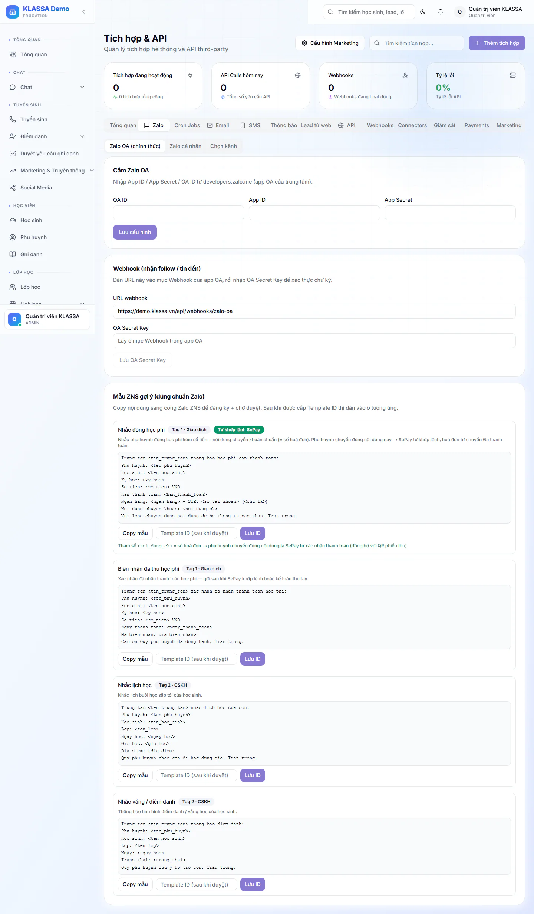
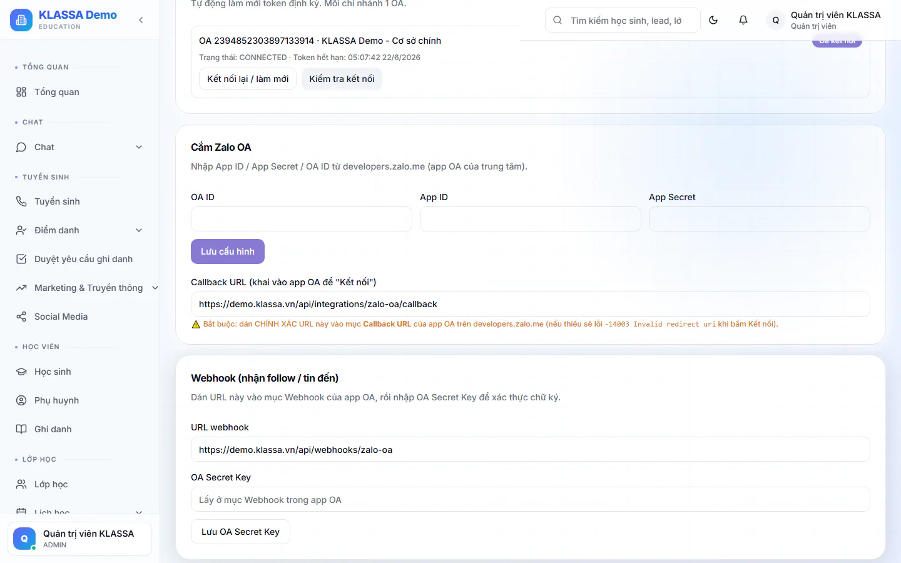
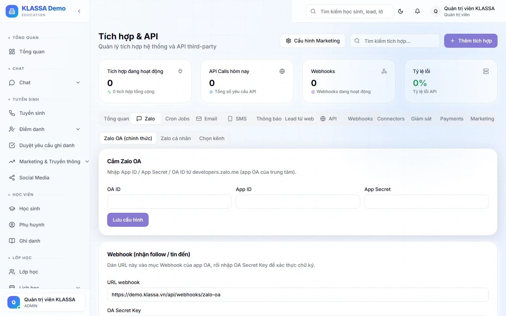
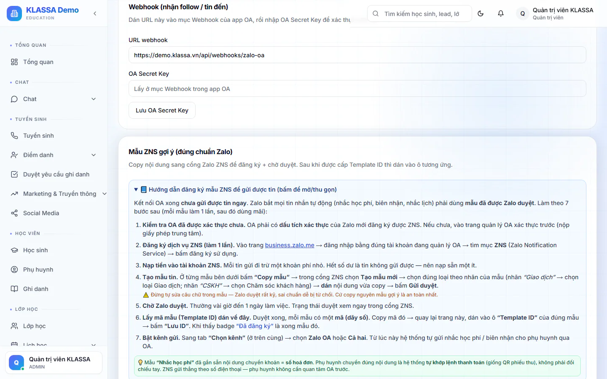
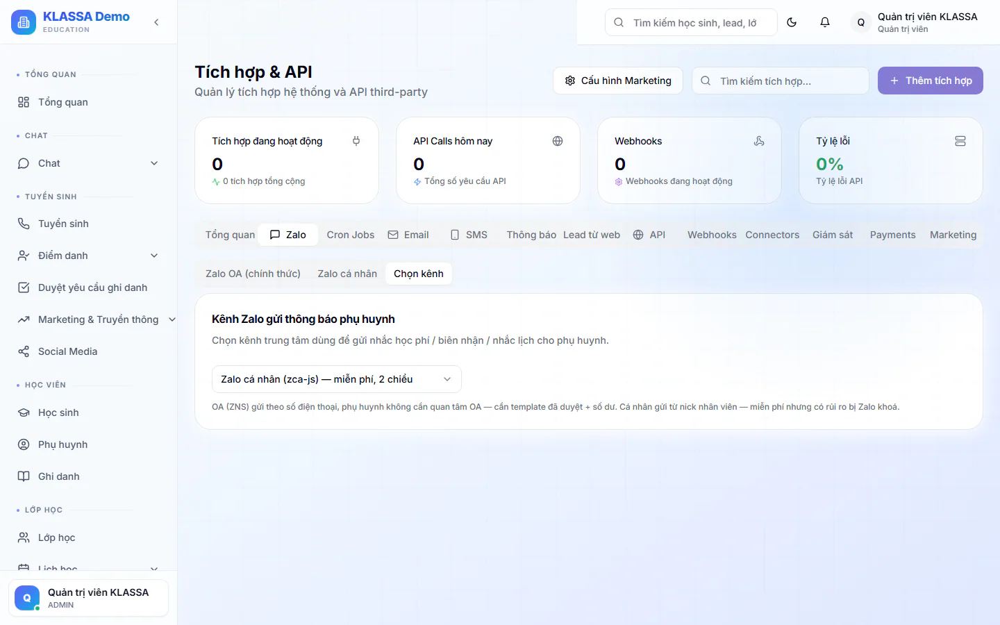

# Kết nối Zalo OA

Zalo OA (Official Account) là kênh gửi tin chính thức của Zalo. Sau khi kết nối, KLASSA tự gửi nhắc học phí, biên nhận và nhắc lịch cho phụ huynh theo số điện thoại. Phụ huynh không cần quan tâm OA trước.

OA gửi một chiều và không có màn hình soạn tay. Muốn chat hai chiều, dùng [Zalo cá nhân](zalo-ca-nhan.md).

| | **Zalo OA (chính thức)** | **Zalo cá nhân** |
|--|--------------------------|-------------------|
| Bản chất | Gửi một chiều | Chat hai chiều |
| Gửi theo | Số điện thoại phụ huynh | Hội thoại trực tiếp |
| Mẫu tin | Mẫu ZNS đã được Zalo duyệt | Gõ tự do |
| Chi phí | Trả phí ZNS cho Zalo | Miễn phí |

## Chuẩn bị

- Gói mở rộng **Zalo (Cá nhân + OA)** đã bật. Xem [Kết nối Zalo cá nhân](zalo-ca-nhan.md) để biết cách yêu cầu bật.
- Zalo OA của trung tâm đã được xác thực (có dấu tích) tại oa.zalo.me.
- Một ứng dụng gắn với OA, tạo tại developers.zalo.me, để lấy **OA ID**, **App ID**, **App Secret**.
- Nếu trung tâm có nhiều cơ sở, mỗi cơ sở dùng một OA riêng.

Vào **Tích hợp**, mở tab **Zalo**, chọn **Zalo OA (chính thức)**.

::: warning Cảnh báo đỏ về khoá mã hoá
Nếu đầu trang hiện cảnh báo "Chưa cấu hình khoá mã hoá", hãy báo KLASSA xử lý trước. Chưa xử lý thì không lưu được thông tin bí mật của OA.
:::

## Bước 1: Nhập thông tin OA

::: steps
1. Ở thẻ **Cắm Zalo OA**, nhập **OA ID**, **App ID** và **App Secret** (cả ba đều bắt buộc).
2. Bấm **Lưu cấu hình**. Hệ thống báo đã lưu và nhắc bấm **Kết nối OA** để uỷ quyền.
:::

Bạn không phải nhập mã truy cập. Hệ thống tự lấy ở bước 3.

## Bước 2: Khai Callback URL vào ứng dụng OA

Ngay dưới nút lưu có ô **Callback URL** (chỉ đọc). Đây là địa chỉ KLASSA tự tạo cho trung tâm bạn.

::: steps
1. Bấm vào ô để bôi đen rồi sao chép địa chỉ.
2. Vào ứng dụng OA trên developers.zalo.me, dán đúng địa chỉ này vào mục Callback URL và lưu.
:::

::: warning Bước dễ sót nhất
Thiếu hoặc sai bước này thì khi bấm **Kết nối OA** sẽ báo lỗi **-14003 Invalid redirect uri**.
:::

## Bước 3: Kết nối OA

Sau khi lưu, thẻ **OA đã kết nối** hiện ra, mỗi OA là một dòng với trạng thái **Chưa kết nối** hoặc **Đã kết nối**.

::: steps
1. Bấm **Kết nối OA**. Hệ thống chuyển sang trang cấp quyền của Zalo.
2. Đăng nhập Zalo bằng đúng tài khoản quản lý OA và đồng ý cấp quyền.
3. Zalo đưa bạn về KLASSA, hiện thông báo **Đã kết nối Zalo OA**.
:::

Kết nối được tự làm mới định kỳ. Khi hết hạn uỷ quyền, bấm **Kết nối lại / làm mới** một lần, không phải nhập lại OA ID hay App ID.

## Bước 4: Kiểm tra kết nối

Khi OA đã kết nối, thẻ có thêm nút **Kiểm tra kết nối**. Bấm trước mỗi đợt gửi để chắc OA còn hoạt động. Thành công thì hiện tên OA và số người quan tâm. Lỗi thì hiện thông báo đỏ, lúc đó bấm **Kết nối lại / làm mới**.

## Bước 5: Khai Webhook để nhận tin đến và lượt quan tâm

Ở thẻ **Webhook (nhận follow / tin đến)**:

::: steps
1. Sao chép **URL webhook** (ô chỉ đọc), dán vào mục Webhook của ứng dụng OA.
2. Nhập **OA Secret Key** (lấy ở mục Webhook của ứng dụng OA).
3. Bấm **Lưu OA Secret Key**.
:::

Chưa nhập khoá thì dòng OA nhắc **Chưa có OA Secret Key (webhook)**. Khi đã khai, thẻ **Người quan tâm OA** liệt kê ai vừa bấm quan tâm hoặc nhắn tin, cùng cột **Gửi free 48h**. Muốn đọc và trả lời tin đầy đủ, dùng app Zalo Official Account hoặc oa.zalo.me.

## Bước 6: Đăng ký mẫu tin ZNS

Kết nối xong chưa gửi được tin ngay. Zalo bắt mọi tin tự động phải dùng mẫu đã được duyệt. Thẻ **Mẫu ZNS gợi ý (đúng chuẩn Zalo)** có sẵn hướng dẫn và 4 mẫu chuẩn. Mỗi mẫu chỉ đăng ký một lần.

::: steps
1. Kiểm tra OA đã có dấu tích xác thực. Chưa có thì xác thực OA trước.
2. Vào business.zalo.me (đúng tài khoản quản lý OA), tìm mục ZNS và đăng ký dịch vụ.
3. Nạp tiền vào tài khoản ZNS. Mỗi tin gửi đi trừ một khoản phí nhỏ, hết số dư là không gửi được.
4. Ở từng mẫu trong KLASSA, bấm **Copy mẫu**. Trong cổng ZNS chọn **Tạo mẫu mới**, chọn loại theo nhãn của mẫu (**Giao dịch** hoặc **CSKH**), dán nội dung và bấm **Gửi duyệt**.
5. Chờ Zalo duyệt, thường vài giờ đến một ngày làm việc.
6. Duyệt xong, mỗi mẫu có một mã (dãy số). Dán vào ô **Template ID (sau khi duyệt)** của đúng mẫu và bấm **Lưu ID**. Mẫu hiện nhãn **Đã đăng ký** là xong.
7. Sang tab **Chọn kênh** để bật kênh gửi (bước 7).
:::

::: warning Đừng sửa câu chữ trong mẫu
Zalo duyệt rất kỹ. Sao chép nguyên mẫu là cách an toàn nhất, sửa chữ dễ bị từ chối.
:::

4 mẫu có sẵn:

| Mẫu | Loại | Ghi chú |
|-----|------|---------|
| Nhắc đóng học phí | Giao dịch | Có nhãn **Tự khớp lệnh SePay**: nội dung chuyển khoản là số hoá đơn, phụ huynh chuyển đúng thì hệ thống tự khớp thanh toán |
| Biên nhận đã thu học phí | Giao dịch | |
| Nhắc lịch học | CSKH | |
| Nhắc vắng / điểm danh | CSKH | |

## Bước 7: Chọn kênh gửi

Mở tab **Chọn kênh**, thẻ **Kênh Zalo gửi thông báo phụ huynh**:

- **Zalo cá nhân**: miễn phí, hai chiều, gửi từ nick nhân viên.
- **Zalo OA chính thức (ZNS)**: đúng luật, trả phí.
- **Cả hai**: OA trước, Zalo cá nhân dự phòng.
- **Tắt thông báo Zalo**: không gửi gì qua Zalo.

Chọn OA hoặc Cả hai thì hệ thống tự gửi nhắc học phí, biên nhận, nhắc lịch qua OA theo sự kiện.

Ngay dưới là thẻ **Bật/tắt từng loại thông báo Zalo**, mặc định bật tất cả. Mỗi loại có một công tắc: **Hoá đơn / học phí mới**, **Nhắc điểm danh thiếu (HS vắng)**, **Đổi lịch học**, **Xếp lớp / thêm học sinh**, **Khách hàng tiềm năng mới**, **Đặt lịch học thử**, **Lời chào khi kết bạn Zalo**. Công tắc này chỉ áp dụng cho kênh Zalo, không ảnh hưởng thông báo qua email hay tin nhắn SMS.

## Cách OA gửi tin

- Trong 48 giờ kể từ lần phụ huynh tương tác cuối, hệ thống gửi được tin tư vấn tự do, miễn phí.
- Ngoài 48 giờ, hệ thống dùng ZNS theo số điện thoại (mẫu đã duyệt, trả phí).

## Khi gặp lỗi

| Lỗi | Nguyên nhân và cách xử lý |
|-----|--------------------------|
| **-14003 Invalid redirect uri** khi bấm **Kết nối OA** | Chưa dán **Callback URL** vào ứng dụng OA (bước 2). |
| Đăng ký ZNS báo OA chưa đủ điều kiện | OA chưa được xác thực. Xác thực OA trước. |
| Tin ZNS không gửi đi | Hết số dư ZNS, hoặc mẫu chưa duyệt, hoặc chưa dán Template ID, hoặc chưa **Chọn kênh** OA hay Cả hai. |
| **Kiểm tra kết nối** báo lỗi | Bấm **Kết nối lại / làm mới**. |
| Tin Zalo cá nhân không gửi, không nhận | Vào **Zalo cá nhân → Tài khoản** kiểm tra trạng thái nick, xem [Kết nối Zalo cá nhân](zalo-ca-nhan.md). |

## Câu hỏi thường gặp

::: details Trung tâm chưa có Zalo OA thì làm sao?
Dùng tạm [Zalo cá nhân](zalo-ca-nhan.md): quét QR, chat hai chiều, miễn phí.
:::

::: details Phụ huynh có phải quan tâm OA mới nhận được tin?
Không với ZNS, vì ZNS gửi thẳng theo số điện thoại. Tin tư vấn miễn phí thì cần phụ huynh đã tương tác trong 48 giờ.
:::

::: details Hoá đơn gửi qua Zalo ở đâu?
Xem [Gửi hoá đơn qua Zalo](../hoc-phi/gui-hoa-don-zalo.md).
:::
