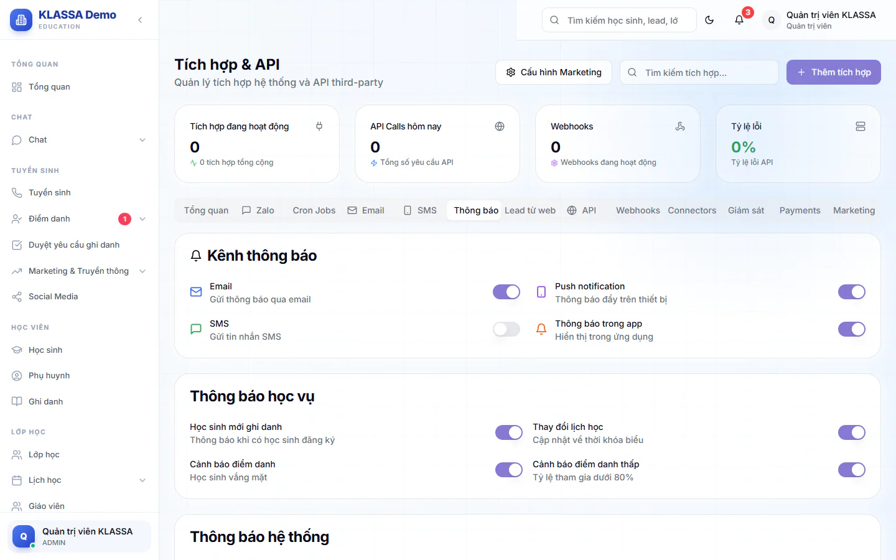

# Thông báo trong phần mềm

Thông báo là tin hiện trong phần mềm (và trên điện thoại nếu người nhận đã bật). Mọi nhân viên đều xem được thông báo của mình. Chỉ Quản trị viên và Quản lý chi nhánh được gửi thông báo mới.

## Xem thông báo của bạn

Vào **Marketing & Truyền thông → Thông báo**. Trang có các tab **Tất cả**, **Chưa đọc**, **Hệ thống** và **Lớp học**, kèm số lượng. Mỗi thông báo có nhãn mức ưu tiên (**Cao**, **Trung bình**, **Thấp**). Ba nút nhỏ ở bên phải cho phép đánh dấu đã đọc, đánh dấu chưa đọc và xoá thông báo.

## Gửi thông báo mới

::: steps
1. Vào **Marketing & Truyền thông → Thông báo**, bấm **Gửi thông báo**.
2. Chọn **Đối tượng nhận** (bắt buộc), xem danh sách bên dưới.
3. Nếu đối tượng cần thu hẹp, ô chọn phù hợp hiện thêm: **Khối lớp** cho phụ huynh theo khối, hoặc danh sách để tích chọn phụ huynh, giáo viên, nhân viên cụ thể.
4. Chọn **Mức độ ưu tiên**: **Thấp**, **Trung bình** hoặc **Cao**.
5. Ở **Kênh gửi thông báo**, tích **Push notification (trong app)** (mặc định bật) và/hoặc **Email** (mặc định tắt).
6. Nhập **Tiêu đề** và **Nội dung** (cả hai bắt buộc).
7. Bấm **Gửi thông báo**. Hệ thống báo đã gửi tới bao nhiêu người.
:::

Các lựa chọn **Đối tượng nhận**:

- Tất cả phụ huynh, phụ huynh theo khối lớp, phụ huynh cụ thể.
- Tất cả nhân viên, hoặc theo từng vai: giáo viên, trợ giảng, lễ tân, kế toán, quản lý (gồm quản lý chi nhánh), nhân sự.
- Giáo viên / trợ giảng cụ thể, nhân viên cụ thể.

::: warning Lưu ý
Nếu không có ai thuộc đối tượng bạn chọn, hệ thống báo "Không có ai nhận thông báo này". Chọn lại đối tượng rồi gửi lại. Kênh **Email** chỉ gửi được khi trung tâm đã [kết nối email](../tich-hop/email.md) và kênh đó đang bật trong cài đặt thông báo.
:::

## Chỉnh ai nhận thông báo tự động

Ngoài thông báo bạn tự gửi, hệ thống còn tự báo khi có lead mới, yêu cầu ghi danh mới (được tạo, được duyệt, bị từ chối) và xung đột điểm danh (phát sinh, được xử lý, được nâng cấp). Quản trị viên chỉnh phần này như sau.

::: steps
1. Vào **AI Hub → Tích hợp**, mở tab **Thông báo**.
2. Ở mục **Kênh thông báo**, bật hoặc tắt từng kênh chung: **Email**, **SMS** (mặc định tắt), **Push notification**, **Thông báo trong app**. Bấm **Lưu cài đặt**.
   
3. Kéo xuống mục **Ma trận thông báo theo vai trò & sự kiện**. Mỗi sự kiện có 3 hàng: **Gửi Email cho**, **Thông báo trong app cho**, **Push điện thoại (PWA/app) cho**.
4. Tích các vai được nhận ở từng hàng. **Chọn tất cả** và **Bỏ tất cả** tích nhanh cả hàng.
5. Bấm **Lưu ma trận**. Bấm **Khôi phục mặc định** để quay về thiết lập gốc (chưa lưu cho tới khi bạn bấm **Lưu ma trận**).
:::

Kênh tắt ở mục **Kênh thông báo** thì các tích trong ma trận không có tác dụng.

## Bật thông báo trên điện thoại của bạn

Mỗi người tự bật thông báo đẩy cho thiết bị mình ở thẻ **Thông báo đẩy** trong **Hồ sơ cá nhân** (bấm tên của bạn ở góc menu, rồi **Hồ sơ cá nhân**), bằng nút **Bật thông báo đẩy**. Trình duyệt sẽ hỏi quyền nhận thông báo, hãy chọn cho phép.

## Câu hỏi thường gặp

::: details Phụ huynh nhận thông báo ở đâu?
Phụ huynh nhận thông báo bạn gửi trong phần mềm hoặc app, và đẩy về điện thoại nếu họ đã bật thông báo. Muốn nhắn qua Zalo, xem [Zalo](zalo.md).
:::

::: details Giáo viên có gửi được thông báo không?
Không. Nút **Gửi thông báo** chỉ hiện với Quản trị viên và Quản lý chi nhánh.
:::
