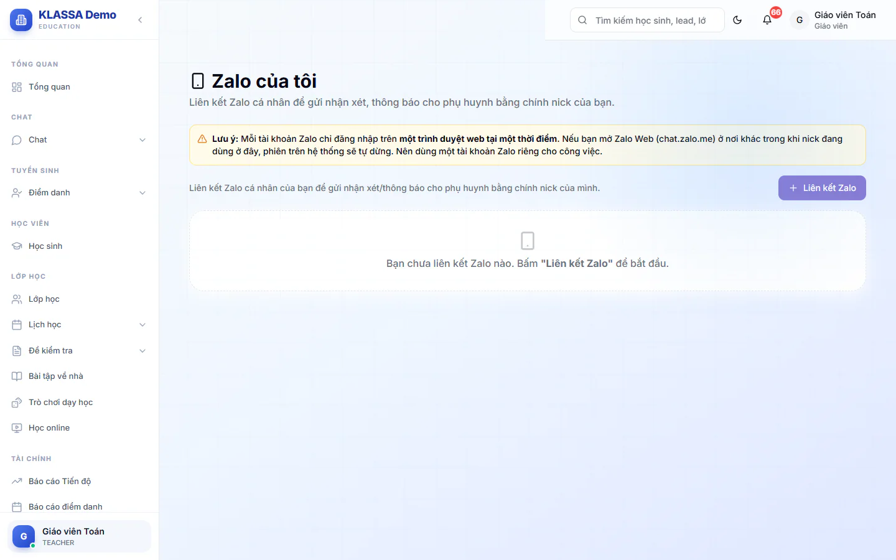

# Zalo của tôi

Trang này giúp bạn liên kết nick Zalo của chính mình để gửi nhận xét, thông báo cho phụ huynh bằng nick đó. Bạn chỉ quản lý nick của bản thân. Trang không có hộp thư hội thoại và không có chia sẻ nick.

Trung tâm cần có gói mở rộng **Zalo (Cá nhân + OA)** thì mục này mới dùng được.

## Liên kết nick Zalo của bạn

::: steps
1. Vào **Zalo của tôi**.
2. Bấm **Liên kết Zalo**, hộp **Liên kết Zalo của tôi** hiện ra.
3. Nhập **Tên gọi** để dễ nhận biết (bắt buộc, ví dụ "Zalo cô Lan") rồi bấm **Tạo**.
4. Bấm **Quét QR** trên thẻ nick vừa tạo, hộp **Quét QR đăng nhập Zalo** hiện mã QR.
5. Trên điện thoại, mở Zalo, vào Cài đặt, chọn Quét QR, quét mã và xác nhận trên điện thoại.
6. Khi đăng nhập thành công, thẻ nick hiện **Đang hoạt động**.
:::

::: warning Lưu ý
Mỗi nick chỉ đăng nhập trên một trình duyệt web tại một thời điểm. Nếu bạn mở Zalo Web (chat.zalo.me) ở nơi khác, phiên trong KLASSA sẽ tự dừng. Nên dùng một nick riêng cho công việc.
:::

## Các nút trên thẻ nick

- **Quét QR** (hoặc **Đăng nhập lại** khi nick đang hoạt động).
- **Đăng xuất**: thoát phiên, có thể quét QR lại sau. Chỉ hiện khi nick đang hoạt động.
- **Xoá khỏi hệ thống** (biểu tượng thùng rác): xoá nick khỏi KLASSA, không ảnh hưởng tài khoản Zalo thật của bạn.

Nick có các trạng thái **Đang hoạt động**, **Cần quét QR**, **Hết phiên**, **Bị khoá**, **Tạm dừng**. Khi nick không phải **Đang hoạt động**, bấm **Quét QR** hoặc **Đăng nhập lại** để vào lại.

## Câu hỏi thường gặp

::: details Nick của tôi báo Hết phiên?
Có thể ai đó đã mở Zalo Web bằng cùng số. Bấm **Quét QR** hoặc **Đăng nhập lại** trên thẻ nick và quét lại.
:::

::: details Tôi có xem được tin phụ huynh nhắn đến không?
Trang này chỉ để liên kết nick. Tin phụ huynh nhắn đến nằm ở hộp thư **Chat Zalo**: Quản trị viên và Quản lý chi nhánh luôn dùng được. Quản lý và Lễ tân thấy hộp thư với nick mình đã liên kết ở đây hoặc nick được **Chia sẻ** cho mình. Giáo viên và Trợ giảng không dùng hộp thư. Xem [Chat Zalo với phụ huynh](zalo.md).
:::

::: details Nick đã liên kết dùng để làm gì?
Để gửi nhận xét, thông báo cho phụ huynh bằng chính nick của bạn.
:::
