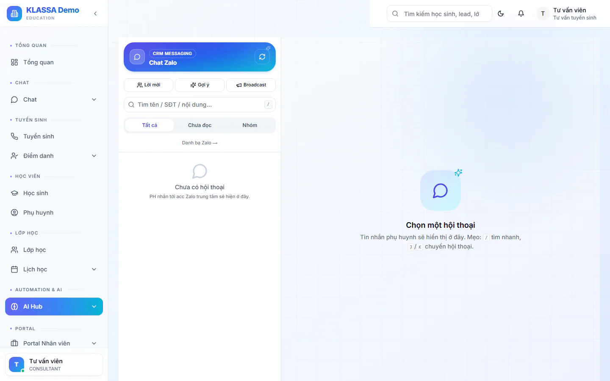
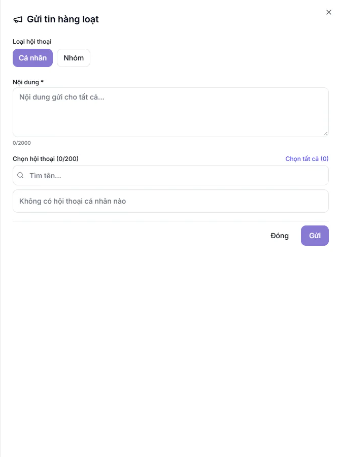

# Chat Zalo với phụ huynh

**Chat Zalo** là hộp thư hai chiều kiểu Messenger: phụ huynh nhắn đến, nhân viên trả lời ngay trong KLASSA. Dùng khi bạn cần chăm sóc phụ huynh, nhắn nhóm lớp hoặc gửi ảnh, thông báo lẻ.

Tính năng này thuộc gói mở rộng **Zalo (Cá nhân + OA)**. Chưa có gói thì mục **Chat Zalo** không hiện trong menu.

## Hai kênh Zalo trong KLASSA

| | **Zalo cá nhân** | **Zalo OA (chính thức)** |
|--|------------------|--------------------------|
| Nơi dùng | **Chat Zalo** (bài này) | Không có màn hình soạn tay |
| Cách gửi | Nhân viên gõ tin trực tiếp, hai chiều | Hệ thống tự gửi tin mẫu theo sự kiện, một chiều |
| Chi phí | Miễn phí | Trả phí theo Zalo |
| Thiết lập | [Kết nối Zalo cá nhân](../tich-hop/zalo-ca-nhan.md) | [Kết nối Zalo OA](../tich-hop/zalo-oa.md) |

Trung tâm chọn kênh nào để gửi thông báo tự động cho phụ huynh ở **Tích hợp → Zalo → Chọn kênh**, xem [Kết nối Zalo OA](../tich-hop/zalo-oa.md).

## Mở hộp thư và trả lời phụ huynh

::: steps
1. Vào **Chat Zalo**.
2. Nếu trung tâm có nhiều nick Zalo, chọn nick ở ô **Lọc theo nick Zalo** (mặc định **Tất cả nick**).
3. Lọc danh sách bên trái bằng **Tất cả**, **Chưa đọc** hoặc **Nhóm**. Gõ vào ô **Tìm tên / SĐT / nội dung…** để tìm nhanh.
4. Bấm một hội thoại, gõ tin vào ô nhập rồi bấm Enter để gửi (Shift+Enter để xuống dòng).
:::

Trong khung chat bạn còn có thể trả lời, chuyển tiếp, thu hồi tin, gửi ảnh, video, sticker và card ngân hàng, nhắc tên (@) trong nhóm, ghim hội thoại hoặc tắt thông báo 24 giờ. Card ngân hàng chỉ Quản trị viên, Quản lý chi nhánh và Kế toán gửi được.

::: warning Lưu ý
**Thu hồi** làm phụ huynh cũng không còn thấy tin, nhưng chỉ thu hồi được tin bạn gửi chưa quá 24 giờ. **Xoá khỏi máy** chỉ ẩn tin ở phía bạn, phụ huynh vẫn thấy.
:::

## Kết bạn và gợi ý

Ở đầu cột trái có ba nút:

- **Lời mời**: xem và xử lý lời mời kết bạn.
- **Gợi ý**: xem gợi ý kết bạn.
- **Broadcast**: gửi tin hàng loạt, xem phần dưới. Kế toán không gửi hàng loạt được.

## Gửi tin hàng loạt

::: steps
1. Bấm **Broadcast**, bảng **Gửi tin hàng loạt** mở ra.
2. Chọn nick ở ô **Gửi từ tài khoản** (bắt buộc).
3. Chọn **Loại hội thoại**: **Cá nhân** hoặc **Nhóm**.
4. Nhập **Nội dung** (bắt buộc, tối đa 2000 ký tự).
5. Tick các hội thoại cần gửi, hoặc bấm **Chọn tất cả**. Mỗi lần tối đa 200 hội thoại.
6. Bấm **Gửi**. Kết quả báo số tin gửi được và số tin lỗi.
:::

::: tip Mẹo
Hệ thống có giãn cách vài giây giữa các tin của cùng một nick. Dù vậy, tránh gửi dồn dập số lượng lớn để nick không bị Zalo hạn chế.
:::

## Mẫu trả lời, trả lời tự động và nhãn

Phần cấu hình nằm ở **Tích hợp → Zalo → Zalo cá nhân** (chỉ Quản trị viên và Quản lý chi nhánh vào được): mẫu trả lời nhanh, trả lời tự động theo từ khoá, nhãn Zalo. Xem [Kết nối Zalo cá nhân](../tich-hop/zalo-ca-nhan.md).

## Ai dùng được

- Quản trị viên, Quản lý chi nhánh, Quản lý, Lễ tân thấy mục **Chat Zalo** trong menu.
- Kế toán cũng thấy mục này nhưng chỉ xem được hội thoại đã gắn nhãn hoá đơn.
- Giáo viên, Trợ giảng, Nhân sự, Phụ huynh không dùng được hộp thư. Giáo viên và Trợ giảng chỉ liên kết nick của chính mình ở [Zalo của tôi](zalo-cua-toi.md).

## Câu hỏi thường gặp

::: details Có dòng đỏ báo nick mất phiên đăng nhập, phải làm gì?
Tin của nick đó không về KLASSA cho đến khi đăng nhập lại. Bấm **Quét QR lại** trên dòng cảnh báo để đến trang Tích hợp (chỉ Quản trị viên và Quản lý chi nhánh vào được, các vai khác nhờ họ xử lý), rồi quét QR theo hướng dẫn ở [Kết nối Zalo cá nhân](../tich-hop/zalo-ca-nhan.md).
:::

::: details Tôi muốn nhắn một nội dung cho cả lớp?
Dùng **Broadcast** với loại **Nhóm** hoặc **Cá nhân**. Nếu lớp đã có nhóm Zalo gắn sẵn, bạn cũng có thể nhắn thẳng vào nhóm từ hộp thư.
:::

::: details Gửi hoá đơn qua Zalo ở đâu?
Xem [Gửi hoá đơn qua Zalo](../hoc-phi/gui-hoa-don-zalo.md).
:::

::: details Nhắn chat nội bộ giữa nhân viên thì sao?
Đó là một tính năng khác, xem [Chat nội bộ](../cong-nhan-vien/chat.md).
:::
