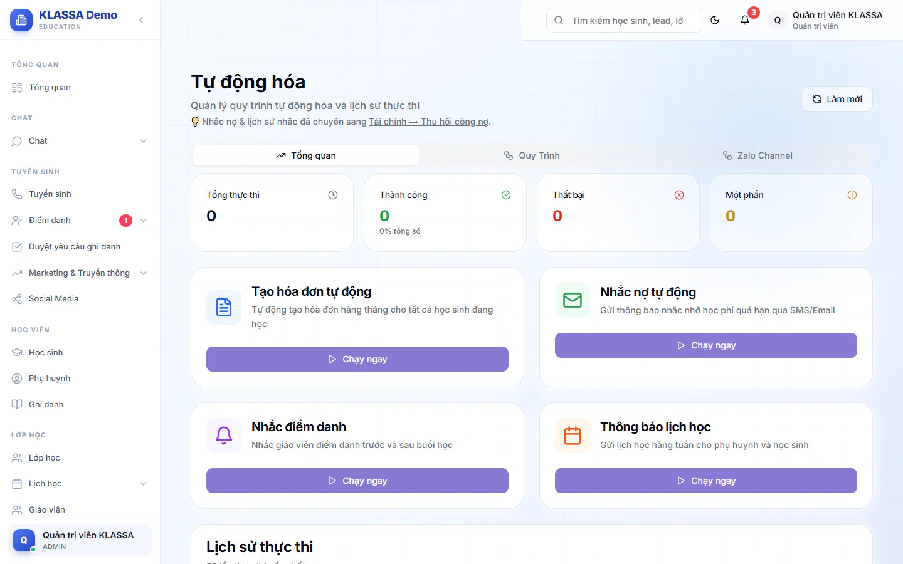

# Tự động hoá: chạy tác vụ hàng loạt

Thẻ **Tổng quan** của trang **Tự động hóa** cho bạn chạy tay bốn tác vụ hay lặp lại và xem lại kết quả các lần chạy. Mỗi tác vụ đều có chế độ **kiểm tra** để xem trước kết quả mà chưa tạo hay gửi gì thật.

Mặc định chỉ Quản trị viên mở được trang này (Quản lý chi nhánh thấy mục trong menu nhưng bị chặn, trừ khi Quản trị viên cấp quyền ở phần phân quyền). Trang cần gói mở rộng **Tự động hoá**. Xem [Gói mở rộng](../plugin/gioi-thieu.md).

## Mở trang

::: steps
1. Vào **AI Hub → Tự động hóa** (nhóm menu **Automation & AI**).
2. Thẻ **Tổng quan** hiện bốn ô số liệu (**Tổng thực thi**, **Thành công**, **Thất bại**, **Một phần**), bốn thẻ tác vụ và bảng **Lịch sử thực thi**.
3. Bấm **Làm mới** ở góc trên để cập nhật lịch sử.
:::

## Quy tắc chung: luôn kiểm tra trước

Cả bốn hộp tác vụ đều có ô đánh dấu **Chế độ kiểm tra** và nó **được chọn sẵn**. Khi còn đánh dấu, nút ở cuối hộp là **Kiểm tra**, hệ thống chỉ báo sẽ có bao nhiêu kết quả. Bỏ đánh dấu thì nút đổi thành nút chạy thật (**Tạo hóa đơn**, **Gửi nhắc nhở**, **Gửi thông báo**).

::: tip Mẹo
Luôn bấm **Kiểm tra** trước, đọc số lượng báo về, rồi mới bỏ đánh dấu và chạy thật.
:::

## Tạo hoá đơn tự động

Dùng để lập phiếu học phí cho tất cả học sinh đang học trong một tháng, bằng đúng cách tính của nút tạo hoá đơn thủ công ở trang Học phí.

::: steps
1. Ở thẻ **Tạo hóa đơn tự động**, bấm **Chạy ngay**. Hộp **Tạo hóa đơn tự động** hiện ra.
2. Chọn **Kỳ hóa đơn** (tháng). Mặc định là tháng kế tiếp.
3. Giữ đánh dấu **Chế độ kiểm tra (không tạo thật)** và bấm **Kiểm tra** để xem số hoá đơn sẽ tạo.
4. Muốn tạo thật: bỏ đánh dấu kiểm tra. Nếu cần báo phụ huynh, chọn **Gửi email báo phụ huynh hoá đơn mới**.
5. Bấm **Tạo hóa đơn**.
:::

Học sinh đã có phiếu của kỳ đó thì được bỏ qua, không tạo trùng. Ô gửi email chỉ chọn được khi đã tắt chế độ kiểm tra, và email chỉ gửi đi nếu trung tâm đã bật thông báo email.

::: warning Lưu ý
Hoá đơn tạo ở đây là phiếu thật. Nếu bạn muốn rà từng học sinh trước khi gửi, hãy dùng [Tạo hoá đơn](../hoc-phi/tao-hoa-don.md) ở trang Học phí.
:::

## Nhắc nợ tự động

Thẻ **Nhắc nợ tự động** mở hộp **Gửi nhắc nợ tự động** với ba ô: **Số ngày quá hạn** (mặc định 7), **Phương thức gửi** (Email, SMS hoặc Cả hai) và **Chế độ kiểm tra**.

Phần nhắc nợ đã được chuyển sang trang **Tài chính → Thu hồi công nợ**, nơi có lịch sử nhắc và nhiều tuỳ chọn hơn. Nên dùng trang đó: xem [Thu hồi công nợ](../ke-toan/thu-hoi-cong-no.md).

## Nhắc điểm danh

Nhắc giáo viên điểm danh quanh giờ học. Bấm **Chạy ngay** ở thẻ **Nhắc điểm danh**, hộp **Nhắc nhở điểm danh tự động** có:

- **Thời điểm gửi**: Trước buổi học, Sau buổi học hoặc Cả hai.
- **Số phút trước buổi học** (5-120, mặc định 30) và **Số phút sau khi kết thúc** (5-60, mặc định 15).
- **Phương thức gửi**: SMS (mặc định), Email, Zalo hoặc Tất cả.
- **Chế độ kiểm tra**.

Với SMS, giáo viên chưa có số điện thoại sẽ bị báo lỗi ở kết quả.

## Thông báo lịch học

Gửi lịch học cho người nhận. Bấm **Chạy ngay** ở thẻ **Thông báo lịch học**, hộp **Thông báo lịch học tự động** có:

- **Đối tượng nhận**: Tất cả (PH + HS + GV), Chỉ phụ huynh, Chỉ học sinh hoặc Chỉ giáo viên.
- **Gửi trước bao nhiêu ngày**: từ 0 đến 7. Số 0 là gửi ngay trong ngày học.
- **Tần suất gửi**: Hàng ngày hoặc Hàng tuần (Chủ nhật).
- **Phương thức gửi**: Zalo OA (mặc định), SMS, Email hoặc Tất cả kênh.
- **Chế độ kiểm tra**.

Gửi Zalo OA cần đã kết nối Zalo OA, xem [Zalo OA](../tich-hop/zalo-oa.md).

## Lịch sử thực thi

Bảng **Lịch sử thực thi** liệt kê 50 lần chạy gần nhất với các cột **Loại** (Tạo hóa đơn, Nhắc nợ, Nhắc điểm danh), **Trạng thái** (Thành công, Thất bại, Một phần), **Target**, **Thời gian** và **Chi tiết** (lỗi nếu có).

## Câu hỏi thường gặp

::: details Hệ thống có tự chạy các tác vụ này không?
Các hộp trên là để bạn chạy tay. Việc tự chạy theo sự kiện nằm ở thẻ **Quy Trình**, xem [Quy trình tự động](quy-trinh.md).
:::

::: details Chạy nhầm tạo hoá đơn thật thì sao?
Hoá đơn tạo ra có thể xem ở trang Học phí. Hãy báo kế toán xử lý theo [Quản lý học phí](../hoc-phi/quan-ly-hoc-phi.md) trước khi gửi cho phụ huynh.
:::
