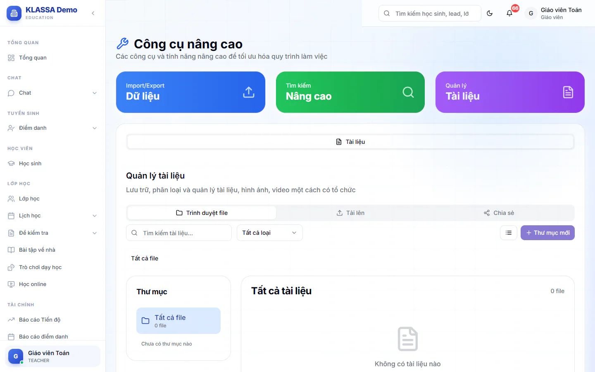

# Công cụ: thư viện tài liệu dùng chung

Trang **Công cụ nâng cao** có thẻ **Tài liệu** để bạn lưu giáo án, đề, hình ảnh, video theo thư mục và chia sẻ cho đồng nghiệp. Thẻ này dùng được thật và là phần duy nhất của trang hoạt động đầy đủ.

## Mở trang

::: steps
1. Vào **Công cụ** trong nhóm menu **Automation & AI**.
2. Bấm thẻ **Tài liệu** ở hàng thẻ chuyển trang phía dưới. Giáo viên và trợ giảng chỉ thấy đúng thẻ chuyển trang này, và trang mở sẵn ở đó.
:::

Phía trên hàng thẻ chuyển trang có ba khung màu **Import/Export Dữ liệu**, **Tìm kiếm Nâng cao** và **Quản lý Tài liệu**. Đây chỉ là khung giới thiệu, không bấm được, và mọi vai vào trang đều thấy, kể cả giáo viên và trợ giảng. Đừng nhầm với hàng thẻ chuyển trang bên dưới.

::: warning Lưu ý
Quản trị viên và Quản lý chi nhánh còn thấy thêm hai thẻ chuyển trang **Import/Export** và **Tìm kiếm** (giáo viên và trợ giảng không có hai thẻ này). Hai thẻ này hiện chỉ là bản minh hoạ, chưa nhập hay tìm dữ liệu thật. Muốn nhập học sinh, phụ huynh từ Excel, dùng [Nhập dữ liệu hàng loạt](../tai-khoan/nhap-du-lieu-hang-loat.md).
:::

## Tải file lên

::: steps
1. Ở thẻ **Tài liệu**, mở thẻ phụ **Tải lên**.
2. Bấm **Chọn file** và chọn một hoặc nhiều file. Mỗi file tối đa 100MB.
3. Chờ thanh tiến trình chạy xong. Thông báo "Đã tải lên ..." hiện ra, trang tự chuyển về **Trình duyệt file**.
:::

Nếu bạn đang đứng trong một thư mục khi tải, file được lưu vào thư mục đó.

## Tạo thư mục và tìm file

::: steps
1. Ở thẻ phụ **Trình duyệt file**, bấm **Thư mục mới**.
2. Nhập **Tên thư mục** (bắt buộc), ví dụ "Tài liệu giảng dạy", và chọn **Màu**.
3. Bấm nút lưu. Thư mục hiện ở khung **Thư mục** bên trái.
:::

Chọn **Tất cả file** hoặc một thư mục để lọc. Gõ vào ô **Tìm kiếm tài liệu...** để tìm theo tên hoặc nhãn. Ô chọn loại lọc theo **Tất cả loại**, **Tài liệu**, **Hình ảnh**, **Video**, **Âm thanh**, **Khác**. Nút biểu tượng cạnh đó đổi giữa dạng lưới và dạng danh sách.

## Tải về, chia sẻ và xoá

- **Tải về**: bấm biểu tượng tải xuống trên file.
- **Chia sẻ toàn trung tâm**: bấm biểu tượng chia sẻ. File chuyển từ riêng tư sang cả trung tâm cùng xem. Bấm lần nữa để bỏ chia sẻ. Chỉ người tải file lên mới chia sẻ và xoá được.
- **Xoá**: bấm biểu tượng thùng rác trên file, rồi bấm **Xóa** ở thanh phía trên. Bạn có thể chọn nhiều file rồi xoá một lượt.

Thẻ phụ **Chia sẻ** liệt kê mọi thư mục và file đang chia sẻ cho cả trung tâm. Người tải lên có nút **Bỏ chia sẻ**.

::: danger Không thể hoàn tác
File đã xoá không khôi phục được. Hệ thống chỉ cho xoá file của chính bạn.
:::

## Câu hỏi thường gặp

::: details Phụ huynh có xem được thư viện này không?
Không. Đây là công cụ nội bộ cho nhân viên.
:::

::: details Chia sẻ toàn trung tâm có nghĩa là mọi cơ sở thấy không?
File chỉ chia sẻ trong phạm vi cơ sở của người tải lên. Nếu trung tâm có nhiều cơ sở, người ở cơ sở khác không thấy.
:::
