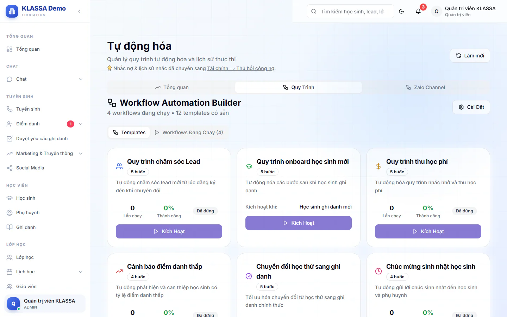
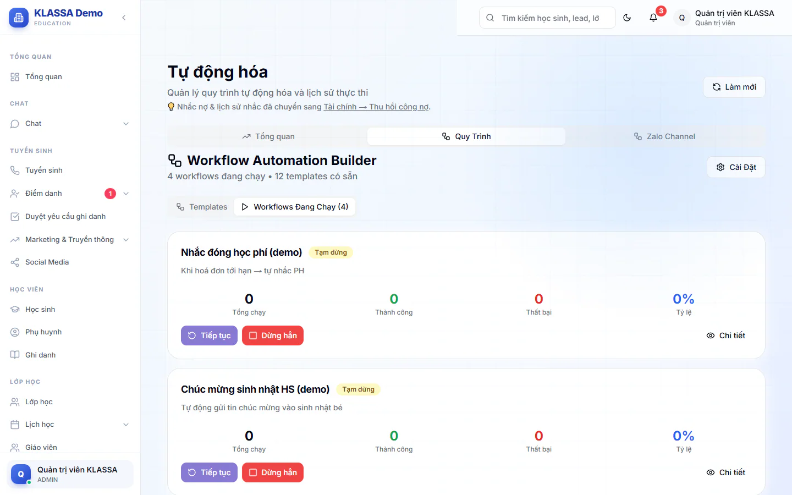

# Quy trình tự động theo sự kiện

Quy trình là chuỗi bước hệ thống tự làm khi có một sự kiện, ví dụ: có lead mới thì gửi email, nhắn SMS rồi giao việc cho lễ tân. Bạn không phải tự tạo từ đầu. Hệ thống có sẵn các mẫu, bạn chỉ cần bật.

Cần gói mở rộng **Tự động hoá**. Danh sách mẫu có ở [Mẫu quy trình có sẵn](mau-co-san.md).

## Kích hoạt một quy trình

::: steps
1. Vào **AI Hub → Tự động hóa**, mở thẻ **Quy Trình**.
2. Ở thẻ phụ **Templates**, mỗi ô là một mẫu: tên, số bước, mô tả và dòng **Kích hoạt khi**.

   
3. Bấm vào ô để xem **Các Bước Thực Hiện**: loại bước, thời gian chờ, nội dung và người nhận.
4. Bấm **Kích Hoạt** (hoặc **Kích Hoạt Workflow Này** trong phần chi tiết).
5. Thông báo "Đã kích hoạt workflow" hiện ra và quy trình xuất hiện ở thẻ phụ **Workflows Đang Chạy**.
:::

::: warning Lưu ý
Mỗi lần bấm **Kích Hoạt** sẽ tạo thêm một quy trình đang chạy. Chỉ bấm một lần cho mỗi mẫu, nếu không phụ huynh có thể nhận tin trùng.
:::

Mẫu đã bật có thêm số liệu thật: **Lần chạy**, tỷ lệ **Thành công** và nhãn **Đang chạy** hoặc **Đã dừng**.

## Loại bước trong một quy trình

Mỗi bước có một loại và thời gian chờ (từ **Ngay lập tức** đến vài ngày kể từ khi sự kiện xảy ra):

| Loại | Việc hệ thống làm |
| --- | --- |
| EMAIL | Gửi email |
| SMS | Gửi tin nhắn SMS |
| ZALO | Gửi tin qua Zalo |
| BOTH | Gửi cả email và SMS |
| TASK | Tạo việc giao cho nhân viên |
| INVOICE | Tạo hoá đơn |

## Theo dõi và quản lý quy trình đang chạy

Thẻ phụ **Workflows Đang Chạy** liệt kê từng quy trình với **Tổng chạy**, **Thành công**, **Thất bại**, **Tỷ lệ** và **Chạy lần cuối**. Nút hiện theo trạng thái:

| Trạng thái | Nút có |
| --- | --- |
| Đang chạy | **Tạm dừng** |
| Tạm dừng | **Tiếp tục**, **Dừng hẳn** |
| Đã dừng | **Xóa** (hỏi xác nhận) |
| Mọi trạng thái | **Chi tiết** |

Bấm **Chi tiết** để mở trang riêng của quy trình: danh sách các bước, **Hàng đợi delay** (các bước đang chờ đến giờ gửi) và **Lịch sử thực thi (50 gần nhất)** với trạng thái từng lần chạy: Thành công, Thất bại, Bỏ qua, Đang chờ, Đã chạy, Hủy.

::: danger Không thể hoàn tác
Quy trình đã **Xóa** không khôi phục được. Muốn dừng tạm thì dùng **Tạm dừng**, không dùng **Dừng hẳn**.
:::

## Cài đặt chung cho quy trình

Bấm **Cài Đặt** ở góc trên của thẻ **Quy Trình** để mở hộp **Cài Đặt Workflow**:

- **Tên người gửi mặc định cho step EMAIL**: để trống thì dùng tên thương hiệu của trung tâm.
- **Role được giao TASK mặc định**: vai nhận các việc do quy trình tạo. Hộp chọn hiện bốn lựa chọn: **Consultant (Tư vấn viên)** (tức Lễ tân), **Admin**, **Branch Manager** và **Teacher**.
- **Số lần thử lại tối đa mỗi bước (0-10)**.
- **Bỏ qua step nếu thiếu context**: nếu chọn, bước không gửi được (ví dụ phụ huynh chưa có Zalo) sẽ được bỏ qua thay vì tính là thất bại.

Bấm **Lưu cài đặt** để lưu. Phần đầu hộp còn cho biết số quy trình đang chạy và tạm dừng.

## Thẻ Zalo Channel

Thẻ **Zalo Channel** giải thích rằng các sự kiện của hệ thống có thể gửi qua Zalo cá nhân khi đã cấu hình. Thẻ có ba nút tắt: **Mở cấu hình Zalo**, **Cron jobs** (lịch chạy tự động) và **Inbox Chat Zalo**. Cách kết nối Zalo xem [Zalo cá nhân](../tich-hop/zalo-ca-nhan.md).

## Câu hỏi thường gặp

::: details Tôi sửa được nội dung từng bước không?
Không trên giao diện này. Bạn chỉ xem được các bước và bật hoặc tắt cả quy trình. Nội dung tin theo mẫu có sẵn.
:::

::: details Quản lý có thấy thẻ này không?
Không. Menu **Tự động hóa** chỉ hiện với Quản trị viên và Quản lý chi nhánh, nhưng mặc định chỉ Quản trị viên mở được trang.
:::

::: details Bước SMS không gửi được thì sao?
Kiểm tra trung tâm đã cấu hình SMS chưa ở [Tích hợp SMS](../tich-hop/sms.md) và học sinh hoặc phụ huynh có số điện thoại hay không. Bật tuỳ chọn bỏ qua bước thiếu thông tin nếu không muốn tính là thất bại.
:::
