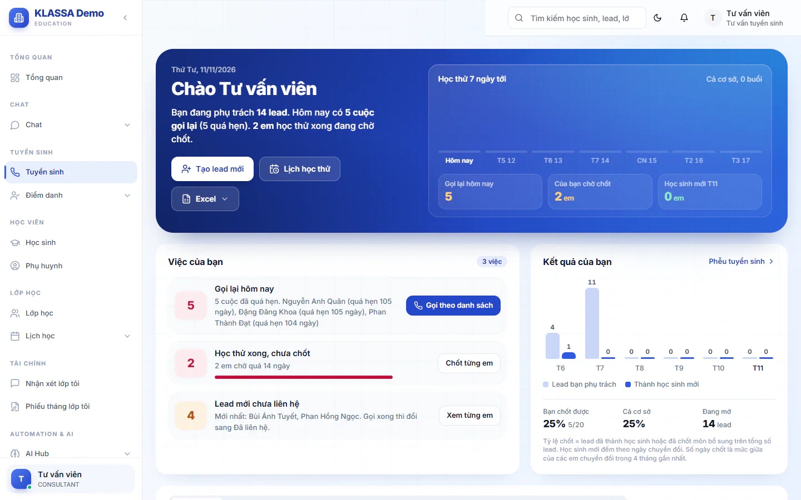

# Trang Tuyển sinh và việc cần làm

Trang **Tuyển sinh** gom mọi việc chăm sóc khách quan tâm (lead) vào một chỗ: gọi lại, hẹn học thử, ghi có mặt, chốt hoặc ghi lý do không chốt. Mở trang đầu ca, làm lần lượt các việc gấp từ trên xuống.

Trang cần gói mở rộng **CRM Tuyển sinh + AI**. Chưa có gói này, menu **Tuyển sinh** sẽ không dùng được.

## Mở trang và đọc bố cục

::: steps
1. Vào **Tuyển sinh** ở menu bên trái.
2. Nhìn dải trên cùng: tóm tắt số lead đang mở, lead chờ chốt và các nút thao tác nhanh.
3. Đọc khối **Việc của bạn** (với Quản trị viên, Quản lý chi nhánh, Quản lý, khối này tên là **Việc cần làm**).
4. Cuộn xuống để xem danh sách lead, rồi hai khối cuối trang.
:::

Các phần của trang, từ trên xuống:

| Phần | Dùng để |
| --- | --- |
| Dải trên cùng | Nút **Tạo lead mới**, **Lịch học thử**, **Excel** (**Nhập lead từ Excel**, và **Xuất danh sách đang lọc** dành cho Quản trị viên, Quản lý chi nhánh), cùng biểu đồ học thử 7 ngày tới của cả cơ sở. |
| **Việc của bạn** | Danh sách việc cần làm ngay, mỗi dòng có số lead và một nút mở thẳng đúng nhóm lead đó. |
| **Kết quả của bạn** | Biểu đồ 6 tháng, tỷ lệ chốt của bạn so với cả cơ sở, số lead đang mở. |
| Danh sách lead | Bảng, bảng theo giai đoạn hoặc nhật ký hoạt động. Xem [Danh sách lead](danh-sach-lead.md). |
| **Học thử hôm nay** | Các buổi học thử trong ngày của cả cơ sở, có nút **Điểm danh**. |
| **Lead mới vào hôm nay** | Ai nhập, từ nguồn nào, đã liên hệ chưa. Bấm tên để mở hồ sơ. |

## Làm việc theo khối "Việc của bạn"

Mỗi dòng là một loại việc. Số bên trái là số lead cần làm, màu đỏ nghĩa là đã trễ. Nút bên phải mở danh sách đã lọc sẵn.

| Việc | Nút | Bạn làm gì |
| --- | --- | --- |
| **Gọi lại hôm nay** | **Gọi theo danh sách** | Gọi từng phụ huynh đã hẹn, ghi lại cuộc gọi và hẹn lần gọi sau. Gọi các cuộc quá hẹn trước. |
| **Lead mới chưa liên hệ** | **Xem từng em** | Gọi trong ngày. Nói chuyện được thì lead chuyển sang **Đã liên hệ**. |
| **Học thử hôm nay** | **Ghi kết quả** hoặc **Xem danh sách** | Hết buổi, ghi **Đã tham gia** hoặc **Không tham gia**. Xem [Đặt lịch và ghi kết quả học thử](dat-lich-hoc-thu.md). |
| **Học thử xong, chưa chốt** | **Chốt từng em** | Gọi hỏi phụ huynh, rồi [chuyển thành học sinh](chuyen-lead-thanh-hoc-sinh.md) hoặc [ghi không chốt](khong-chot-lead.md). |
| **Vắng học thử, chưa hẹn lại** | **Hẹn lại** | Gọi hẹn buổi khác. |

Khi không còn việc gấp, khối hiện **Không có việc gấp**. Thời gian còn lại, mở nhóm **Đang mở** để chăm sóc tiếp các lead khác.

::: tip Mẹo
Trang tự tải lại khi bạn tạo lead hoặc nhập Excel, và khi bạn quay lại tab sau hơn 1 phút. Muốn chắc chắn có số mới nhất, bấm nút tải lại (mũi tên vòng) ở cuối hàng bộ lọc.
:::

## Ai thấy gì

- Lễ tân thấy lead mình phụ trách, bấm **Cả cơ sở** để xem của mọi người trong cơ sở.
- Quản trị viên, Quản lý chi nhánh, Quản lý thấy khối **Việc cần làm** và **Lead mới và học sinh mới** thay cho phần kết quả cá nhân, và được phân công người phụ trách.
- Báo cáo phễu chi tiết nằm ở menu **Báo cáo**. Xem [Phễu tuyển sinh trong báo cáo](../bao-cao/pheu-tuyen-sinh.md).

## Câu hỏi thường gặp

::: details Tôi không thấy lead mình vừa tạo?
Bấm nhóm **Tất cả**, bấm **Xoá lọc**, rồi gõ số điện thoại vào ô tìm. Lead của người khác thì bấm **Cả cơ sở**.
:::

::: details Số liệu chưa đổi sau khi tôi vừa làm xong?
Bấm nút tải lại (mũi tên vòng) ở cuối hàng bộ lọc.
:::
